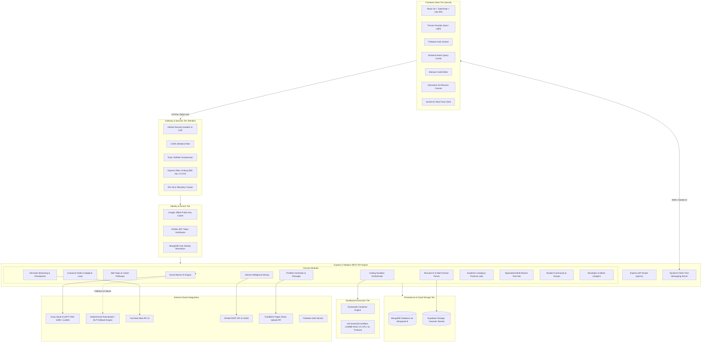

# Smart Skill Hub (SSH)

> **"Your Skills. Your Intelligence. Your Career."**

An AI-powered developer intelligence and career development platform that connects technical learning, verified skill assessment, coding practice, GitHub intelligence, AI mentorship, and professional resume development in one unified workspace.

[](LICENSE)
[](https://react.dev/)
[](https://www.typescriptlang.org/)
[](https://vitejs.dev/)
[](https://tailwindcss.com/)
[](https://nodejs.org/)
[](https://expressjs.com/)
[](https://www.mongodb.com/)
[](https://firebase.google.com/)
[](https://groq.com/)
[](https://www.docker.com/)
[](https://socket.io/)
[](https://vitest.dev/)

---

## 📑 Subsystem Documentation

Smart Skill Hub maintains dedicated technical architecture documentation for each subsystem:

- 🌐 **Frontend Technical Documentation**: [`./frontend/README.md`](./frontend/README.md) – React 18, Vite, Tailwind CSS, TanStack Query, Monaco Editor, and UI/UX design system.
- ⚙️ **Backend Technical Documentation**: [`./backend/README.md`](./backend/README.md) – Node.js, Express 5 REST API, MongoDB Mongoose schemas, Groq AI inference, Dockerode execution sandbox, and Socket.IO messaging.
- 🔗 **GitHub Repository**: [https://github.com/sampatakumar/SSH-final-year-project](https://github.com/sampatakumar/SSH-final-year-project)
- 🎓 **Academic Project Certification**: Peer-reviewed journal research published in IRE Journals (*SSH_IRE_Journals.pdf*), documented under [`Published Papers/`](Published%20Papers/) and [`Certificates/`](Certificates/).

---

## 📑 Table of Contents

1. [Project Overview](#1-project-overview)
2. [Problem Statement](#2-problem-statement)
3. [Proposed Solution](#3-proposed-solution)
4. [Traditional Approach vs. Smart Skill Hub](#4-traditional-approach-vs-smart-skill-hub)
5. [System Architecture](#5-system-architecture)
6. [Major Platform Features](#6-major-platform-features)
   - [A. Smart Mentor](#a-smart-mentor)
   - [B. Developer Intelligence and GitHub Mining](#b-developer-intelligence-and-github-mining)
   - [C. Canonical Skill Profile and Verifiable Badges](#c-canonical-skill-profile-and-verifiable-badges)
   - [D. Career Intelligence and Career Pathway Studio](#d-career-intelligence-and-career-pathway-studio)
   - [E. Learning Roadmap and Adaptive Loop](#e-learning-roadmap-and-adaptive-loop)
   - [F. EduTube Educational Learning System](#f-edutube-educational-learning-system)
   - [G. Coding Assessment and Docker Sandbox](#g-coding-assessment-and-docker-sandbox)
   - [H. Assessment Center and Practical Labs](#h-assessment-center-and-practical-labs)
   - [I. Specialized Multi-Branch Academic Tool Hub](#i-specialized-multi-branch-academic-tool-hub)
   - [J. Student Community and Real-Time Collaboration](#j-student-community-and-real-time-collaboration)
   - [K. Resume AI Studio](#k-resume-ai-studio)
   - [L. Developer Portfolio Generator](#l-developer-portfolio-generator)
   - [M. Personal and Administrative Analytics](#m-personal-and-administrative-analytics)
7. [Technology Stack](#7-technology-stack)
8. [Repository Structure](#8-repository-structure)
9. [Installation and Local Setup](#9-installation-and-local-setup)
10. [Deployment Architecture](#10-deployment-architecture)
11. [Security Architecture](#11-security-architecture)
12. [Project Roadmap](#12-project-roadmap)
13. [Contribution Guidelines](#13-contribution-guidelines)
14. [Academic Publications and License](#14-academic-publications-and-license)

---

## 1. Project Overview

**Smart Skill Hub (SSH)** is a unified developer intelligence, technical learning, coding assessment, and career acceleration platform developed as a final-year engineering capstone project.

Modern engineering students and software developers face an increasingly fragmented ecosystem: learning occurs on disconnected video portals, coding practice happens on isolated algorithm sites, skills are self-claimed on static resumes without empirical verification, and GitHub repository contributions remain unanalyzed for tangible competencies.

Smart Skill Hub bridges these gaps by establishing a **continuous developer intelligence loop**:
1. **Mining & Assessing**: Evaluates live GitHub code repositories, automated coding challenge submissions in an isolated Docker sandbox, and branch-specific academic assessments.
2. **Taxonomy & Gap Benchmarking**: Normalizes technical competencies against industry-standard career profiles (e.g., Full Stack Engineer, Cloud/DevOps Architect, Machine Learning Specialist) to compute real-time readiness scores.
3. **Adaptive Upskilling**: Curates educational video curricula via YouTube Data API v3 with interactive checkpoints, schedules spaced revision tasks, and recommends personalized learning milestones.
4. **Professional Presentation**: Empowers engineers to generate ATS-optimized resumes with AI bullet tailoring and publish verified portfolio websites directly to Cloudflare Pages.
5. **Real-Time Collaboration**: Unites learners across engineering disciplines with Socket.IO real-time channels, password-protected study circles, and cross-branch project matchmaking.

---

## 2. Problem Statement

Aspiring software engineers, college students, and hiring evaluators encounter systemic obstacles:

- **Fragmented Learning Environments**: Students jump between disparate tutorial platforms, documentation sites, and video streaming channels without structured progress tracking or curriculum alignment.
- **Unverified Skill Claims**: Resumes and portfolios rely on subjective self-reported keyword lists rather than evidence derived from evaluated code execution or authentic version control history.
- **Opaque Career Skill Gaps**: Engineers struggle to identify the exact technical competencies and framework proficiency levels required to qualify for target industry job roles.
- **Disconnected Coding Practice**: Algorithmic problem-solving is practiced in silos, disconnected from an engineer's broader master skill taxonomy and career profile.
- **Underutilized GitHub Activity**: Git commit histories, repository architectures, and language distributions remain dormant data rather than actionable proof of technical depth.
- **Generic Resume Workflows**: Job seekers draft generic resume documents using word processors without automated ATS keyword matching, role alignment, or multi-format text extraction.
- **Lack of Unified Contextual Mentorship**: Standard AI chatbots lack access to a student's evaluated skills, academic discipline, GitHub history, and ongoing learning roadmaps, resulting in generic and superficial career advice.

---

## 3. Proposed Solution

Smart Skill Hub delivers an integrated, closed-loop technical ecosystem connecting learning, evaluation, intelligence, and career placement:

```
    +-------------------------------------------------------------+
    |                     SMART SKILL HUB                         |
    +-------------------------------------------------------------+
    |                                                             |
    |   [ Developer Intelligence ]      [ Verifiable Skills ]     |
    |   GitHub Mining & Analysis   ---> Canonical Skill Profile   |
    |   Docker Coding Execution         Competency Badges         |
    |   Academic Practical Labs         Readiness Scoring         |
    |              |                            |                 |
    |              v                            v                 |
    |   [ Adaptive Learning ]           [ Career Elevation ]      |
    |   EduTube Curated Videos     <--- Smart AI Mentor Coaching  |
    |   Interactive Checkpoints         ATS Resume AI Studio      |
    |   Spaced Revision Loops           Cloudflare Web Portfolios |
    |   Specialized Tool Hub            Student Community Hub     |
    |                                                             |
    +-------------------------------------------------------------+
```

---

## 4. Traditional Approach vs. Smart Skill Hub

| Dimension | Traditional Approach | Smart Skill Hub (SSH) |
|---|---|---|
| **Skill Evidence** | Self-reported keywords on static documents | Evidence-based skill profiles backed by GitHub commits and sandboxed code execution |
| **Skill Gap Analysis** | Manual review of job descriptions | Automated comparison against industry role taxonomies with quantified readiness scoring |
| **Coding Practice** | Isolated algorithm portals with disconnected scores | Monaco Editor assessments verified in a Docker sandbox feeding the master skill taxonomy |
| **Video Learning** | Ad-driven video feeds containing distractions | Curated educational video streaming (EduTube) with interactive checkpoints and notes |
| **AI Mentorship** | Generic AI prompts lacking personal context | Context-aware Smart Mentor grounded in user skills, gaps, code activity, and target roles |
| **Resume Building** | Static word processor files requiring manual tweaks | Interactive A4 canvas with automated ATS keyword tailoring, OCR extraction, and PDF export |
| **Portfolio Deployment**| Manual web hosting configuration and deployment | Automated developer portfolio generation with one-click publishing to Cloudflare Pages |
| **Discipline Support** | Strictly software engineering-focused | 10 canonical academic discipline families supported with specialized calculation studios |
| **Peer Collaboration** | External messaging apps detached from code | Real-time Socket.IO chat, password-protected study groups, and project matchmaking |

---

## 5. System Architecture

Smart Skill Hub is architected as a decoupled, multi-tier cloud platform prioritizing security, horizontal scalability, and deterministic fallback resilience.



### Architectural Layer Breakdown

1. **Client Tier**: A responsive SPA built with React 18, TypeScript, and Vite. Implements route-level lazy loading (`React.lazy` + `Suspense`), centralized TanStack Query caching (5-minute stale-time window), Monaco Editor for code input, and an interactive A4 resume builder.
2. **Gateway & Security Tier**: Configured with Helmet for Strict Content Security Policies (allowing frame-ancestors across Vercel, Render, and development tunnels), rate limiting (500 requests per 15-minute window), Gzip/Deflate compression, and dynamic CORS whitelisting.
3. **Identity & Authentication Tier**: Client authenticates against Firebase Web SDK. Backend validates incoming `Authorization: Bearer <token>` RS256 JWT signatures against Google's live JWKS certificate endpoint without round-trip network overhead.
4. **Core Application Engine**: Express 5 application divided into 15 domain modules. Express handles REST endpoints while Socket.IO manages bidirectional real-time channels on the same HTTP server instance.
5. **Sandboxed Code Execution Tier**: Dockerode client managing isolated Docker containers with non-root UID execution, 128 MB RAM, 0.5 CPU cores, disabled swap, 5-second wall-clock timeouts, and a 4-container concurrency throttle via `p-limit`.
6. **Persistence & Storage Tier**: MongoDB cluster accessed via Mongoose 8 with strict user document ownership isolation and indexing. Binary documents (PDF, DOCX) are persisted in Supabase Storage with local filesystem fallback.
7. **External Provider Integrations**: Groq Cloud LLM inference with automatic deterministic NLP fallback, YouTube Data API v3 for educational curation, GitHub REST API for repository intelligence, and Cloudflare Pages for portfolio hosting.

---

## 6. Major Platform Features

### A. Smart Mentor
- **Context-Aware Coaching**: Aggregates a comprehensive user snapshot (academic branch, skill profile, identified skill gaps, GitHub commit activity, and coding assessment scores) to deliver grounded advice.
- **AI Inference & Local Fallback**: Uses Groq Cloud running `openai/gpt-oss-120b` (primary) and `openai/gpt-oss-20b` (lightweight), with prioritized fallbacks (`qwen/qwen3.6-27b`, `groq/compound`). Automatically shifts to a local deterministic rule/NLP engine if the AI provider is unavailable.
- **Streaming & Sync Chat**: Supports both standard JSON responses and chunked Server-Sent Events (`/chat/stream`) for low-latency conversational feedback.
- **Course & Action Recommendations**: Formulates structured action plans and recommends targeted educational courses aligned with target career benchmarks.

### B. Developer Intelligence and GitHub Mining
- **Automated Repository Synchronization**: Inspects public GitHub repositories via GitHub REST API, calculating commit velocity, language distributions, and repository complexity.
- **Demonstrated Skill Evidence**: Mines codebases to identify concrete evidence of frameworks, databases, and architectural patterns (e.g., Express middleware, MongoDB schemas, Dockerfiles).
- **AI-Powered Repository Insights**: Generates structured repository health scores, identifies architectural anti-patterns, and drafts professional, markdown-compliant README files.

### C. Canonical Skill Profile and Verifiable Badges
- **Canonical Skill Taxonomy**: Maps thousands of arbitrary student keywords to a curated taxonomy of technical skills categorized into Core Languages, Frameworks, Cloud/DevOps, Databases, and Methodologies.
- **Multi-Source Evidence Aggregation**: Weighs skill confidence scores across four distinct empirical inputs: GitHub repository code, coding challenge evaluations, academic practical labs, and resume parser extractions.
- **Verifiable Competency Badges**: Generates cryptographically verifiable badges with UUIDs and public verification URLs (`/badges/verify/:badgeId`), allowing students to share tamper-proof credentials with external employers.

### D. Career Intelligence and Career Pathway Studio
- **Role Benchmarking**: Compares a user's verified competencies against industry-standard role benchmarks (e.g., Full Stack Engineer, Cloud Architect, AI/ML Specialist, Embedded Systems Engineer).
- **Quantified Readiness Scoring**: Calculates a weighted role readiness percentage based on required vs. optional competencies.
- **Skill Gap Identification**: Highlights missing critical skills, under-developed frameworks, and recommended next steps to reach target benchmark thresholds.
- **Multi-Role Comparison**: Enables side-by-side evaluation of up to three career roles simultaneously to inform career transition decisions.

### E. Learning Roadmap and Adaptive Loop
- **Milestone-Based Roadmaps**: Deconstructs skill gaps into structured, sequential learning milestones with concrete deliverables.
- **Adaptive Learning Loop**: Records real-time student activities, updating mastery levels and dynamically adjusting milestone priorities based on assessment results.
- **Spaced Revision Scheduling**: Implements spaced-repetition schedules calculating due and upcoming review items to reinforce long-term concept retention.

### F. EduTube Educational Learning System
- **Curated Educational Discovery**: Queries YouTube Data API v3 while applying a strict multi-stage educational classifier (enforcing minimum duration thresholds, filtering entertainment/vlog tags, and validating educational metadata).
- **Interactive Video Checkpoints**: Embeds quiz checkpoints at specific timestamps during video playback; student submissions are evaluated and recorded for mastery tracking.
- **Study Workspaces**: Provides saved video bookmarks, custom multi-video playlists, and rich timestamped note-taking capabilities.
- **Recommendation Optimization**: Includes an experimental model registry with impression logging and user feedback mechanisms to continuously refine video suggestions.

### G. Coding Assessment and Docker Sandbox
- **Monaco Code Editor**: Features an in-browser code editor with JavaScript syntax highlighting, line numbers, automatic bracket matching, and configurable themes.
- **Isolated Docker Container Sandbox**: Submissions run inside dedicated `ssh-javascript-sandbox` containers with strict constraints (128 MB RAM, 0.5 CPU cores, 5-second execution timeout, 64 KB code size limit, and non-root execution).
- **Multi-Case Evaluation**: Executes student algorithms against hidden and visible test cases, collecting standard output, execution time, and error traces.
- **Execution Safeguard**: Controlled via `CODING_EXECUTION_ENABLED` environment flag; gracefully disables container execution in environments lacking an authorized Docker daemon.

### H. Assessment Center and Practical Labs
- **Branch-Aware Assessments**: Delivers domain-specific academic quizzes and multiple-choice evaluations tailored to specific university degrees and engineering branches.
- **Practical Virtual Labs**: Provides step-by-step technical lab challenges across disciplines (e.g., SQL schema design, circuit analysis, Linux commands) with automated output verification.
- **Attempt Tracking & Feedback**: Preserves detailed submission histories, scoring breakdowns, and comprehensive solution explanations.

### I. Specialized Multi-Branch Academic Tool Hub
A centralized suite of 11 functional, discipline-tailored academic calculation and review studios:
- **Computer Science & IT**: Quick access to Resume AI, Interactive Coding Sandbox, and GitHub Reviewer.
- **Mechanical Engineering**: Stress/strain calculations, structural factor of safety, gear train ratios, and Euler-Bernoulli beam bending.
- **ECE & EEE**: Equivalent impedance (series/parallel), voltage/current dividers, and Thévenin network analysis.
- **Civil Engineering**: Concrete volume estimation, nominal mix proportions (1:1.5:3, 1:2:4), dry shrinkage factor (1.54), and Bill of Quantities (BOQ) cost calculations.
- **Chemical Engineering**: Steady-state binary distillation mass balances and ideal CSTR reactor space-time sizing.
- **Biotechnology**: DNA/RNA oligonucleotide GC% content, Marmur-Doty melting temperatures ($T_m$), and structured hypothesis evaluation.
- **Business Management (MBA)**: Break-even volume/revenue, margin of safety, and CAC/LTV unit economics.
- **Commerce & Finance**: Liquidity ratios (Current/Quick), profitability metrics (ROE, Gross/Net margins), and 3-period DCF (NPV) models.
- **Arts, Media & Humanities**: Exact citation formatting (APA 7th, MLA 9th, Chicago 17th) and thesis statement critique.
- **Nursing & Allied Health**: Pediatric/adult dosage calculations via dimensional analysis and standardized SBAR clinical handover builder.
- **Cross-Disciplinary Report Reviewer**: Formative academic evaluation for lab writeups, capstone proposals, and technical reports.

### J. Student Community and Real-Time Collaboration
- **Dual-Transport Real-Time Architecture**: WebSocket communication powered by Socket.IO with automatic HTTP long-polling fallback.
- **Global Student Lounge**: Public discussion channel connecting students across all academic branches and universities.
- **Password-Protected Study Circles**: Student-created private study groups secured with cryptographic `scrypt` password hashing, constant-time `timingSafeEqual` comparison, and automatic lockout after 5 consecutive failed attempts.
- **Student Peer Directory**: Cross-branch student discovery filtered by verified competency tags, with strict privacy protection preventing email and phone number exfiltration.
- **Project Matchmaking**: Surfaces student projects marked as seeking collaborators, specifying required competencies and open roles.
- **Moderation Pipeline**: Automated XSS sanitization, message reporting workflows, user blocking, and soft-delete capabilities.

### K. Resume AI Studio
- **Multi-Format Document Parsing**: Ingests existing resumes in PDF, DOCX, TXT, and scanned image formats using `pdf-parse`, `mammoth`, and `tesseract.js` OCR.
- **Interactive A4 Resume Canvas**: Real-time editable A4 preview with custom styling controls (typography, primary accent colors, margin spacing, section reordering).
- **AI Job Description Tailoring**: Analyzes target job postings, extracts core ATS keywords, identifies missing qualifications, and rewrites project bullet points using action verbs and quantifiable metrics.
- **Cloud Document Storage**: Persists resume attachments securely in Supabase Storage with local filesystem fallback.
- **High-Fidelity PDF Export**: Client-side vector PDF generation via `jspdf` and `html2canvas`.

### L. Developer Portfolio Generator
- **Static Portfolio Assembly**: Synthesizes profile details, GitHub projects, verified skills, and work experience into a modern, static web portfolio.
- **ZIP Export & Cloudflare Deployment**: Packages portfolios into a downloadable ZIP archive via `jszip` or publishes them directly to Cloudflare Pages using the Direct Upload API.

### M. Personal and Administrative Analytics
- **Personal Trajectory Analytics**: Tracks daily learning streaks, code submission histories, skill growth velocity, and roadmap milestone completions via Recharts visualizations.
- **Administrative Oversight**: Provides platform-wide analytics for authorized administrators (`ADMIN_EMAIL`), including user registration counts, API endpoint utilization rates, and catalog integrity audits.

---

## 7. Technology Stack

### Frontend Technologies

| Technology | Version | Purpose |
|---|---|---|
| **React** | `18.3.1` | Core declarative component UI library |
| **TypeScript** | `5.8.3` | Type-safe static analysis and developer tooling |
| **Vite** | `5.4.19` | High-performance build tool and local dev server |
| **Tailwind CSS** | `3.4.19` | Utility-first responsive design system |
| **Radix UI** | Latest | Unstyled, accessible UI primitive components (dialogs, dropdowns, tabs, tooltips) |
| **React Router** | `6.30.1` | Client-side declarative routing and route guarding |
| **TanStack Query** | `5.83.0` | Asynchronous server state caching, pagination, and invalidation |
| **Monaco Editor** | `4.7.0` | In-browser code editing environment |
| **Recharts** | `2.15.4` | Responsive SVG charting for analytics and radar profiles |
| **Framer Motion** | `11.0.0` | Declarative UI animations and page transitions |
| **Lucide React** | `0.462.0` | Consistent, accessible SVG iconography |
| **Socket.IO Client**| `4.8.4` | Real-time WebSocket connection for Community messaging |
| **Sonner & Toaster**| `1.7.4` | Non-blocking toast notifications and user alerts |
| **jsPDF / html2canvas**| `4.2.1 / 1.4.1` | Client-side A4 resume PDF rendering and export |

### Backend Technologies

| Technology | Version | Purpose |
|---|---|---|
| **Node.js** | `18+` / `20+` | Asynchronous event-driven JavaScript runtime (ES Modules) |
| **Express** | `5.1.0` | High-performance REST API routing and middleware framework |
| **MongoDB / Mongoose**| `8.18.0` | Document database and object-data modeling with schema validation |
| **Firebase Admin** | `14.3.0` | Server-side RS256 token verification and user authentication |
| **Groq SDK** | `0.26.0` | Ultra-low latency LLM inference provider (`openai/gpt-oss-120b`) |
| **LangChain Core** | `1.2.0` | Prompt templating and structured LLM output handling |
| **Dockerode** | `5.0.1` | Programmatic Docker daemon API client for sandbox orchestration |
| **Socket.IO** | `4.8.4` | Real-time bidirectional event-based WebSocket server |
| **Supabase JS** | `2.110.2` | Object storage client for resume attachments and binary assets |
| **Multer** | `2.1.1` | Multipart form-data parser for resume uploads |
| **pdf-parse / mammoth**| `2.4.5 / 1.12.0` | Text extraction from PDF and Word documents |
| **Tesseract.js** | `7.0.0` | Optical Character Recognition for scanned image resumes |
| **JSZip** | `3.10.1` | Server-side ZIP archive creation for portfolio export |
| **Helmet & CORS** | `8.1.0 / 2.8.5` | HTTP security headers, CSP directives, and CORS filtering |
| **Express Rate Limit**| `7.5.0` | Request rate limiting to prevent API abuse and DoS |
| **Zod** | `3.25.76` | Runtime environment and request payload schema validation |

### Testing and Tooling

| Technology | Version | Purpose |
|---|---|---|
| **Vitest** | `3.2.4` | Unit, integration, and security test runner (Frontend & Backend) |
| **Supertest** | `7.1.4` | Programmatic HTTP assertion library for backend API routes |
| **React Testing Library**| `16.0.0` | DOM testing utilities for React component verification |
| **Playwright** | `1.57.0` | End-to-end browser automation and regression testing |
| **ESLint & Prettier** | `9.32.0` | Static code analysis and consistent formatting standards |

### Infrastructure and Deployment

| Platform | Target | Purpose |
|---|---|---|
| **Vercel** | Frontend SPA | Static edge hosting with SPA rewrite rules (`smartskillhub.vercel.app`) |
| **Render** | Backend API | Web service container hosting with auto-deploy (`ssh-final-year-project.onrender.com`) |
| **MongoDB Atlas** | Database | Cloud-hosted MongoDB cluster with automated backups |
| **Supabase Storage**| Object Storage | Cloud S3-compatible bucket (`resumes`) for binary document storage |
| **Cloudflare Pages**| Portfolios | Edge hosting for user-generated static portfolio sites |
| **Docker** | Execution Sandbox | Containerized isolation environment for running student code submissions |

---

## 8. Repository Structure

```text
SSH-final-year-project/
│
├── README.md                           # Root project documentation (this file)
├── LICENSE                             # MIT License file (Copyright 2026 sampatakumar)
├── docker-compose.yml                  # Local development multi-container orchestration
├── render.yaml                         # Production infrastructure-as-code specification for Render
│
├── Certificates/                       # Academic certification documents
│   └── IRE_Certificates.pdf            # Research journal publication certificates
│
├── Published Papers/                   # Peer-reviewed journal papers
│   └── SSH_IRE_Journals.pdf            # Published Smart Skill Hub research paper
│
├── docs/                               # Engineering audit reports and phase certifications
│   ├── DEPLOYMENT_GUIDE.md             # Cloud deployment and environment setup runbook
│   ├── ENVIRONMENT_VARIABLES.md        # Reference list of all system environment variables
│   └── PHASE_*.md                      # Phase completion reports (Phase 16 through Phase 56)
│
├── frontend/                           # React 18 + TypeScript + Vite Single Page Application
│   ├── README.md                       # Comprehensive frontend technical documentation
│   ├── package.json                    # Frontend dependencies and npm scripts
│   ├── vite.config.ts                  # Vite configuration, proxying, and Rollup chunking
│   ├── tailwind.config.ts              # Tailwind CSS theme extension and color tokens
│   ├── vercel.json                     # Vercel deployment rewrites for SPA routing
│   ├── public/                         # Public static web assets and fonts
│   └── src/
│       ├── App.tsx                     # Application root, provider tree, and route declarations
│       ├── main.tsx                    # React DOM entry point
│       ├── components/                 # Reusable UI primitives (Radix UI wrappers, navigation)
│       ├── contexts/                   # React context definitions
│       ├── core/                       # Core infrastructure (AuthContext, apiClient, socket)
│       ├── lib/                        # Shared utility libraries and dashboard navigation links
│       ├── modules/                    # Feature domain modules (coding, edutube, mentor, resume, skills)
│       ├── pages/                      # Top-level page views (Landing, Dashboard, Community, Tools)
│       ├── styles/                     # CSS variable stylesheets and theme definitions
│       └── test/                       # Vitest component and integration test suites
│
└── backend/                            # Node.js + Express 5 Modular REST API Engine
    ├── README.md                       # Comprehensive backend API & architecture documentation
    ├── package.json                    # Backend dependencies and npm scripts
    ├── vitest.config.js                # Backend test runner configuration
    ├── Dockerfile                      # Production Docker container build definition
    ├── tasks/                          # Background maintenance tasks and seed scripts
    ├── test/                           # Vitest unit and integration test suites
    └── src/
        ├── app.js                      # Express application setup, security middleware, and routes
        ├── index.js                    # HTTP server startup, Socket.IO binding, and graceful shutdown
        ├── config/                     # Environment validation (env.js), Firebase Admin, and Groq SDK
        ├── core/                       # Core database, auth middleware, and error handling
        ├── middlewares/                # Reusable Express middlewares (auth, admin, multer, rate-limit)
        ├── models/                     # Shared Mongoose database schemas
        ├── modules/                    # Feature domain modules (academic, coding, edutube, mentor, skills)
        ├── routes/                     # Centralized API route declarations
        ├── services/                   # Business logic and external service clients
        └── utils/                      # Helper utilities and data formatters
```

---

## 9. Installation and Local Setup

### Prerequisites

Ensure the following tools are installed on your workstation:
- **Node.js**: `v18.18.0` or higher (Node 20 LTS recommended).
- **npm**: `v9.0.0` or higher.
- **Git**: Latest release.
- **MongoDB**: Local MongoDB instance running on `mongodb://localhost:27017` or a MongoDB Atlas connection string.
- **Docker Engine**: Required if executing coding challenge submissions locally inside the sandbox.

### 1. Clone the Repository

```bash
git clone https://github.com/sampatakumar/SSH-final-year-project.git
cd SSH-final-year-project
```

### 2. Frontend Setup

```bash
# Navigate to frontend directory
cd frontend

# Install dependencies
npm install

# Configure environment variables
cp .env.example .env

# Start local development server (runs on port 8080)
npm run dev
```

The frontend application will be accessible at: `http://localhost:8080`

### 3. Backend Setup

```bash
# Open a new terminal and navigate to backend directory
cd backend

# Install dependencies
npm install

# Configure environment variables
cp .env.example .env

# Seed the academic catalog (degrees, branches, career roles)
npm run seed:academic

# Start local development server with nodemon (runs on port 8000)
npm run dev
```

The backend REST API will be accessible at: `http://localhost:8000/api/v1`
API Health Check: `http://localhost:8000/api/v1/healthcheck/ready`

> [!NOTE]
> For detailed environment variable configuration and instructions for external services (Firebase, Groq, Supabase), refer to [`./frontend/README.md`](./frontend/README.md) and [`./backend/README.md`](./backend/README.md).

---

## 10. Deployment Architecture

Smart Skill Hub utilizes a modern, decoupled production deployment topology:

```
                          +-----------------------------------+
                          |      Vercel Edge Network          |
                          |  https://smartskillhub.vercel.app |
                          +-----------------+-----------------+
                                            |
                                 HTTPS / REST Calls
                                            |
                                            v
                          +-----------------------------------+
                          |     Render Web Service            |
                          |  https://ssh-final-year-project   |
                          |          .onrender.com            |
                          +--------+---------+--------+-------+
                                   |         |        |
             +---------------------+         |        +--------------------+
             |                               |                             |
             v                               v                             v
+-------------------------+     +-------------------------+   +-------------------------+
|   MongoDB Database      |     |  Supabase Cloud Storage |   |  Cloudflare Pages       |
|   (Mongoose Schemas)    |     |  ('resumes' Bucket)     |   |  (Published Portfolios) |
+-------------------------+     +-------------------------+   +-------------------------+
```

- **Frontend Deployment (Vercel)**:
  - Repository Root: `frontend`
  - Build Command: `npm run build`
  - Output Directory: `dist`
  - SPA Routing: Handled via `frontend/vercel.json` rewrite rules.
- **Backend Deployment (Render)**:
  - Infrastructure Specification: Managed via `render.yaml`.
  - Service Type: Web Service (`Node.js`).
  - Region: `singapore`.
  - Build Command: `npm install`
  - Start Command: `npm start`
  - Health Check Endpoint: `/api/v1/healthcheck`
- **File Storage (Supabase)**:
  - Stores binary resume uploads (PDF, DOCX) in a dedicated bucket (`resumes`).
- **Generated Portfolios (Cloudflare Pages)**:
  - Published via Cloudflare Direct Upload API when configured.

---

## 11. Security Architecture

Smart Skill Hub implements multi-layered security controls across the stack:

1. **RS256 JWT Authentication**: Firebase ID tokens are cryptographically verified using Google's live JWKS public keys (`https://www.googleapis.com/service_accounts/v1/jwk/securetoken@system.gserviceaccount.com`).
2. **User Data Isolation**: Mongoose queries enforce user tenancy by filtering on `userId: req.user._id` or `firebaseUid: req.user.firebaseUid`, preventing unauthorized data access.
3. **HTTP Security Headers**: Express uses `helmet` with custom Content Security Policy (CSP) headers, restricting frame embedding to trusted origins.
4. **CORS Whitelisting**: Strict origin validation permits only authorized domains (production Vercel app, Render host, local development ports, and secure development tunnels).
5. **Rate Limiting**: `express-rate-limit` enforces a threshold of 500 requests per 15-minute window per IP address, with telemetry logging for rate limit hits.
6. **Docker Sandbox Containment**:
   - Containers run as an unprivileged user.
   - Resource limits: 128 MB RAM, 0.5 CPU cores, no swap, 32 max processes, 5-second execution timeout.
   - Isolated internal network namespace preventing outbound container connections.
7. **Cryptographic Password Protection**: Private community study circles hash passwords using Node.js `crypto.scrypt` with random 16-byte salts, timing-safe equality checks (`timingSafeEqual`), and automatic lockout after 5 consecutive failed attempts.
8. **Navigation Security**: Client-side URL redirect protections prevent open redirect vulnerabilities by validating return paths against internal routes.

---

## 12. Project Roadmap

### Implemented Capabilities (Certified and Available)
- [x] Master User Profile & Canonical Skill Taxonomy.
- [x] Multi-format Resume Ingestion (PDF, DOCX, TXT, OCR) and interactive A4 canvas.
- [x] AI-Powered Resume Tailoring & ATS Scoring using Groq LLM.
- [x] GitHub Repository Intelligence (Commit analysis, language metrics, skill evidence).
- [x] In-browser Monaco Code Editor with Dockerode containerized execution sandbox.
- [x] EduTube curated educational video streaming with timestamped quiz checkpoints.
- [x] Smart Mentor conversational coaching with automatic local deterministic NLP fallback.
- [x] Career Pathway Studio with multi-role readiness benchmarking.
- [x] 11 Specialized Multi-Branch Academic Tools across engineering, business, and healthcare.
- [x] Real-time Student Community with Socket.IO chat and password-protected study groups.
- [x] Verifiable Competency Badges with public verification links (`/badges/verify/:badgeId`).
- [x] Developer Portfolio Generator with Cloudflare Pages publishing integration.
- [x] Split Developer & Admin Analytics dashboards.

### Future Enhancements (Planned Ideas)
- [ ] Multi-Language Sandbox Runner supporting Python, Java, C++, and Go execution.
- [ ] Enterprise Webhook System for real-time GitHub push event ingestion.
- [ ] Peer-to-Peer Video Study Rooms leveraging WebRTC alongside Socket.IO.
- [ ] Automated Mock Technical Interview Simulator with voice-to-text feedback.

---

## 13. Contribution Guidelines

Contributions are welcome. Please follow this development workflow:

1. **Fork the Repository**: Create a personal fork on GitHub.
2. **Create a Feature Branch**:
   ```bash
   git checkout -b feature/your-feature-name
   ```
3. **Implement Changes**: Maintain existing coding standards and include comprehensive comments.
4. **Execute Test Suites**:
   ```bash
   # Test frontend
   cd frontend && npm test

   # Test backend
   cd ../backend && npm test
   ```
5. **Submit a Pull Request**: Provide a detailed description of the changes, test results, and any relevant issue references.

---

## 14. Academic Publications and License

### Academic Publications

This platform was designed, engineered, and certified as a final-year engineering capstone project:
- **Research Journal**: International Research Journal of Innovations in Engineering & Technology (IRE Journals).
- **Published Paper**: Available under [`Published Papers/SSH_IRE_Journals.pdf`](Published%20Papers/SSH_IRE_Journals.pdf).
- **Certificates**: Documented under [`Certificates/IRE_Certificates.pdf`](Certificates/IRE_Certificates.pdf).

### License

Smart Skill Hub is open-source software licensed under the **MIT License**.

```text
MIT License

Copyright (c) 2026 sampatakumar

Permission is hereby granted, free of charge, to any person obtaining a copy
of this software and associated documentation files (the "Software"), to deal
in the Software without restriction, including without limitation the rights
to use, copy, modify, merge, publish, distribute, sublicense, and/or sell
copies of the Software, and to permit persons to whom the Software is
furnished to do so, subject to the following conditions:

The above copyright notice and this permission notice shall be included in all
copies or substantial portions of the Software.

THE SOFTWARE IS PROVIDED "AS IS", WITHOUT WARRANTY OF ANY KIND, EXPRESS OR
IMPLIED, INCLUDING BUT NOT LIMITED TO THE WARRANTIES OF MERCHANTABILITY,
FITNESS FOR A PARTICULAR PURPOSE AND NONINFRINGEMENT. IN NO EVENT SHALL THE
AUTHORS OR COPYRIGHT HOLDERS BE LIABLE FOR ANY CLAIM, DAMAGES OR OTHER
LIABILITY, WHETHER IN AN ACTION OF CONTRACT, TORT OR OTHERWISE, ARISING FROM,
OUT OF OR IN CONNECTION WITH THE SOFTWARE OR THE USE OR OTHER DEALINGS IN THE
SOFTWARE.
```

---

*For detailed subsystem implementations, continue to the [Frontend Documentation](./frontend/README.md) and [Backend Documentation](./backend/README.md).*
