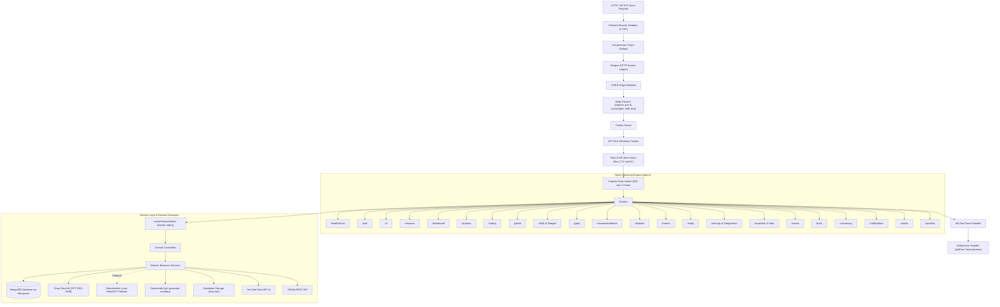
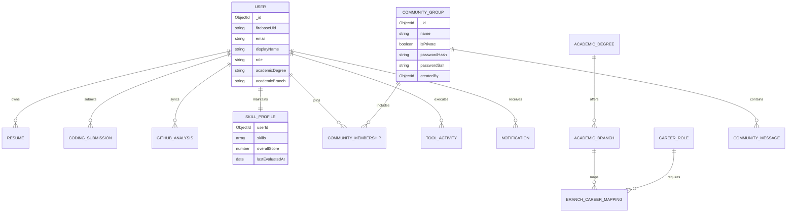

# Smart Skill Hub Backend Documentation

> **Node.js & Express 5 Modular REST API Engine for Smart Skill Hub**

[](https://nodejs.org/)
[](https://expressjs.com/)
[](https://www.mongodb.com/)
[](https://firebase.google.com/)
[](https://groq.com/)
[](https://github.com/apocas/dockerode)
[](https://socket.io/)
[](https://supabase.com/)
[](https://vitest.dev/)

---

## 📑 Related Documentation

- 🏠 **Root System Documentation**: [`../README.md`](../README.md) – Overall platform overview, system architecture, and repository information.
- 🌐 **Frontend Technical Documentation**: [`../frontend/README.md`](../frontend/README.md) – React 18, Vite, Tailwind CSS, TanStack Query, and Monaco Editor.

---

## 📑 Table of Contents

1. [Backend Overview](#1-backend-overview)
2. [Technology Stack](#2-technology-stack)
3. [Backend Architecture](#3-backend-architecture)
4. [Backend Directory Structure](#4-backend-directory-structure)
5. [Server Initialization and Lifecycle](#5-server-initialization-and-lifecycle)
6. [API Architecture and Endpoint Reference](#6-api-architecture-and-endpoint-reference)
7. [Authentication and Authorization](#7-authentication-and-authorization)
8. [Database Architecture and Data Ownership](#8-database-architecture-and-data-ownership)
9. [AI Integration and Fallback Engine](#9-ai-integration-and-fallback-engine)
10. [Smart Mentor Backend](#10-smart-mentor-backend)
11. [Career Intelligence and Skill Engine](#11-career-intelligence-and-skill-engine)
12. [EduTube Educational System](#12-edutube-educational-system)
13. [Coding Assessment and Docker Sandbox](#13-coding-assessment-and-docker-sandbox)
14. [Assessment Center and Practical Labs](#14-assessment-center-and-practical-labs)
15. [Specialized Multi-Branch Academic Tool Hub](#15-specialized-multi-branch-academic-tool-hub)
16. [Student Community and Real-Time Socket Architecture](#16-student-community-and-real-time-socket-architecture)
17. [GitHub Intelligence](#17-github-intelligence)
18. [Resume AI and File Ingestion](#18-resume-ai-and-file-ingestion)
19. [Portfolio Generation](#19-portfolio-generation)
20. [External Integrations](#20-external-integrations)
21. [Middleware and Security](#21-middleware-and-security)
22. [Environment Variables](#22-environment-variables)
23. [Local Development](#23-local-development)
24. [Testing Suite](#24-testing-suite)
25. [API Error Handling](#25-api-error-handling)
26. [Production Deployment (Render)](#26-production-deployment-render)
27. [Monitoring and Troubleshooting](#27-monitoring-and-troubleshooting)

---

## 1. Backend Overview

The **Smart Skill Hub Backend** is a high-performance modular REST API and real-time WebSocket server built on Node.js (ES Modules) and Express 5. It manages data persistence, authentication, AI inference, code execution containment, video classification, and multi-disciplinary academic tooling.

### Core Backend Responsibilities

- **REST API Routing**: Over 100 structured endpoints serving all platform feature modules under the `/api/v1` namespace.
- **Identity & Token Verification**: Cryptographically validates Firebase RS256 JWT tokens using Google's live JWKS certificate endpoint without database round-trips.
- **Sandboxed Code Execution**: Manages isolated Docker containers via Dockerode with memory, CPU, process, and execution time bounds.
- **AI Inference Orchestration**: Uses Groq Cloud running `openai/gpt-oss-120b` with automated fallback to lightweight models and a deterministic local NLP engine.
- **Real-Time WebSocket Messaging**: Manages public and password-protected community study circles via Socket.IO with typing indicators and online presence tracking.
- **Multi-Format Document Parsing**: Ingests PDF, DOCX, TXT, and scanned image resumes using `pdf-parse`, `mammoth`, and `tesseract.js` OCR.
- **Database Persistence**: MongoDB with Mongoose 8 enforcing tenant data isolation, indexes, and schema validations.

---

## 2. Technology Stack

All dependencies are verified from [`backend/package.json`](./package.json):

### Core Runtime and Framework
- **Node.js (`18+` / `20+` LTS)**: Native ES Modules (`"type": "module"`).
- **Express (`5.1.0`)**: High-performance routing, middleware handling, and HTTP error normalization.
- **dotenv (`17.2.3`) & Zod (`3.25.76`)**: Environment variable loading and runtime schema validation (`src/config/env.js`).

### Database and Storage
- **Mongoose (`8.18.0`)**: Object Data Modeling (ODM) library for MongoDB with automated schema validation and index creation.
- **Supabase JS (`2.110.2`)**: Cloud storage client persisting binary resume files in the `resumes` bucket with local filesystem fallback.

### Authentication and Security
- **Firebase Admin SDK (`14.3.0`)**: Server-side user identity verification and administrative privileges.
- **jsonwebtoken (`9.0.3`) & jwks-rsa (`4.1.0`)**: Local RS256 token decoding against Google's live public keys.
- **Helmet (`8.1.0`)**: HTTP security headers and Content Security Policy (CSP) with frame-ancestor rules.
- **CORS (`2.8.5`)**: Cross-Origin Resource Sharing with dynamic origin whitelisting.
- **Express Rate Limit (`7.5.0`)**: IP-based rate limiting (500 requests per 15-minute window).

### AI and Natural Language Processing
- **Groq SDK (`0.26.0`)**: High-throughput LLM client invoking `openai/gpt-oss-120b` and `openai/gpt-oss-20b`.
- **LangChain (`1.2.0`) & @langchain/groq (`1.2.0`)**: Prompt templating and structured schema formatting.

### Containerization and Execution Sandbox
- **Dockerode (`5.0.1`)**: Programmatic Docker daemon client managing execution containers.
- **p-limit (`7.3.0`)**: Concurrency limiter restricting active sandbox containers to 4 concurrent instances.

### Real-Time Communication and File Processing
- **Socket.IO (`4.8.4`)**: Real-time bidirectional WebSocket server mounted on the Express HTTP instance.
- **Multer (`2.1.1`)**: Multipart form-data parser for resume uploads (10 MB size limit).
- **pdf-parse (`2.4.5`) & mammoth (`1.12.0`)**: Binary text extraction for PDF and Word files.
- **Tesseract.js (`7.0.0`)**: OCR engine for image-based resumes.
- **JSZip (`3.10.1`)**: In-memory ZIP archive bundling for static portfolio downloads.

### Testing and Tooling
- **Vitest (`3.2.4`)**: Unit, integration, and security test runner.
- **Supertest (`7.1.4`)**: HTTP assertions for Express endpoints.
- **Nodemon (`3.1.10`)**: Development auto-reload file watcher.

---

## 3. Backend Architecture

The backend implements a multi-tier request pipeline:



---

## 4. Backend Directory Structure

```text
backend/
├── Dockerfile                          # Production container build specification
├── package.json                        # Backend scripts and dependencies
├── render.yaml                         # Render web service infrastructure-as-code
├── vitest.config.js                    # Vitest configuration for backend test suites
├── tasks/                              # Maintenance, migration, and diagnostic scripts
├── test/                               # Comprehensive unit and integration tests
└── src/
    ├── app.js                          # Express application configuration, middlewares, and route mounting
    ├── index.js                        # HTTP server entry point, Socket.IO binding, and graceful shutdown
    │
    ├── config/                         # Configuration and external client initializations
    │   ├── env.js                      # Zod-validated environment configuration
    │   ├── firebaseAdmin.js            # Firebase Admin SDK initialization
    │   └── groq.config.js              # Groq model configurations and fallback hierarchy
    │
    ├── constants/                      # Application-wide static constants
    │
    ├── controllers/                    # Global domain controllers
    │   ├── admin.controller.js         # Administrative management and analytics
    │   ├── analytics.controller.js     # User learning analytics
    │   ├── dashboard.controller.js     # Dashboard summary metrics
    │   └── healthcheck.controller.js   # Health, liveness, and readiness probes
    │
    ├── core/                           # Foundation infrastructure
    │   ├── auth/                       # Firebase auth router, controller, service, and middleware
    │   │   ├── auth.controller.js      # Auth endpoints (sign-in, me, verify)
    │   │   ├── auth.middleware.js      # RS256 token verification middleware
    │   │   └── auth.routes.js          # Authentication route declarations
    │   ├── database/                   # MongoDB connection management and shared schemas
    │   │   ├── db.js                   # Mongoose connection handler
    │   │   └── models/                 # Core user and academic models
    │   ├── errors/                     # Centralized error handling
    │   │   ├── ApiError.js             # Standardized operational error class
    │   │   ├── asyncHandler.js         # Promise rejection wrapper for route handlers
    │   │   └── errorHandler.js         # Global error handler and 404 middleware
    │   └── middleware/                 # Shared logging and analytics middleware
    │
    ├── middlewares/                    # Specialized request middlewares
    │   ├── admin.middleware.js         # Role-based admin access guard
    │   └── multer.middleware.js        # File upload filter (PDF, DOCX, image)
    │
    ├── models/                         # Domain Mongoose database schemas
    │   ├── academicBranch.models.js    # Academic branches (CSE, IT, ECE, Mech, etc.)
    │   ├── academicDegree.models.js    # Academic degrees (B.Tech, B.E., M.Tech, etc.)
    │   ├── careerRole.models.js        # Canonical career role taxonomy
    │   ├── codingSubmission.models.js  # Coding challenge submissions
    │   ├── notification.models.js      # In-app notifications
    │   ├── portfolio.models.js         # Generated developer web portfolios
    │   ├── project.models.js           # Student showcase projects
    │   ├── resume.models.js            # Resume master documents and versions
    │   ├── skillProfile.models.js      # User skill profiles and competency matrices
    │   └── user.models.js              # Core user documents
    │
    ├── modules/                        # Domain feature modules
    │   ├── academic/                   # Academic catalog, branches, and virtual labs
    │   ├── career/                     # Career pathway studio and readiness benchmarks
    │   ├── coding/                     # Coding assessment & Docker execution sandbox
    │   ├── community/                  # Socket.IO chat, study groups, and moderation
    │   ├── edutube/                    # YouTube video curation, notes, and checkpoints
    │   ├── gaps/                       # Skill gap computation and role benchmarking
    │   ├── github/                     # GitHub profile sync, language analysis, and README generation
    │   ├── mentor/                     # Smart Mentor AI chat and context aggregation
    │   ├── notifications/              # In-app notification dispatcher
    │   ├── recommendations/            # Learning recommendations and pathways
    │   ├── resume/                     # Resume AI tailoring, parsing, and A4 canvas
    │   ├── settings/                   # User preferences and integrations
    │   ├── skills/                     # Canonical skill taxonomy, badges, and spaced revision
    │   ├── study/                      # Flashcards, syllabi, and study profiles
    │   └── tools/                      # 11 Specialized Multi-Branch Academic Tools
    │
    ├── routes/                         # Centralized route definitions
    │   ├── admin.routes.js             # Administrative endpoints
    │   ├── analytics.routes.js         # User analytics endpoints
    │   ├── dashboard.routes.js         # Dashboard overview endpoints
    │   └── healthcheck.routes.js       # Health and readiness endpoints
    │
    ├── services/                       # Business logic and external API services
    └── utils/                          # Helper functions, math engines, and string formatters
```

---

## 5. Server Initialization and Lifecycle

Server initialization and process management are handled in `src/index.js`:

```javascript
// Server startup flow:
1. Connect to MongoDB cluster via connectDB()
2. Start HTTP listener on configured PORT (default: 8000)
3. Attach real-time Community Socket.IO server via initCommunitySocket(server)
4. Register OS signal handlers for graceful shutdown (SIGTERM, SIGINT)
```

### Graceful Teardown (`shutdown`)
When receiving a termination signal (`SIGTERM` or `SIGINT`):
1. **Drains In-Flight Requests**: Closes the HTTP server, refusing new incoming TCP connections with a 10-second safety timeout.
2. **Closes Socket.IO**: Disconnects all active WebSocket connections and clears presence caches via `closeCommunitySocket()`.
3. **Disconnects Database**: Closes the Mongoose MongoDB connection pool cleanly.
4. **Exits Cleanly**: Exits the process with code `0`.

---

## 6. API Architecture and Endpoint Reference

The backend exposes all endpoints under the `/api/v1` namespace.

### Health and Readiness Probes
| Method | Endpoint | Description | Auth Required |
|---|---|---|---|
| `GET` | `/` | Root API keep-alive | No |
| `GET` | `/api/v1` | API base status | No |
| `GET` | `/api/v1/healthcheck` | Overall system health summary | No |
| `GET` | `/api/v1/healthcheck/health` | Service uptime and process info | No |
| `GET` | `/api/v1/healthcheck/live` | Liveness probe for Render container orchestrators | No |
| `GET` | `/api/v1/healthcheck/ready` | Readiness probe confirming MongoDB connectivity | No |

### Authentication (`/api/v1/auth`)
| Method | Endpoint | Description | Auth Required |
|---|---|---|---|
| `POST` | `/api/v1/auth/firebase/sign-in` | Authenticate Firebase ID token, sync MongoDB user | Bearer Token |
| `GET` | `/api/v1/auth/me` | Fetch authenticated user profile | Bearer Token |
| `PATCH` | `/api/v1/auth/me` | Update user profile and academic info | Bearer Token |
| `POST` | `/api/v1/auth/send-verification-email`| Send email verification email | Bearer Token |
| `POST` | `/api/v1/auth/send-password-reset` | Send password reset email | No |
| `GET` | `/api/v1/auth/github` | Initiate GitHub OAuth flow | No |
| `GET` | `/api/v1/auth/github/callback` | Handle GitHub OAuth callback | No |
| `GET` | `/github/callback` | Root callback alias for OAuth redirect compatibility | No |

### AI and Resume Engineering (`/api/v1/ai` and `/api/v1/resumes`)
| Method | Endpoint | Description | Auth Required |
|---|---|---|---|
| `GET` | `/api/v1/ai/health` | AI provider connectivity check | Bearer Token |
| `POST` | `/api/v1/ai/tailor` | Tailor resume bullet points to job description | Bearer Token |
| `POST` | `/api/v1/ai/project-bullet/extend` | Expand and quantify project bullet point | Bearer Token |
| `POST` | `/api/v1/ai/profile-summary` | Generate professional summary from profile | Bearer Token |
| `POST` | `/api/v1/ai/description-bullets` | Generate accomplishment bullets from job description | Bearer Token |
| `POST` | `/api/v1/ai/onboarding/parse-resume` | Fast resume text parsing during onboarding | Bearer Token |
| `POST` | `/api/v1/ai/analyze-jd` | Extract required skills and keywords from JD | Bearer Token |
| `POST` | `/api/v1/ai/match-master-data` | Match candidate profile against JD criteria | Bearer Token |
| `POST` | `/api/v1/ai/tailor-two-stage` | Two-stage deep resume tailoring | Bearer Token |
| `POST` | `/api/v1/ai/resume/copilot-chat` | Interactive resume editor copilot chat | Bearer Token |
| `POST` | `/api/v1/ai/resume/review-language` | Linguistic and grammar quality review | Bearer Token |
| `POST` | `/api/v1/ai/resume/evaluate-scores` | Calculate ATS match and impact scores | Bearer Token |
| `POST` | `/api/v1/ai/resume/analyze-role` | Analyze profile fit for target role | Bearer Token |
| `POST` | `/api/v1/ai/resume/analyze-uploaded` | Deep analysis of uploaded resume file | Bearer Token |
| `GET` | `/api/v1/resumes` | List all user resumes | Bearer Token |
| `POST` | `/api/v1/resumes` | Create a new resume document | Bearer Token |
| `POST` | `/api/v1/resumes/upload` | Upload resume file (PDF, DOCX, image) | Bearer Token |
| `GET` | `/api/v1/resumes/:resumeId/file` | Stream resume attachment from Supabase | Bearer Token |
| `POST` | `/api/v1/resumes/:resumeId/extract` | Trigger OCR / text extraction on file | Bearer Token |
| `POST` | `/api/v1/resumes/apply-profile` | Populate resume from master user profile | Bearer Token |
| `PUT` | `/api/v1/resumes/:resumeId` | Update resume document data and styling | Bearer Token |
| `DELETE` | `/api/v1/resumes/:resumeId` | Delete resume and cloud attachment | Bearer Token |

### Coding Assessment and Sandbox (`/api/v1/coding`)
| Method | Endpoint | Description | Auth Required |
|---|---|---|---|
| `GET` | `/api/v1/coding/sandbox/status` | Check Docker daemon status and runner health | Bearer Token |
| `GET` | `/api/v1/coding/tasks` | List available coding challenges | Bearer Token |
| `GET` | `/api/v1/coding/tasks/:taskId` | Get challenge specifications and starter code | Bearer Token |
| `POST` | `/api/v1/coding/run` | Run code against visible test cases in Docker sandbox | Bearer Token |
| `POST` | `/api/v1/coding/submit` | Submit code for full evaluation against hidden tests | Bearer Token |
| `GET` | `/api/v1/coding/submissions` | List past coding submissions and scores | Bearer Token |

### Skills, Badges and Adaptive Loop (`/api/v1/skills` and `/api/v1/badges`)
| Method | Endpoint | Description | Auth Required |
|---|---|---|---|
| `POST` | `/api/v1/skills/evaluate` | Trigger comprehensive skill profile evaluation | Bearer Token |
| `GET` | `/api/v1/skills/profile` | Retrieve master canonical skill profile | Bearer Token |
| `GET` | `/api/v1/skills/history` | Retrieve skill progression timeline | Bearer Token |
| `GET` | `/api/v1/skills/competencies/matrix` | Full competency matrix across domains | Bearer Token |
| `GET` | `/api/v1/skills/competencies/taxonomy` | Authoritative skill taxonomy | Bearer Token |
| `GET` | `/api/v1/skills/badges/my` | List earned competency badges | Bearer Token |
| `POST` | `/api/v1/skills/badges/claim` | Claim an eligible competency badge | Bearer Token |
| `GET` | `/api/v1/skills/badges/verify/:badgeId` | Verify badge authenticity | No |
| `GET` | `/api/v1/badges/verify/:badgeId` | Public alias for badge verification | No |
| `GET` | `/badges/verify/:badgeId` | Public root alias for badge verification | No |
| `POST` | `/api/v1/skills/learning-loop/activity` | Record learning activity in adaptive loop | Bearer Token |
| `GET` | `/api/v1/skills/spaced-revision/due` | Get review tasks due today | Bearer Token |
| `POST` | `/api/v1/skills/spaced-revision/:id/review`| Submit spaced revision review result | Bearer Token |

### Career Intelligence and Pathways (`/api/v1/career` and `/api/v1/gaps`)
| Method | Endpoint | Description | Auth Required |
|---|---|---|---|
| `GET` | `/api/v1/career/roles` | List all benchmark career roles | Bearer Token |
| `GET` | `/api/v1/career/roles/:roleId` | Get benchmark competencies for a role | Bearer Token |
| `GET` | `/api/v1/career/readiness/:roleId` | Calculate readiness score against role | Bearer Token |
| `POST` | `/api/v1/career/compare` | Compare readiness across multiple roles | Bearer Token |
| `GET` | `/api/v1/career/preparation-plan/:roleId`| Generate structured role preparation plan | Bearer Token |
| `GET` | `/api/v1/gaps` | Retrieve current skill gap analysis | Bearer Token |
| `GET` | `/api/v1/gaps/analysis` | Detailed gap breakdown with missing skills | Bearer Token |
| `POST` | `/api/v1/gaps/analyze` | Recalculate skill gaps against target role | Bearer Token |

### EduTube Educational Streaming (`/api/v1/edutube`)
| Method | Endpoint | Description | Auth Required |
|---|---|---|---|
| `GET` | `/api/v1/edutube/search` | Curated educational video search via YouTube API | Bearer Token |
| `GET` | `/api/v1/edutube/video/:videoId` | Get video metadata and educational score | Bearer Token |
| `POST` | `/api/v1/edutube/history` | Record video watch session | Bearer Token |
| `GET` | `/api/v1/edutube/history` | Retrieve video watch history | Bearer Token |
| `PUT` | `/api/v1/edutube/progress/:videoId` | Update video playback progress | Bearer Token |
| `GET` | `/api/v1/edutube/continue-learning` | Fetch recently watched in-progress videos | Bearer Token |
| `POST` | `/api/v1/edutube/saved` | Bookmark video to saved library | Bearer Token |
| `GET` | `/api/v1/edutube/saved` | Retrieve saved videos | Bearer Token |
| `POST` | `/api/v1/edutube/playlists` | Create custom educational playlist | Bearer Token |
| `GET` | `/api/v1/edutube/playlists` | List user's playlists | Bearer Token |
| `POST` | `/api/v1/edutube/videos/:videoId/notes`| Save timestamped video note | Bearer Token |
| `GET` | `/api/v1/edutube/videos/:videoId/notes`| Retrieve notes for video | Bearer Token |
| `GET` | `/api/v1/edutube/video/:videoId/checkpoints`| Get timestamped quiz checkpoints | Bearer Token |
| `POST` | `/api/v1/edutube/video/:videoId/checkpoints/:checkpointId/submit`| Submit checkpoint quiz answer | Bearer Token |

### Smart Mentor (`/api/v1/mentor`)
| Method | Endpoint | Description | Auth Required |
|---|---|---|---|
| `GET` | `/api/v1/mentor/context` | View aggregated user context supplied to AI | Bearer Token |
| `POST` | `/api/v1/mentor/refresh-context` | Regenerate user context snapshot | Bearer Token |
| `POST` | `/api/v1/mentor/chat` | Send conversational chat message | Bearer Token |
| `POST` | `/api/v1/mentor/chat/stream` | Stream chat response via Server-Sent Events | Bearer Token |
| `GET` | `/api/v1/mentor/history` | Retrieve mentor conversation history | Bearer Token |
| `DELETE` | `/api/v1/mentor/history` | Clear mentor conversation history | Bearer Token |
| `POST` | `/api/v1/mentor/recommend-courses` | Generate personalized course recommendations | Bearer Token |
| `GET` | `/api/v1/mentor/unified-action` | Get prioritized unified action recommendations | Bearer Token |

### Academic Catalog and Practical Labs (`/api/v1/academic` and `/api/v1/labs`)
| Method | Endpoint | Description | Auth Required |
|---|---|---|---|
| `GET` | `/api/v1/academic/options` | Combined degrees, branches, and streams | Bearer Token |
| `GET` | `/api/v1/academic/degrees` | List university degrees (B.Tech, B.E., MCA, etc.) | Bearer Token |
| `GET` | `/api/v1/academic/branches` | List academic branches (CSE, Mech, Civil, etc.) | Bearer Token |
| `GET` | `/api/v1/academic/branches/:branchSlug/roles`| Career roles mapped to an academic branch | Bearer Token |
| `GET` | `/api/v1/labs` | List virtual practical labs by discipline | Bearer Token |
| `GET` | `/api/v1/labs/:labId` | Get instructions and steps for practical lab | Bearer Token |
| `POST` | `/api/v1/labs/:labId/submit` | Submit lab step outputs for evaluation | Bearer Token |
| `GET` | `/api/v1/labs/history` | Student's practical lab attempt history | Bearer Token |

### Specialized Multi-Branch Academic Tools (`/api/v1/tools`)
| Method | Endpoint | Description | Auth Required |
|---|---|---|---|
| `GET` | `/api/v1/tools` | List all 11 Specialized Academic Tools | Bearer Token |
| `GET` | `/api/v1/tools/:toolId` | Get input schemas and formulas for tool | Bearer Token |
| `POST` | `/api/v1/tools/:toolId/execute` | Execute calculations or review for tool | Bearer Token |
| `GET` | `/api/v1/tools/history/my-activity` | Retrieve past tool calculation records | Bearer Token |
| `PATCH` | `/api/v1/tools/history/:recordId/portfolio`| Toggle inclusion in web portfolio | Bearer Token |

### Student Community and Collaboration (`/api/v1/community`)
| Method | Endpoint | Description | Auth Required |
|---|---|---|---|
| `GET` | `/api/v1/community/global` | Fetch recent Global Student Lounge messages | Bearer Token |
| `GET` | `/api/v1/community/groups` | List public and member study circles | Bearer Token |
| `POST` | `/api/v1/community/groups` | Create a new study group (supports password) | Bearer Token |
| `GET` | `/api/v1/community/groups/:groupId` | Get study group details | Bearer Token |
| `POST` | `/api/v1/community/groups/:groupId/join`| Join study group (validates password if private) | Bearer Token |
| `POST` | `/api/v1/community/groups/:groupId/leave`| Leave study group | Bearer Token |
| `GET` | `/api/v1/community/groups/:groupId/messages`| Get message history for study group | Bearer Token |
| `POST` | `/api/v1/community/groups/:groupId/messages`| Send message to group (HTTP fallback) | Bearer Token |
| `DELETE` | `/api/v1/community/messages/:messageId`| Soft-delete message (sender/moderator) | Bearer Token |
| `POST` | `/api/v1/community/messages/:messageId/report`| Report message for moderation | Bearer Token |
| `GET` | `/api/v1/community/students` | Search student peer directory | Bearer Token |
| `GET` | `/api/v1/community/projects` | Discover student projects seeking collaborators | Bearer Token |

### GitHub Intelligence (`/api/v1/github`)
| Method | Endpoint | Description | Auth Required |
|---|---|---|---|
| `GET` | `/api/v1/github/profile/:username` | Inspect public GitHub profile | Bearer Token |
| `POST` | `/api/v1/github/analyze` | Analyze repository languages and complexity | Bearer Token |
| `POST` | `/api/v1/github/sync` | Synchronize authenticated user's repositories | Bearer Token |
| `POST` | `/api/v1/github/sync-skills` | Extract verified technical skills from code | Bearer Token |
| `POST` | `/api/v1/github/ai/insights` | Generate AI repository improvement advice | Bearer Token |
| `GET` | `/api/v1/github/latest` | Retrieve latest saved repository analysis | Bearer Token |
| `POST` | `/api/v1/github/mentor/readme` | Generate professional markdown README | Bearer Token |

### Developer Portfolio and Projects (`/api/v1/portfolio` and `/api/v1/projects`)
| Method | Endpoint | Description | Auth Required |
|---|---|---|---|
| `POST` | `/api/v1/portfolio/publish` | Deploy portfolio to Cloudflare Pages | Bearer Token |
| `GET` | `/api/v1/portfolio/status/:jobId` | Check Cloudflare deployment status | Bearer Token |
| `GET` | `/api/v1/projects` | List showcase projects | Bearer Token |
| `POST` | `/api/v1/projects` | Create a new project showcase | Bearer Token |
| `POST` | `/api/v1/projects/from-readme` | Extract project info from repository README | Bearer Token |

### Analytics and Administration (`/api/v1/analytics` and `/api/v1/admin`)
| Method | Endpoint | Description | Auth Required |
|---|---|---|---|
| `GET` | `/api/v1/analytics/me` | Fetch personal learning metrics and streaks | Bearer Token |
| `GET` | `/api/v1/admin/analytics` | View platform-wide metrics and rate limit hits | Admin Role |
| `GET` | `/api/v1/admin/users` | List registered platform users | Admin Role |
| `PATCH` | `/api/v1/admin/users/:userId/role`| Update user role (`user` or `admin`) | Admin Role |
| `PATCH` | `/api/v1/admin/users/:userId/status`| Suspend or reactivate user account | Admin Role |
| `GET` | `/api/v1/admin/catalog/integrity` | Audit database catalog integrity | Admin Role |

---

## 7. Authentication and Authorization

Authentication is enforced via the `verifyFirebaseToken` middleware (`src/core/auth/auth.middleware.js`):

```javascript
// Verification Mechanism:
1. Extract token from header: Authorization: Bearer <token>
2. Query Google's live JWKS certificate endpoint for public keys
3. Verify RS256 signature, audience (FIREBASE_PROJECT_ID), and issuer
4. Resolve or upsert the User document in MongoDB using firebaseUid
5. Attach the authenticated user document to req.user
```

### Authorization Middleware
- **`requireAdminRole` (`src/middlewares/admin.middleware.js`)**: Verifies that `req.user.role === "admin"` or `req.user.email === env.ADMIN_EMAIL`. Rejects unauthorized requests with HTTP `403 Forbidden`.
- **Tenant Isolation**: All database operations scope records using `userId: req.user._id` or `firebaseUid: req.user.firebaseUid`.

---

## 8. Database Architecture and Data Ownership

Smart Skill Hub persists state in MongoDB using Mongoose 8:



---

## 9. AI Integration and Fallback Engine

Smart Skill Hub uses Groq Cloud running open-source large language models:

### Model Configuration (`src/config/groq.config.js`)
- **Primary Model**: `openai/gpt-oss-120b` (high-reasoning tasks: resume tailoring, career gap analysis, code intelligence).
- **Lightweight Model**: `openai/gpt-oss-20b` (summaries, bullet point expansion, quick suggestions).
- **Prioritized Fallbacks**: `qwen/qwen3.6-27b` and `groq/compound`.

### Deterministic Local Fallback Engine
If Groq Cloud is unreachable, times out, or rate limits, the system shifts to a local deterministic rule/NLP fallback:
- Evaluates skill gaps using set intersection and weighted role benchmarks.
- Generates structured career advice using rule-based recommendation matrices.
- Tailors resume bullets using deterministic action verb substitution and keyword matching.
- Guarantees zero downtime or service interruptions for users even during external AI outages.

---

## 10. Smart Mentor Backend

Located in `src/modules/mentor/`:
- **Context Synthesis (`mentorContext.service.js`)**: Collects a 360-degree user snapshot (verified skills, missing gaps, recent coding challenge submissions, GitHub commit velocity, and current academic branch).
- **Conversational Processing**: Enforces grounding prompts preventing hallucinated career advice.
- **Dual Transport**: Supports standard JSON responses (`/chat`) and Server-Sent Events streaming (`/chat/stream`) for low-latency feedback.
- **Persistence**: Records conversations in the `SmartMentorConversation` collection with soft-delete capabilities.

---

## 11. Career Intelligence and Skill Engine

Located in `src/modules/skills/` and `src/modules/career/`:
- **Taxonomy Normalization**: Maps candidate keywords to a canonical taxonomy of technical competencies.
- **Readiness Calculation**:
  $$\text{Readiness Score} = \left( \frac{\sum \text{Verified Required Skills}}{\sum \text{Total Benchmark Required Skills}} \times 0.7 \right) + \left( \frac{\sum \text{Verified Optional Skills}}{\sum \text{Total Benchmark Optional Skills}} \times 0.3 \right)$$
- **Spaced Revision**: Implements spaced-repetition schedules calculating due and upcoming review items to reinforce long-term concept retention.
- **Verifiable Badges**: Cryptographically signs competency badges with UUIDs and SHA-256 integrity hashes.

---

## 12. EduTube Educational System

Located in `src/modules/edutube/`:
- **YouTube API Integration**: Queries YouTube Data API v3 for technical keywords.
- **Multi-Stage Educational Classifier**:
  1. Validates category IDs (e.g., Science & Technology, Education).
  2. Enforces minimum video duration (`EDUTUBE_MIN_DURATION_SECONDS`, default: 120s) to exclude short-form clickbait.
  3. Scans titles and descriptions against negative keyword filters (e.g., entertainment, reaction, vlog, gaming).
- **Interactive Checkpoints**: Stores timestamped quiz checkpoints in `EdutubeVideoCheckpoint` evaluated on student submission.

---

## 13. Coding Assessment and Docker Sandbox

Located in `src/modules/coding/`:
- **Container Isolation (`dockerExecutor.js`)**: Executes student code inside temporary `ssh-javascript-sandbox` containers.
- **Resource Constraints**:
  - Memory: 128 MB RAM (no swap).
  - CPU: 0.5 CPU cores (500,000,000 NanoCPUs).
  - Process Limit: Max 32 concurrent processes.
  - Timeout: 5-second wall-clock execution limit.
  - Code Size: Max 64 KB source code.
  - Concurrency: Max 4 active containers managed via `p-limit`.
- **Execution Safeguard**: Controlled via `CODING_EXECUTION_ENABLED`. If set to `false`, the system gracefully returns simulated evaluations, allowing staging environments to run without an authorized Docker daemon.

---

## 14. Assessment Center and Practical Labs

Located in `src/modules/academic/`:
- **Academic Assessments**: Branch-aware quiz engine evaluating theoretical knowledge across engineering disciplines.
- **Practical Labs (`practicalLab.service.js`)**: Virtual lab exercises (e.g., SQL queries, Linux commands, circuit analysis) with automated evaluation of student terminal outputs.
- **Attempts Tracking**: Preserves full submission history, scoring rubrics, and detailed step explanations.

---

## 15. Specialized Multi-Branch Academic Tool Hub

Located in `src/modules/tools/`:
Implements 11 functional, discipline-tailored calculation and review engines:
- `cse-resume-ai`, `cse-coding-platform`, `cse-github-reviewer`: CS/IT studios.
- `mech-calc`: Stress/strain, factor of safety, and beam deflection formulas.
- `ece-circuits`: Equivalent impedance, voltage/current dividers, and Thévenin networks.
- `civil-boq`: Concrete volume, nominal mix batching, dry shrinkage (1.54), and BOQ cost sheets.
- `chem-process`: Binary distillation mass balances and CSTR reactor space-time sizing.
- `biotech-research`: GC% content, Marmur-Doty melting temperatures ($T_m$), and hypothesis evaluation.
- `business-kpi`: Break-even volume/revenue, margin of safety, and CAC/LTV unit economics.
- `commerce-finance`: Working capital, liquidity ratios (Current/Quick), and 3-period DCF models.
- `arts-humanities`: Formatted citations (APA 7th, MLA 9th, Chicago 17th) and thesis critique.
- `allied-health`: Pediatric/adult dosage calculations and SBAR clinical handover builder.
- `shared-academic-reviewer`: Formative evaluation for technical reports and capstone proposals.

---

## 16. Student Community and Real-Time Socket Architecture

Located in `src/modules/community/`:
- **Socket.IO Event Engine (`communitySocket.js`)**: Attached to the primary Express HTTP server, authenticating incoming WebSocket connections using Firebase RS256 tokens.
- **Password-Protected Study Circles**: Private groups hash access passwords using Node.js `crypto.scrypt` with random 16-byte salts, timing-safe equality checks (`timingSafeEqual`), and automatic lockout after 5 consecutive failed attempts.
- **Moderation Pipeline**: Sanitizes incoming messages, provides message reporting workflows, and enables user-level blocking.

---

## 17. GitHub Intelligence

Located in `src/modules/github/`:
- **API Synchronization**: Fetches public repositories, branches, commit logs, and language distributions via GitHub REST API.
- **Complexity Scoring**: Calculates cyclomatic complexity heuristics and repository architecture depth.
- **AI README Generator**: Synthesizes repository structure, dependencies, and code comments to generate comprehensive markdown README files.

---

## 18. Resume AI and File Ingestion

Located in `src/modules/resume/`:
- **Multi-Format Ingestion**: Ingests PDF, DOCX, TXT, and scanned image resumes using `pdf-parse`, `mammoth`, and `tesseract.js` OCR.
- **Supabase Cloud Storage**: Uploads binary attachments to Supabase Storage with local filesystem fallback.
- **ATS Keyword Matching**: Compares extracted resume keywords against target job descriptions, scoring match percentages and generating bullet point improvements.

---

## 19. Portfolio Generation

Located in `src/modules/resume/services/portfolio.service.js`:
- **Static Site Assembly**: Generates modern, responsive HTML/CSS/JS portfolios from user profiles and GitHub projects.
- **ZIP Packaging**: Packages site assets into a downloadable archive via `jszip`.
- **Cloudflare Pages Publishing**: Deploys static sites directly to Cloudflare Pages using the Direct Upload API.

---

## 20. External Integrations

| External Service | Role in Platform | Authentication & Config |
|---|---|---|
| **Firebase Admin** | User authentication & RS256 token verification | `FIREBASE_PROJECT_ID`, `FIREBASE_CLIENT_EMAIL`, `FIREBASE_PRIVATE_KEY` |
| **MongoDB Atlas** | Primary relational document store | `MONGODB_URI` connection string |
| **Groq Cloud** | High-speed LLM inference (`openai/gpt-oss-120b`) | `GROQ_API_KEY`, `GROQ_MODEL` |
| **Supabase Storage** | Binary resume file persistence | `SUPABASE_URL`, `SUPABASE_SERVICE_ROLE_KEY`, `SUPABASE_STORAGE_BUCKET` |
| **YouTube Data API**| Educational video discovery | `YOUTUBE_API_KEY` |
| **GitHub API** | Repository analysis & developer metrics | `GITHUB_TOKEN`, `GITHUB_CLIENT_ID`, `GITHUB_CLIENT_SECRET` |
| **Cloudflare Pages**| Automated portfolio hosting | `CF_ACCOUNT_ID`, `CF_API_TOKEN` |

---

## 21. Middleware and Security

- **`helmet`**: Configures Content Security Policy (CSP), cross-origin resource policy, and frame embedding protections.
- **`cors`**: Dynamically verifies request origin against allowed origins (Vercel, Render, local dev, devtunnels).
- **`express-rate-limit`**: Enforces a 500 requests per 15-minute threshold per IP address.
- **`multer`**: Enforces a 10 MB file size limit and restricts uploads to PDF, DOCX, and image formats.
- **Centralized Error Handler (`src/core/errors/errorHandler.js`)**: Formats all errors into standardized JSON payloads (`ApiError`).

---

## 22. Environment Variables

All variables are validated on startup via Zod in `src/config/env.js`:

| Variable | Required | Default | Description |
|---|---|---|---|
| `NODE_ENV` | No | `development` | Runtime environment (`development`, `test`, `production`) |
| `PORT` | No | `8000` | HTTP port for Express server |
| `API_PREFIX` | No | `/api/v1` | URL prefix for REST API endpoints |
| `CORS_ORIGIN` | No | `*` | Comma-separated list of allowed CORS origins |
| `MONGODB_URI` | **Yes** | — | MongoDB connection URI string |
| `ADMIN_EMAIL` | No | `sampatakumarsv@gmail.com` | Primary administrator email address |
| `FIREBASE_PROJECT_ID` | **Yes** | — | Firebase project identifier |
| `FIREBASE_CLIENT_EMAIL` | No | `""` | Firebase service account email |
| `FIREBASE_PRIVATE_KEY` | No | `""` | Firebase RSA private key |
| `FIREBASE_SERVICE_ACCOUNT_PATH`| No | `""` | Path to service account JSON file |
| `SUPABASE_URL` | **Yes** | — | Supabase project URL |
| `SUPABASE_SERVICE_ROLE_KEY` | **Yes** | — | Supabase service role API key |
| `SUPABASE_STORAGE_BUCKET` | No | `resumes` | Name of storage bucket for resumes |
| `GROQ_API_KEY` | **Yes** | — | Groq Cloud API authentication key |
| `GROQ_MODEL` | No | `openai/gpt-oss-120b` | Target Groq LLM model |
| `YOUTUBE_API_KEY` | No | `""` | YouTube Data API v3 key |
| `CODING_EXECUTION_ENABLED` | No | `"true"` | Enables Docker container execution |
| `MAX_RESUME_SIZE_MB` | No | `10` | Maximum file size for resume uploads |
| `EDUTUBE_MIN_DURATION_SECONDS` | No | `120` | Minimum video duration threshold (seconds) |
| `FRONTEND_URL` | No | `https://smartskillhub.vercel.app` | Frontend client origin URL |
| `BACKEND_URL` | No | `https://ssh-final-year-project.onrender.com` | Backend server origin URL |

> [!CAUTION]
> Never commit production secrets (`FIREBASE_PRIVATE_KEY`, `SUPABASE_SERVICE_ROLE_KEY`, `GROQ_API_KEY`) to version control. Use secret managers or environment configuration dashboards in production.

---

## 23. Local Development

### 1. Install Dependencies
```bash
cd backend
npm install
```

### 2. Configure Environment
```bash
cp .env.example .env
# Edit .env with your local MongoDB and API credentials
```

### 3. Seed Academic Taxonomy and Roles
```bash
npm run seed:academic
```

### 4. Start Development Server
```bash
npm run dev
```

The server launches on port **8000** with Nodemon auto-reload:
- Base API URL: `http://localhost:8000/api/v1`
- Health Check: `http://localhost:8000/api/v1/healthcheck/ready`

---

## 24. Testing Suite

The backend uses Vitest and Supertest:

```bash
# Run complete test suite
npm test

# Run a specific unit test file
npx vitest run test/coding.sandbox.unit.test.js
```

### Test Suite Highlights
- `coding.sandbox.unit.test.js`: Validates Docker daemon connectivity, container lifecycle, memory/CPU bounds, and timeout handling.
- `academic.catalog.test.js`: Tests academic catalog seeding and multi-branch role mappings.
- `edutube.education-filter.test.js`: Validates YouTube educational classifier, duration thresholds, and checkpoint scoring.
- `community-messaging.test.js`: Tests Socket.IO chat dispatch, password verification, and moderation soft-deletes.

---

## 25. API Error Handling

Errors are normalized using the `ApiError` class (`src/core/errors/ApiError.js`):

```json
{
  "success": false,
  "statusCode": 404,
  "message": "Resource not found",
  "errors": [],
  "timestamp": "2026-11-02T15:20:00.000Z"
}
```

Standard HTTP status codes are enforced:
- `400 Bad Request`: Payload validation failures or malformed inputs.
- `401 Unauthorized`: Missing or invalid Firebase ID token.
- `403 Forbidden`: Insufficient role permissions (non-admin accessing admin endpoints).
- `404 Not Found`: Requested document or entity does not exist.
- `429 Too Many Requests`: Rate limit threshold exceeded (500 req / 15 min).
- `500 Internal Server Error`: Unhandled exceptions with stack traces hidden in production.

---

## 26. Production Deployment (Render)

The backend is deployed as a Web Service on Render:
- **Service Name**: `resumeai-backend`
- **Region**: `singapore`
- **Build Command**: `npm install`
- **Start Command**: `npm start`
- **Health Check Path**: `/api/v1/healthcheck`
- **Production URL**: `https://ssh-final-year-project.onrender.com`

Infrastructure is declared as code in [`render.yaml`](../render.yaml).

---

## 27. Monitoring and Troubleshooting

### 1. MongoDB Connection Timeout
**Symptom**: `MongooseServerSelectionError: connect ECONNREFUSED`.
**Resolution**: Verify that your local MongoDB daemon is running (`systemctl status mongod`) or that your IP address is whitelisted in MongoDB Atlas Network Access rules.

### 2. Firebase ID Token Verification Failure
**Symptom**: `401 Unauthorized: Invalid token: jwt expired` or `kid not found`.
**Resolution**: Ensure the client is sending a fresh token acquired via `currentUser.getIdToken(true)`. Check that the backend machine clock is synchronized via NTP.

### 3. Groq AI Rate Limit or Quota Error
**Symptom**: `429 Rate limit reached for model`.
**Resolution**: The backend automatically falls back to lightweight models (`openai/gpt-oss-20b`) and local deterministic NLP logic. Verify API quota in the Groq Cloud Console.

### 4. Docker Daemon Unavailable
**Symptom**: `Docker connection failure: connect ENOENT /var/run/docker.sock`.
**Resolution**: Ensure Docker is installed and running (`sudo systemctl start docker`). In environments without Docker access, set `CODING_EXECUTION_ENABLED=false` in `.env` to enable simulated execution mode.

---

*For client application architecture and UI components, continue to the [Frontend Documentation](../frontend/README.md).*
