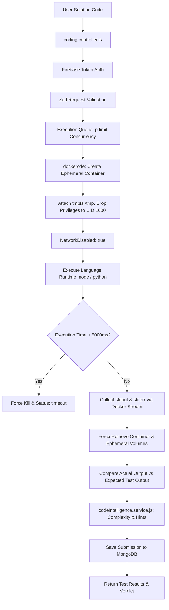

# Coding Module — Secure Sandboxed Execution & Code Intelligence

> **Docker-Isolated Algorithmic Execution, Multi-Language Assessment & AI Code Analysis**

---

## 1. Overview & Capabilities

The **Coding Module** provides a secure, sandboxed evaluation environment for algorithmic problem solving and coding competency assessment in Smart Skill Hub.

### Core Capabilities:
- **Docker Container Sandboxing**: Executes untrusted code inside isolated ephemeral containers managed via `dockerode`.
- **Strict Security Boundaries**:
  - `NetworkDisabled: true`: Zero outbound network connectivity; prevents data exfiltration.
  - `ReadonlyRootfs: true`: Root filesystem is mounted read-only; prevents container tampering.
  - `PidsLimit: 32`: Thwarts fork bomb and thread exhaustion attacks.
  - `Memory: 128MB` & `MemorySwap: 128MB`: Prevents host memory starvation.
  - `NanoCPUs: 500,000,000` (0.5 CPU core limit): Restricts CPU usage.
  - Non-root user: Executes as unprivileged user (`User: '1000:1000'`).
  - Ephemeral tmpfs: Only `/tmp` is writable (`rw,noexec,nosuid,size=64m`).
- **Deterministic Test Runner**: Evaluates submissions against visible test cases and hidden edge-case suites with strict execution timeouts ($< 5000\text{ms}$).
- **AI Code Intelligence**: Analyzes submitted code for algorithmic time/space complexity, style improvements, and generates graduated hints without revealing the full solution.

---

## 2. Execution Architecture



---

## 3. Directory Structure

```
backend/src/modules/coding/
├── controllers/
│   └── coding.controller.js        # HTTP route handlers for submissions & problems
├── models/
│   ├── problem.models.js           # Coding challenge schemas & test cases
│   └── submission.models.js        # User submission history, execution times & memory
├── routes/
│   └── coding.routes.js            # Express router: /api/v1/coding/*
└── services/
    ├── codeIntelligence.service.js # AI complexity analysis & hint generation
    └── dockerSandbox.service.js    # Dockerode container lifecycle management
```

---

## 4. API Endpoints

| Method | Endpoint | Description | Auth |
| :--- | :--- | :--- | :--- |
| `GET` | `/api/v1/coding/problems` | List catalog of coding challenges with difficulty & tags. | Optional |
| `GET` | `/api/v1/coding/problems/:id` | Fetch problem description, starter code, and sample test cases. | Optional |
| `POST` | `/api/v1/coding/run` | Execute code against sample test cases in the Docker sandbox. | Required |
| `POST` | `/api/v1/coding/submit` | Submit code against all test cases (visible + hidden) for scoring. | Required |
| `POST` | `/api/v1/coding/hints` | Request progressive hints from the AI Code Intelligence service. | Required |
| `GET` | `/api/v1/coding/submissions` | Retrieve authenticated user's past submission history. | Required |

---

## 5. Security Controls & Attack Defenses

| Attack Vector | Defense Mechanism | Verified Behavior |
| :--- | :--- | :--- |
| **Filesystem Overwrite** | `ReadonlyRootfs: true` | `EACCES: permission denied` for all paths outside `/tmp`. |
| **System Compromise** | Execution as `UID 1000` | Process cannot access `/etc/shadow`, root files, or system configs. |
| **Data Exfiltration** | `NetworkDisabled: true` | Socket connections (`http`, `fetch`, `curl`) fail immediately with `EHOSTUNREACH`. |
| **Fork Bomb** | `PidsLimit: 32` | Subprocess spawning capped; host system unaffected. |
| **Memory Exhaustion (OOM)** | `Memory: 134217728` (128MB) | Container terminated by kernel cgroup without impacting host Node.js. |
| **Infinite Loop** | Wall-clock execution timer | Kills container after 5000ms and returns `status: "timeout"`. |
| **Credential Stealing** | Clean environment without host `process.env` | Host API keys (`GROQ_API_KEY`, `MONGO_URI`) never passed to container. |
