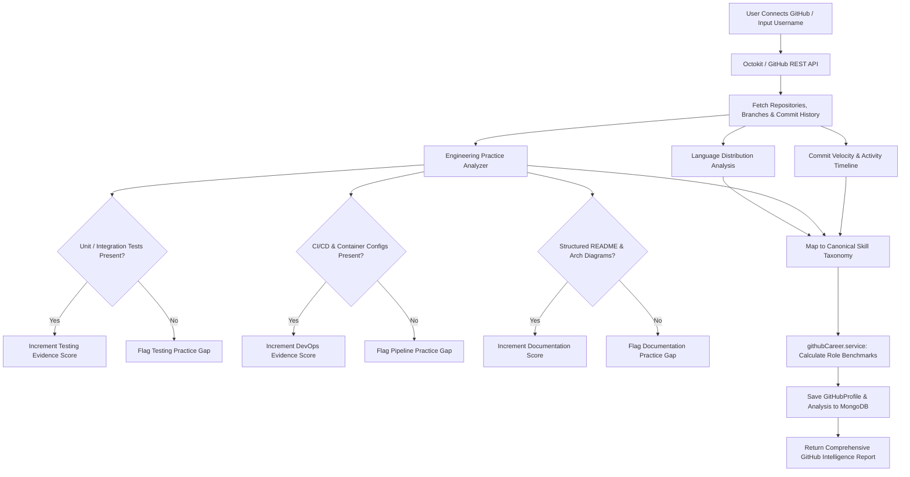

# GitHub Intelligence Module — Architecture & Evidence Scoring Engine

> **Automated Repository Mining, Engineering Practice Extraction & Career Intelligence**

---

## 1. Overview & Capabilities

The **GitHub Intelligence Module** analyzes public and private GitHub repositories to transform raw git activity into verifiable engineering evidence, skill proficiency scores, and career readiness benchmarks.

### Core Capabilities:
- **Repository Mining & Metrics**: Aggregates commit velocity, branch hygiene, pull request frequency, commit activity over time, and code churn.
- **Language & Stack Breakdown**: Analyzes linguistic distribution across repositories with byte-accurate percentages.
- **Engineering Practice Verification**:
  - **Testing Culture**: Inspects repositories for unit and integration testing frameworks (Jest, Vitest, Pytest, Mocha, JUnit).
  - **CI/CD Automation**: Detects `.github/workflows`, Docker configurations, Kubernetes manifests, and automated deployment pipelines.
  - **Documentation Rigor**: Evaluates README completeness, architecture diagrams, and inline documentation.
- **Evidence-Based Skill Scoring**: Bridges code patterns directly into Smart Skill Hub's canonical skill taxonomy (e.g. detecting React hooks, Express routers, or Dockerfiles contributes directly to skill verification).
- **Career Role Matching**: Computes career archetype readiness scores (Full Stack, Backend, Frontend, DevOps, Machine Learning) based on repository evidence.

---

## 2. Evidence Extraction Pipeline



---

## 3. Directory Structure

```
backend/src/modules/github/
├── controllers/
│   └── github.controller.js        # Route handlers for OAuth, syncing, and analysis
├── models/
│   └── github.models.js            # Schemas for GitHub profiles, repos, and evidence
├── routes/
│   └── github.routes.js            # Express router: /api/v1/github/*
└── services/
    ├── github.service.js           # Octokit client & repository statistics fetcher
    └── githubCareer.service.js     # Evidence scoring engine & career role matching
```

---

## 4. API Reference

| Method | Endpoint | Description | Auth |
| :--- | :--- | :--- | :--- |
| `POST` | `/api/v1/github/connect` | Connects user GitHub account with OAuth access token. | Required |
| `GET` | `/api/v1/github/sync` | Fetches repositories, re-analyzes commits, and updates metrics. | Required |
| `GET` | `/api/v1/github/profile` | Retrieves cached GitHub intelligence profile and summary stats. | Required |
| `GET` | `/api/v1/github/evidence` | Returns extracted engineering practice evidence and skill scores. | Required |
| `GET` | `/api/v1/github/career-matches` | Evaluates role readiness benchmarks based on verified code evidence. | Required |
| `GET` | `/api/v1/github/repositories` | Lists user repositories with complexity scores and detected languages. | Required |

---

## 5. Evidence Scoring Formula

Readiness and skill confidence are computed deterministically using weighted evidence parameters:
$$\text{SkillScore} = \min\left(100, \sum (\text{RepoWeight} \times \text{LanguageRatio}) + \text{PracticeBonus} + \text{VelocityMultiplier}\right)$$
- **PracticeBonus**: Awarded for detected unit tests (+15), GitHub Actions CI (+15), and Dockerfile containerization (+10).
- **VelocityMultiplier**: Scales dynamically based on consistent commit activity over the past 90 days.
