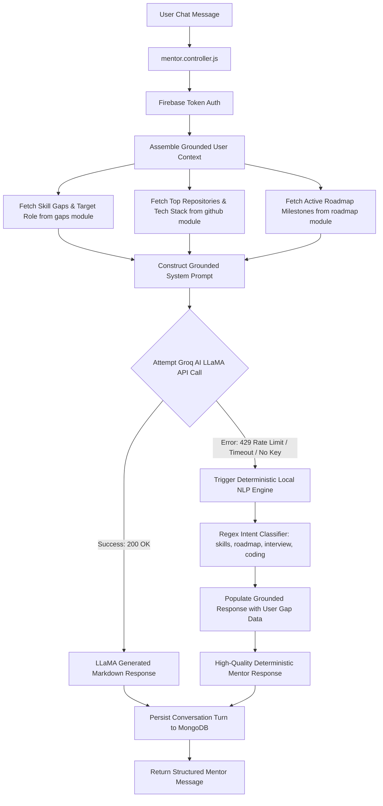

# Smart Mentor Module — AI Career Coaching & Hybrid Fallback Engine

> **Context-Aware Conversational AI Mentorship Powered by Groq LLaMA & Deterministic Local Fallback**

---

## 1. Overview & Capabilities

The **Smart Mentor Module** provides personalized, real-time technical mentorship and career guidance to engineers. It acts as an interactive coach with complete awareness of the user's skill profile, code evidence, learning progress, and target career goals.

### Core Capabilities:
- **Grounded Context Injection**: System prompts dynamically incorporate the user's actual skill profile, identified gaps, target roles, recent assessment scores, and GitHub activity.
- **Groq LLaMA Inference**: High-speed LLM generation using `llama-3.3-70b-versatile` and `llama-3.1-8b-instant`.
- **Hybrid Local Fallback Engine**: If the Groq API key is missing, network requests timeout, or rate limits (HTTP 429) occur, the mentor seamlessly transitions to a deterministic NLP rule-based engine to provide structured, relevant career advice without failing.
- **Persistent Conversation Memory**: Preserves chat sessions and message history in MongoDB, allowing continuous multi-turn dialogue.
- **Curated Prompt Templates**: Offers quick-start prompts for System Design, Coding Interview Practice, Career Transition, and Resume Critique.

---

## 2. Mentorship Pipeline & Fallback Architecture



---

## 3. Directory Structure

```
backend/src/modules/mentor/
├── controllers/
│   └── mentor.controller.js        # Chat, history, and template route handlers
├── models/
│   └── mentor.models.js            # Schemas for mentor sessions and message history
├── routes/
│   └── mentor.routes.js            # Express router: /api/v1/mentor/*
└── services/
    ├── mentor.service.js           # Groq API client, prompt assembler & stream handling
    └── localMentorFallback.service.js # Deterministic rule-based NLP fallback engine
```

---

## 4. API Reference

| Method | Endpoint | Description | Auth |
| :--- | :--- | :--- | :--- |
| `POST` | `/api/v1/mentor/chat` | Send a message to the mentor; returns stream or structured reply. | Required |
| `GET` | `/api/v1/mentor/history` | Retrieve full conversation message history for the user. | Required |
| `DELETE` | `/api/v1/mentor/history` | Clear conversational chat history. | Required |
| `GET` | `/api/v1/mentor/prompts` | Retrieve curated quick-start mentorship prompt templates. | Optional |
| `GET` | `/api/v1/mentor/context` | View active user context injected into the mentor's system prompt. | Required |

---

## 5. Resilience & Graceful Degradation

The deterministic local fallback covers primary intent categories:
- **`skill_gap`**: Inspects user's highest priority missing skills and suggests concrete projects.
- **`roadmap_progress`**: Reviews current milestone status and offers pacing recommendations.
- **`system_design`**: Provides architectural breakdown checklists (scalability, caching, DB partitioning).
- **`interview_prep`**: Outlines behavioral (STAR method) and algorithmic interview frameworks.
