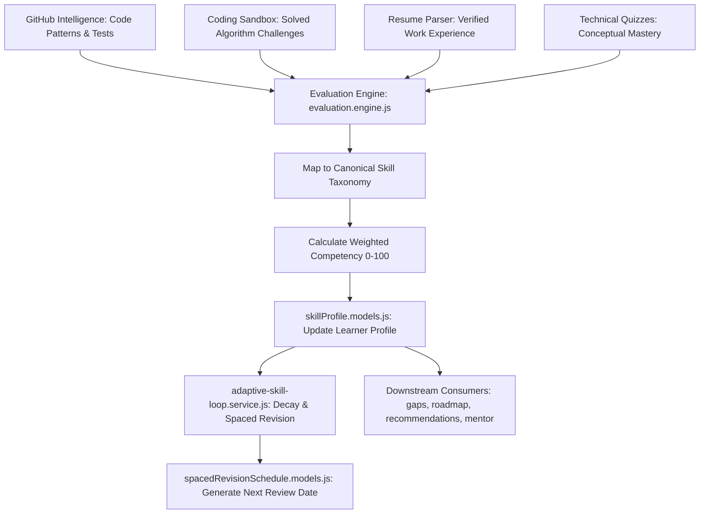

# Skills Module — Canonical Taxonomy, Evaluation Engine & Adaptive Skill Loop

> **Master Skill Taxonomy, Multi-Source Evidence Scoring & Spaced Revision Intelligence**

---

## 1. Overview & Capabilities

The **Skills Module** serves as the central source of truth for technical competencies across Smart Skill Hub. It normalizes skills from disparate inputs (resumes, GitHub repositories, coding assessments, quizzes) into a canonical ontology and maintains an active competency profile for every learner.

### Core Capabilities:
- **Canonical Skill Taxonomy**: Standardizes variations (e.g. `JS`, `JavaScript`, `ECMAScript` $\to$ `JavaScript`; `k8s` $\to$ `Kubernetes`).
- **Empirical Evaluation Engine (`evaluation.engine.js`)**: Evaluates skill mastery based on concrete evidence types rather than self-reported claims:
  - Repository code commits & complexity.
  - Passing unit tests in Docker coding assessments.
  - Spaced repetition quiz scores.
  - ATS resume parsing extractions.
- **Adaptive Skill Loop (`adaptive-skill-loop.service.js`)**: Automatically recalculates skill proficiency and decay over time using spaced-repetition retention curves.
- **Spaced Revision Scheduling (`spacedRevisionSchedule.models.js`)**: Schedules timely micro-assessments to ensure long-term retention of critical engineering skills.

---

## 2. Skill Evidence & Calculation Pipeline



---

## 3. Directory Structure

```
backend/src/modules/skills/
├── controllers/
│   └── skills.controller.js        # Handlers for skill profiles, assessments & revisions
├── models/
│   ├── learnerSkillAssessment.models.js # Evidence records for specific skill assessments
│   ├── skillProfile.models.js      # Consolidated user skill proficiency profile
│   └── spacedRevisionSchedule.models.js # Spaced-repetition review triggers & intervals
├── routes/
│   └── skills.routes.js            # Express router: /api/v1/skills/*
└── services/
    ├── adaptive-skill-loop.service.js # Feedback loop adjusting scores and decay
    ├── evaluation.engine.js        # Multi-factor score computation
    └── skillProfile.service.js     # Profile CRUD and taxonomy normalization
```

---

## 4. API Reference

| Method | Endpoint | Description | Auth |
| :--- | :--- | :--- | :--- |
| `GET` | `/api/v1/skills/profile` | Retrieve the authenticated user's complete skill profile with levels. | Required |
| `POST` | `/api/v1/skills/evaluate` | Trigger on-demand re-evaluation across all connected evidence sources. | Required |
| `GET` | `/api/v1/skills/revision-schedule` | Fetch upcoming spaced revision milestones and due skills. | Required |
| `POST` | `/api/v1/skills/revision-complete` | Mark a spaced review item as completed with accuracy score. | Required |
| `GET` | `/api/v1/skills/taxonomy` | Retrieve the canonical taxonomy catalog and supported domains. | Optional |
