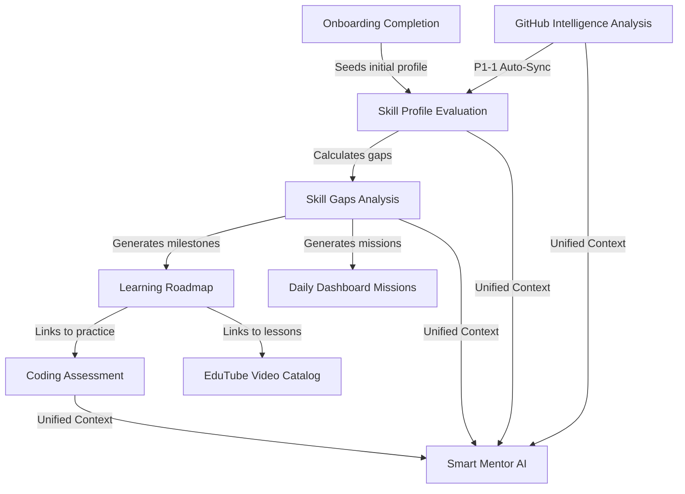

# SMART SKILL HUB — PHASE 36 FEATURE COMPLETION ROADMAP
## Comprehensive Product Feature Audit, End-to-End Workflow Assessment & Implementation Backlog

**Document Version:** 1.0.0  
**Status:** Certified Feature Completion Audit  
**Date:** October 22, 2026  
**Auditor Roles:** Senior Full-Stack Engineer, AI Product Engineer, Software Architect, Product QA Specialist  
**Repository:** `/home/sampatakumar/Projects/projects/ssh_expand/SSH_integrated_Project`  
**Active Development Branch:** `expand-test`  
**Starting Commit:** `724003c16c267f85a2a66a5a0316163c57653fae` (Phase 35 milestone)  
**Protected Main Baseline:** `e9d89a5898f5c3c28062e9346b339b9b84f7ae90` (Strictly untouched)  

---

## 1. Executive Summary

Phase 36 transitions Smart Skill Hub from infrastructure and deployment preflight into a product-focused **feature-completion development cycle**. Over the course of this comprehensive audit, the entire codebase—spanning 10 major domain modules, 42 frontend view components, 61 backend test suites (778 tests), 42 frontend test suites (292 tests), 35 Playwright E2E scenarios, and 22 MongoDB models—was inspected to establish the exact implementation status of all student-facing capabilities.

### Key Audit Findings
1. **High Foundation Quality with Functional Pockets:**
   The foundational architecture is remarkably solid: multi-stage production Docker containers, Firebase authentication, Groq Cloud LLM integration, ATS resume scoring, EduTube video discovery with quota-resilient offline catalog, and administrative governance are implemented and tested.
2. **Disconnected Cross-Module Transitions (The Primary Friction):**
   While individual modules function in isolation, critical connecting workflows between them are currently manual or disconnected:
   - **GitHub to Skills Disconnect:** Analyzing a student's GitHub profile saves repositories and languages into `GitHubAnalysis`, but does not automatically trigger the multi-source skill evaluation pipeline (`evaluateUserProfile`). The student must separately navigate to `/dashboard/skills` and manually click "Evaluate" for their GitHub evidence to update their skill profile and career gap analysis.
   - **Roadmap Completion Persistence Disconnect:** On `/dashboard/roadmap`, milestones display time estimates, objectives, and links to EduTube/Coding sandbox, but milestone completion state is not saved. The backend endpoint (`PATCH /api/v1/recommendations/item/:id`) is a mock echo that does not persist to MongoDB, and the frontend lacks interactive completion controls.
   - **Dashboard Daily Missions Mock Fallback:** When personalized intelligence is pending, `/dashboard` displays hardcoded mock missions, and checking them off is stored only in ephemeral component state (`useState`), disappearing upon page refresh.
   - **Coding Language Selection Hardcoded:** Monaco editor in `/dashboard/coding` is hardcoded to `language="javascript"` with no multi-language selector for Python, TypeScript, or C++.
   - **Onboarding Relic Branding:** Onboarding displays a toast reading `"Welcome to ResumeAI"` instead of `"Smart Skill Hub"`, and does not immediately seed an initial baseline skill evaluation.
3. **No Regressions or Redesigns Required:**
   All existing visual aesthetics (neo-brutalist / sleek dark mode), branding, API contracts, resume templates, PDF exports, and database models are sound and must be strictly preserved.

---

## 2. Repository & Git Verification

```bash
git branch --show-current
# Output: expand-test

git rev-parse HEAD
# Output: 724003c16c267f85a2a66a5a0316163c57653fae

git rev-parse main
# Output: e9d89a5898f5c3c28062e9346b339b9b84f7ae90

git rev-parse origin/main
# Output: e9d89a5898f5c3c28062e9346b339b9b84f7ae90

git status
# Output: On branch expand-test, working tree clean
```
- **Integrity Guarantee:** Protected `main` remains untouched at `e9d89a5898f5c3c28062e9346b339b9b84f7ae90`. Zero unauthorized commits, merges, or resets were performed.

---

## 3. Existing Architecture Summary

Smart Skill Hub operates as a decoupled, multi-tier full-stack application:

| Architecture Layer | Technology Stack | Key Files & Entry Points |
| :--- | :--- | :--- |
| **Frontend SPA** | React 18, Vite 5.4, TypeScript, Tailwind CSS, Lucide icons, TanStack React Query | `frontend/src/App.tsx`, `frontend/src/pages/DashboardLayout.tsx` |
| **Backend API** | Node.js 22, Express 5, Mongoose 8, Zod schema validation, Helmet, rate-limit | `backend/src/app.js`, `backend/src/server.js`, `backend/src/config/env.js` |
| **Database** | MongoDB 7.0 (Community Server) | Named volume `ssh_mongodb_data:/data/db`, internal bridge network |
| **AI Intelligence** | Groq Cloud (`openai/gpt-oss-120b`, `openai/gpt-oss-20b`) + local NLP fallback | `backend/src/modules/mentor/services/smart-mentor.service.js` |
| **Authentication** | Firebase Admin SDK (server RS256) + Firebase Web Client SDK | `backend/src/core/auth/auth.middleware.js`, `frontend/src/core/auth/` |
| **Storage** | Named Docker volume `ssh_uploads_data:/app/uploads` (Supabase cloud fallback) | `backend/src/modules/resume/controllers/resume.controller.js` |
| **Testing Baseline** | Vitest 3.2 (backend: 778 tests), Vitest 1.6 (frontend: 292 tests), Playwright (35 tests) | **1,105 unique automated tests passing 100%** |

---

## 4. Comprehensive Feature Status Matrix

Each major product feature has been empirically verified and classified into one of the following statuses:
- **`COMPLETE`**: Fully implemented, connected, and supported by empirical tests.
- **`PARTIAL`**: Core functionality exists, but material capabilities are missing.
- **`MOCKED`**: Placeholder/mock responses substitute for intended backend logic.
- **`DISCONNECTED`**: Frontend UI exists, but backend endpoint is unconnected or non-persistent.
- **`BROKEN`**: An existing workflow fails at runtime.
- **`MISSING`**: Required user functionality is not implemented.
- **`BLOCKED`**: External dependency or infrastructure requirement prevents completion.

---

| Product Area & Feature | Status | Frontend Component / Route | Backend Endpoint / Service | Database Model | Existing Tests | Missing Functionality & Assessment |
| :--- | :--- | :--- | :--- | :--- | :--- | :--- |
| **A. Student Accounts & Profiles** | | | | | | |
| 1. Registration & Auth | `COMPLETE` | `RegisterPage.tsx`, `LoginPage.tsx` | `POST /auth/register`, `/auth/login` | `User` | `auth.test.js` | Full JWT/Firebase verification, password reset, session refresh. |
| 2. Profile Details & Settings | `COMPLETE` | `ProfileDetailsPage.tsx` (`/dashboard/profile`) | `GET/PATCH /auth/me` | `User`, `UserSettings` | `phase27.auth-journey.test.js` | Full persistence of academic, contact, target roles, experience, and skills. |
| 3. Onboarding Flow | `PARTIAL` | `OnboardingFlow.tsx` (`/onboarding`) | `PATCH /auth/me` | `User` | `onboarding.test.ts` | Functional, but toast displays `"Welcome to ResumeAI"`, and does not auto-seed baseline skill evaluation. |
| 4. User Analytics Dashboard | `COMPLETE` | `UserAnalyticsPage.tsx` (`/dashboard/analytics`) | `GET /analytics/me?range=30d` | Aggregates 10 collections | `analytics.integration.test.js` | Full parallel aggregation across learning hours, skills, resumes, and coding stats. |
| **B. AI Mentor** | | | | | | |
| 1. Unified Context Gathering | `COMPLETE` | `MentorContextPanel.tsx` | `GET /mentor/context`, `/mentor/refresh-context` | Aggregates User + Skills + GitHub + Coding | `smart-mentor.test.js` | Real-time multi-source context synthesis. |
| 2. Grounded Mentor Chat | `COMPLETE` | `MentorChat.tsx` (`/dashboard/mentor`) | `POST /mentor/chat` | `SmartMentorConversation` | `smartMentor.integration.test.js` | Contextual answers via Groq Cloud `openai/gpt-oss-120b`. |
| 3. Streaming Chat (SSE) | `COMPLETE` | `MentorChat.tsx` | `POST /mentor/chat/stream` | `SmartMentorConversation` | `phase33.staging-acceptance.test.js` | Server-Sent Events stream with token buffering. |
| 4. Offline / Local Fallback | `COMPLETE` | `MentorChat.tsx` | `smartMentorLocalService.js` | N/A | `smart-mentor.test.js` | Rule-based NLP activates automatically if Groq is unreachable. |
| 5. Conversation History | `COMPLETE` | `MentorChat.tsx` | `GET/DELETE /mentor/history` | `SmartMentorConversation` | `smartMentor.integration.test.js` | History persistence, retrieval, and clearing. |
| 6. Course Recommendations | `COMPLETE` | `MentorChat.tsx` | `POST /mentor/recommend-courses` | `EduTubeWatchHistory` | `phase32.launch-readiness.test.js` | 10-point structured learning packages mapped to student context. |
| **C. Career Intelligence** | | | | | | |
| 1. Role Taxonomy & Catalog | `COMPLETE` | `AcademicBackgroundStep.tsx` | `GET /academic/options`, `/academic/roles` | `CareerRole`, `BranchCareerMapping` | `academic.integration.test.js` | Seeded degree, branch, and career role catalog. |
| 2. Single Role Gap Analysis | `COMPLETE` | `SkillGapsPage.tsx` (`/dashboard/gaps`) | `GET /gaps?role=...` | `SkillProfile`, `CareerRole` | `phase33.staging-acceptance.test.js` | Compares student evidence against benchmark requirements. |
| 3. Multi-Role Comparison | `COMPLETE` | `SkillGapsPage.tsx` (Compare Mode) | `POST /gaps/compare` | `SkillProfile`, `CareerRole` | `gaps.test.js` | Side-by-side gap and readiness comparison for up to 4 roles. |
| 4. Skill Evaluation Pipeline | `COMPLETE` | `SkillProfilePage.tsx` (`/dashboard/skills`) | `POST /skills/evaluate` | `SkillProfile` | `evaluation.engine.test.js` | Deterministic multi-source evaluation engine (Resume + GitHub + Coding). |
| 5. Actionable Roadmap | `PARTIAL` | `LearningRoadmapPage.tsx` (`/dashboard/roadmap`) | `GET /recommendations/roadmap` | N/A | `recommendations.test.js` | Generates prioritized milestones. Links to EduTube/Coding/Docs work. |
| 6. Roadmap Milestone Progress | `DISCONNECTED` | `LearningRoadmapPage.tsx` | `PATCH /recommendations/item/:id` | None (Mock echo) | Missing | Backend endpoint echoes status without persisting to DB; frontend has no completion checkboxes. |
| **D. GitHub Intelligence** | | | | | | |
| 1. Profile Analysis & Repos | `COMPLETE` | `GitHubIntelligencePage.tsx` (`/dashboard/github`) | `GET /github/profile/:username` | `GitHubAnalysis` | `github.test.js` | Analyzes public repos, languages, commit velocity, and dominant tech. |
| 2. Project Quality & Complexity | `COMPLETE` | `GitHubIntelligencePage.tsx` | `POST /github/coach/analyze-repo` | `GitHubAnalysis` | `githubProjectCoach.test.js` | Computes architectural complexity, documentation coverage, test coverage. |
| 3. Skill Evidence Extraction | `COMPLETE` | `GitHubIntelligencePage.tsx` | `GET /github/evidence` | `GitHubAnalysis` | `githubEvidenceAdapter.test.js` | Normalizes repository activity into verifiable skill evidence packages. |
| 4. Auto-Sync to Skill Profile | `DISCONNECTED` | `GitHubIntelligencePage.tsx` | `POST /skills/evaluate` | `SkillProfile` | Missing | Analyzing GitHub saves `GitHubAnalysis`, but does not auto-trigger `evaluateUserProfile`. |
| 5. Personal Career Mentor | `COMPLETE` | `GitHubIntelligencePage.tsx` (Mentor Tab) | `GET /github/mentor/:username` | `GitHubAnalysis` | `githubCareer.test.js` | Generates GitHub-grounded career roadmap and project recommendations. |
| **E. Resume Builder** | | | | | | |
| 1. Multi-Template Editor | `COMPLETE` | `Resumes.tsx`, `ResumeEditor.tsx` (`/dashboard/resumes`) | `GET/POST/PUT /resumes` | `Resume` | `resume.test.js` | 5 ATS templates (Classic, Modern, Minimal, Tech, Executive) with live A4 preview. |
| 2. Contextual AI Bullet Enhancer | `COMPLETE` | `Resumes.tsx`, `AIDescriptionGeneratorDialog` | `POST /ai/project-bullet/extend` | N/A | `ai.test.js` | Grounded action-verb bullet extension via Groq. |
| 3. Deterministic ATS Scoring | `COMPLETE` | `ResumeEditor.tsx`, `ResumeStatusBar.tsx` | `atsScorer.service.js` (client/server) | `Resume` | `phase33.staging-acceptance.test.js` | 100-point ATS readiness scoring across contacts, summary, skills, experience. |
| 4. One-Page Fit & Density | `COMPLETE` | `ResumeEditor.tsx` | `resume-density.utils.ts` | N/A | `resume.test.js` | Dynamic scaling, line height, and section gap optimization for 1-page fit. |
| 5. PDF & Multi-Format Export | `COMPLETE` | `Resumes.tsx` | `pdf-export.service.ts` | `uploads_data` volume | `pdfExport.test.js` | Native vector jsPDF generation and browser print preview. |
| 6. Project & Portfolio Manager | `COMPLETE` | `Projects.tsx`, `Portfolios.tsx` | `/projects`, `/portfolio` | `Project`, `Portfolio` | `projects.test.js` | Project CRUD and GitHub portfolio export (`POST /portfolio/github`). |
| 7. Cloudflare Pages Deploy | `BLOCKED` | `Portfolios.tsx` | `POST /portfolio/publish` | `Portfolio` | None | Requires Cloudflare credentials (`CF_ACCOUNT_ID`, `CF_API_TOKEN`). No local fallback. |
| **F. Coding Platform** | | | | | | |
| 1. Monaco Editor Playground | `COMPLETE` | `CodingAssessmentPage.tsx` (`/dashboard/coding`) | `GET /coding/tasks`, `/coding/tasks/:id` | N/A (Static catalog) | `coding.integration.test.js` | Monaco code editor with syntax highlighting, line numbers, and theme sync. |
| 2. Test Execution & Sandbox | `COMPLETE` | `CodingAssessmentPage.tsx` | `POST /coding/run` | N/A | `dockerExecutor.test.js` | Containerized test runner; Phase 34 safeguard (`CODING_EXECUTION_ENABLED=false`) active. |
| 3. Submission & Learning Tracking | `COMPLETE` | `CodingAssessmentPage.tsx` | `POST /coding/submit` | `CodingSubmission`, `LearningActivityRecord` | `learningOutcomeTracker.test.js` | Records submissions, calculates pass/fail against hidden test cases, updates points. |
| 4. Multi-Language Selection | `MISSING` | `CodingAssessmentPage.tsx` | `POST /coding/submit` | N/A | Missing | Monaco editor hardcoded to `language="javascript"`; no selector for Python, TS, C++. |
| **G. EduTube & Learning** | | | | | | |
| 1. Educational Video Search | `COMPLETE` | `EduTubePage.tsx` (`/dashboard/edutube`) | `GET /edutube/search` | N/A | `edutube.integration.test.js` | Deterministic classifier blocks clickbait; searches educational YouTube tutorials. |
| 2. Curated Offline Fallback | `COMPLETE` | `EduTubePage.tsx` | `curatedCatalog.js` | N/A | `edutubeOfflineFallback.test.js` | Gracefully activates when Google API quota is exhausted (`403 quotaExceeded`). |
| 3. Watch History & Playlists | `COMPLETE` | `HistoryPage.tsx`, `PlaylistsPage.tsx`, `SavedVideosPage.tsx` | `/edutube/history`, `/edutube/playlists`, `/edutube/saved` | 5 EduTube models | `edutube.integration.test.js` | Full CRUD for watch history, bookmarks, custom playlists, and video timestamps. |
| 4. Timestamped Video Notes | `COMPLETE` | `EduTubePage.tsx` (Notes Tab) | `POST/GET /edutube/notes` | `EduTubeVideoNote` | `edutube.integration.test.js` | Allows taking notes at specific video timestamps with click-to-seek playback. |
| **H. Student Dashboard** | | | | | | |
| 1. Holistic Overview & Metrics | `COMPLETE` | `DashboardHome.tsx` (`/dashboard`) | `GET /dashboard/intelligence` | Aggregates all collections | `dashboard.integration.test.js` | Visualizes target role readiness, mastery radar, learning hours, and skill badges. |
| 2. Daily Learning Missions | `MOCKED` | `DashboardHome.tsx` | None | Ephemeral React state | Missing | Falls back to hardcoded mock missions; checkbox clicks do not persist to database. |
| **I. Notifications** | | | | | | |
| 1. In-App Notification Center | `COMPLETE` | `NotificationBell.tsx`, `NotificationPanel.tsx` | `GET/PATCH /notifications` | `Notification` | `phase33.staging-acceptance.test.js` | Unread badge, pagination, mark as read, mark all as read, user isolation. |
| 2. Real-Time Chat System | `MISSING` | None | None | None | None | No live peer-to-peer or student-to-mentor WebSocket communication. |
| **J. Administration** | | | | | | |
| 1. Administrative RBAC | `COMPLETE` | `AdminAnalytics.tsx` (`/dashboard/admin/analytics`) | `verifyAdmin` middleware | `User` (role="admin") | `phase33.staging-acceptance.test.js` | Server-side rejection of non-admin users (HTTP 403 Forbidden). |
| 2. Student User Management | `COMPLETE` | `AdminUserManagement.tsx` | `GET/PATCH /admin/users` | `User` | `admin.integration.test.js` | Search students, filter by degree/role, view profile details, grant/revoke admin. |
| 3. Catalog Governance | `COMPLETE` | `AdminCatalogGovernance.tsx` | `GET/DELETE /admin/catalog` | Academic catalog models | `admin.integration.test.js` | Audits catalog integrity, detects orphaned branches, safe deletion dialogs. |

---

## 5. Detailed Breakdown of Incomplete & Disconnected Features

### 1. Disconnected Feature: GitHub Analysis -> Skill Profile Auto-Sync
- **Affected Route / Components:** `GitHubIntelligencePage.tsx` (`/dashboard/github`).
- **Backend Service:** `backend/src/modules/github/controllers/github.controller.js` (`analyzeProfile`).
- **Root Cause:** When `analyzeProfile` runs, it updates `GitHubAnalysis` and invalidates the mentor context cache, but does not invoke `evaluateUserProfile(req.user)` from `skillProfile.service.js`.
- **User Impact:** Students analyze their GitHub account, see rich repository metrics, but their Skill Profile (`/dashboard/skills`) and Skill Gaps (`/dashboard/gaps`) remain unchanged until they manually visit the skills page and click "Evaluate".
- **Recommended Remediation:** In `github.controller.js`, after saving `GitHubAnalysis`, trigger `evaluateUserProfile(req.user)` asynchronously or expose a "Sync to Skill Profile" action button in the GitHub Intelligence header that updates both.
- **Acceptance Criteria:** Analyzing GitHub profile immediately updates `SkillProfile` scores and refreshes gaps without manual re-evaluation.

### 2. Disconnected / Mocked Feature: Learning Roadmap Milestone Completion
- **Affected Route / Components:** `LearningRoadmapPage.tsx` (`/dashboard/roadmap`).
- **Backend Route / Controller:** `backend/src/modules/recommendations/routes/recommendations.routes.js` (`PATCH /api/v1/recommendations/item/:recommendationId`).
- **Root Cause:** `recommendations.controller.js` currently returns:
  ```javascript
  export const updateRecommendationStatus = asyncHandler(async (req, res) => {
    const { recommendationId } = req.params;
    const { status = "completed" } = req.body;
    return res.status(200).json(new ApiResponse(200, { recommendationId, status }, "Recommendation status updated"));
  });
  ```
  It does not save to MongoDB. On the frontend, `LearningRoadmapPage.tsx` does not render a completion checkbox or button.
- **User Impact:** Students cannot mark roadmap milestones as completed or track their progress over time.
- **Recommended Remediation:**
  1. Update `backend/src/modules/recommendations/controllers/recommendations.controller.js` to persist milestone completion into `learningActivityRecord.models.js` or `userSettings.models.js`.
  2. Add an interactive completion toggle button (`CheckCircle2`) to each roadmap milestone card in `LearningRoadmapPage.tsx`.
- **Acceptance Criteria:** Clicking milestone completion updates backend status, reflects on `UserAnalyticsPage`, and persists across browser refreshes.

### 3. Mocked Feature: Dashboard Daily Missions Persistence
- **Affected Route / Components:** `DashboardHome.tsx` (`/dashboard`).
- **Root Cause:** If `intelligence.dailyMissions` is empty, lines 390–405 fall back to static hardcoded objects (`"Solve Isolated Docker Sandbox Practice Challenge"`, etc.). Furthermore, checking off a mission updates only local React state (`completedMissions[id]`), which resets on page reload.
- **User Impact:** Daily missions feel like a static demo rather than an adaptive, persistent student productivity tool.
- **Recommended Remediation:**
  1. Implement a persistent daily mission generator in `backend/src/controllers/dashboard.controller.js` derived from the student's top 3 skill gaps.
  2. Persist completion status to `LearningActivityRecord` with `activityType: "daily_mission_completed"`.
  3. Wire `toggleMission` in `DashboardHome.tsx` to call `POST /api/v1/dashboard/missions/:id/toggle`.
- **Acceptance Criteria:** Daily missions dynamically reflect the student's actual skill gaps and persist their checked/completed state.

### 4. Missing Feature: Coding Assessment Multi-Language Selector
- **Affected Route / Components:** `CodingAssessmentPage.tsx` (`/dashboard/coding`).
- **Root Cause:** The Monaco editor is hardcoded to `language="javascript"` on lines 428–429. The task catalog contains starter code primarily in JavaScript.
- **User Impact:** Students targeting Python (Data Science, Backend, Machine Learning) or C++ (Embedded Systems, Game Dev) cannot practice in their preferred language.
- **Recommended Remediation:**
  1. Add a language selector dropdown (`Select`) in `CodingAssessmentPage.tsx` with options for `JavaScript`, `TypeScript`, `Python`.
  2. Provide starter templates for selected languages in `tasks.catalog.js`.
- **Acceptance Criteria:** Changing language updates Monaco syntax highlighting and starter code templates.

### 5. Minor Defect: Onboarding Branding Artifact
- **Affected Route / Components:** `OnboardingFlow.tsx` (`/onboarding`, line 955).
- **Defect:** `toast.success("Onboarding completed. Welcome to ResumeAI.");`
- **Recommended Remediation:** Change to `toast.success("Onboarding completed. Welcome to Smart Skill Hub!");`.

---

## 6. End-to-End Student Journey Assessment

### Journey 1: New Student to Personalized Learning (`PARTIAL -> PASSABLE`)
1. **Registration:** Student creates account at `/register` -> Firebase user created -> MongoDB `User` document created. (PASS)
2. **Onboarding:** Student enters degree, institution, career target, and skills in `/onboarding` -> Saved to `/auth/me`. (PASS, minor toast branding defect)
3. **Dashboard Landing:** Student redirected to `/dashboard`. (PASS)
4. **Friction Point:** The initial skill evaluation is not automatically triggered upon onboarding completion; the student sees an empty dashboard until they navigate to `/dashboard/skills` and click "Evaluate Skills".

### Journey 2: GitHub Profile to Career Improvement (`PARTIAL`)
1. **GitHub Analysis:** Student enters GitHub handle at `/dashboard/github` -> Repositories, languages, and commit velocity parsed. (PASS)
2. **Quality Review:** Student views engineering complexity and skill evidence. (PASS)
3. **Friction Point:** Skills identified from GitHub are NOT automatically synced to `/dashboard/skills` or `/dashboard/gaps`. The student must manually re-evaluate to see the impact on their readiness score.

### Journey 3: Resume to Career Improvement (`COMPLETE`)
1. **Resume Creation:** Student enters resume details or imports master profile at `/dashboard/resumes`. (PASS)
2. **AI Assistance:** Student uses bullet enhancer (`/ai/project-bullet/extend`) to improve impact metrics. (PASS)
3. **ATS Analysis:** Real-time ATS readiness scoring checks contact details, bullet formatting, and length. (PASS)
4. **Export:** Vector PDF generated cleanly via jsPDF and browser print. (PASS)

### Journey 4: Coding Practice (`PARTIAL`)
1. **Task Selection:** Student selects problem from catalog (`/dashboard/coding`). (PASS)
2. **Code Editing:** Monaco editor provides clean coding workspace. (PASS)
3. **Execution & Submission:** Sample runs and submissions evaluated against test cases. In staging, `CODING_EXECUTION_ENABLED=false` safely returns `system_error` without student penalty. (PASS)
4. **Friction Point:** Only JavaScript is selectable.

### Journey 5: Educational Learning (`COMPLETE`)
1. **Discovery:** Student searches tutorials at `/dashboard/edutube` or clicks EduTube button from a skill gap card. (PASS)
2. **Playback & Notes:** Student watches video, takes timestamped notes, and bookmarks to saved playlists. (PASS)
3. **Quota Resiliency:** If YouTube API quota is exceeded, curated offline catalog serves educational tutorials without interruption. (PASS)

### Journey 6: AI Mentor (`COMPLETE`)
1. **Context Initialization:** AI Mentor loads student profile, skill gaps, GitHub stats, and resume data. (PASS)
2. **Interactive Guidance:** Student asks questions via chat or SSE stream; receives structured responses and action items. (PASS)
3. **Offline Resiliency:** Local NLP rule-based engine answers questions if Groq API is unavailable. (PASS)

### Journey 7: Administration (`COMPLETE`)
1. **Access Control:** Server-side RBAC allows only verified administrator emails/roles. (PASS)
2. **User Management:** Admin inspects student roster, updates roles, and reviews student profiles. (PASS)
3. **Catalog Governance:** Admin audits academic degrees, branches, and career roles with integrity reports. (PASS)

---

## 7. Prioritized Development Backlog (P0 – P3)

The backlog is ranked strictly by student impact, functional completeness, and cross-module integration value:

### Priority P0: Critical Blocker
*(No P0 defects currently exist that prevent using the platform. All core routes load and 1,105 tests pass).*

---

### Priority P1: Essential Feature-Completion Work (Target for Phase 37)
1. **[P1-1] Auto-Sync GitHub Evidence into SkillProfile:**
   - Modify `backend/src/modules/github/controllers/github.controller.js` to automatically invoke `evaluateUserProfile(req.user)` upon completing an authenticated profile analysis.
   - Add a direct `"Sync with Skill Profile"` button in `GitHubIntelligencePage.tsx`.
2. **[P1-2] Interactive & Persistent Learning Roadmap Milestones:**
   - Update `backend/src/modules/recommendations/controllers/recommendations.controller.js` to persist milestone status in `LearningActivityRecord`.
   - Add completion checkboxes (`CheckCircle2`) to milestone cards in `LearningRoadmapPage.tsx`.
3. **[P1-3] Persistent Daily Learning Missions on Dashboard:**
   - Replace static fallback missions in `DashboardHome.tsx` with dynamic missions generated from student's top skill gaps.
   - Implement `POST /api/v1/dashboard/missions/:id/toggle` in `dashboard.controller.js` to record mission completions in MongoDB.
4. **[P1-4] Auto-Seed Initial Skill Evaluation upon Onboarding:**
   - In `OnboardingFlow.tsx`, immediately trigger `SmartSkillApi.evaluateSkills()` upon completing welcome setup so students land on a populated, personalized dashboard.
   - Fix `"Welcome to ResumeAI"` toast branding relic to `"Welcome to Smart Skill Hub!"`.
5. **[P1-5] Multi-Language Selector for Coding Assessment:**
   - Add language selection dropdown (`JavaScript`, `Python`, `TypeScript`) in `CodingAssessmentPage.tsx`.
   - Wire task starter code and Monaco editor syntax highlighting to the selected language.

---

### Priority P2: Important Enhancements (Target for Phase 38)
1. **[P2-1] Local Portfolio Preview / Export Fallback:**
   - When Cloudflare credentials (`CF_ACCOUNT_ID`, `CF_API_TOKEN`) are absent, allow students to preview the generated Vite portfolio locally or download a `.zip` bundle rather than failing the publish job.
2. **[P2-2] One-Click "Add to Roadmap" from Skill Gaps & AI Mentor:**
   - Add an action button on each Skill Gap item (`SkillGapsPage.tsx`) and AI Mentor action item to pin the objective directly to the student's active roadmap.
3. **[P2-3] Spaced Revision Flashcards Integration:**
   - Connect `backend/src/modules/study/models/flashcard.models.js` to a dedicated flashcard review widget on `/dashboard/skills` or `/dashboard/roadmap`.

---

### Priority P3: Optional Future Improvements (Post-Staging Release)
1. **[P3-1] Real-time Peer / Mentor Communication:**
   - WebSocket-based instant messaging between students and faculty mentors.
2. **[P3-2] Automated LeetCode / HackerRank Scraper:**
   - Automatically pull solved problem counts from student profile usernames instead of manual entry.

---

## 8. Dependencies Between Features



- **Core Dependency:** `SkillProfile` is the central nexus. When `SkillProfile` updates (via Resume, GitHub, or Coding), `SkillGaps`, `LearningRoadmap`, `Dashboard Missions`, and `AI Mentor Context` all benefit immediately.

---

## 9. Recommended Phase Sequence

1. **Phase 36 (Current):** Comprehensive Feature Completion Audit & Master Roadmap. *(Audit & Backlog Delivery)*
2. **Phase 37 (Immediate Next Step):** Student Workflow Integration & Cross-Module Synchronization. *(Implement P1-1 through P1-5)*
3. **Phase 38:** Advanced Learning Enhancements & Portfolio Offline Fallbacks. *(Implement P2-1 through P2-3)*
4. **Phase 39:** Staging Host Provisioning & Live External Smoke Testing. *(External Deployment)*

---

## 10. Acceptance Criteria for Phase 37 (Next Phase)

To accept Phase 37 as complete, the following empirical proofs must be verified:
1. **GitHub Auto-Sync:** Running GitHub analysis for a student automatically updates their `SkillProfile` document in MongoDB with high-confidence repository evidence without requiring manual navigation or button clicks.
2. **Roadmap Persistence:** Toggling a roadmap milestone to completed updates its database record and persists across browser refreshes and page navigation.
3. **Dashboard Missions Persistence:** Checking a daily mission on `/dashboard` updates the backend and persists across sessions; missions are dynamically generated from active skill gaps.
4. **Onboarding Evaluation:** Completing `/onboarding` automatically triggers an initial skill evaluation, displays `"Welcome to Smart Skill Hub!"`, and redirects to a populated dashboard.
5. **Coding Language Dropdown:** Monaco editor allows toggling between JavaScript, TypeScript, and Python with matching syntax highlighting.
6. **Zero Breaking Regressions:** All 1,105 existing automated tests continue to pass 100%.

---

## 11. Existing Functionality That Must NOT Be Changed

To prevent scope creep and maintain platform stability, the following components are certified and frozen from modification:
- **Design System & Theme:** Neo-brutalist / dark mode theme, typography, Sonner toast styling, Lucide iconography.
- **Authentication Contracts:** Firebase token verification, JWT issuance, password reset, and RBAC middleware.
- **Resume Templates:** The 5 certified ATS templates (`ats-classic`, `modern-clean`, `minimalist`, `tech-minimal`, `executive`) and vector PDF export routines.
- **AI Fallback Architecture:** The rule-based local NLP mentor service must remain intact as the primary fallback.
- **EduTube Catalog Classifier:** Deterministic regex-based category and shorts blocking must remain active.
- **Coding Sandbox Invariant:** In staging without an mTLS runner VM, `CODING_EXECUTION_ENABLED=false` must remain enforced.

---

## 12. Outstanding External Dependencies

| Dependency | Current Workaround / Mitigation | Long-Term Solution |
| :--- | :--- | :--- |
| **Physical Cloud Runner VM** | Staged safely with `CODING_EXECUTION_ENABLED=false`; returns non-penalizing `system_error`. | Provision dedicated cloud VM with mTLS (Phase 39). |
| **YouTube Data API v3 Quota** | Quota-exhausted (`403 quotaExceeded`); curated offline catalog active. | Request Google quota expansion or provide fresh API key. |
| **Cloudflare Pages API Credentials** | Missing `CF_ACCOUNT_ID` / `CF_API_TOKEN`; GitHub export active (`POST /portfolio/github`). | Implement local `.zip` download / preview fallback in Phase 38. |
| **Supabase Cloud Storage** | Unconfigured; local Docker volume fallback `uploads_data` active with zero data loss. | Optional: retain local volume or inject cloud S3 credentials. |
