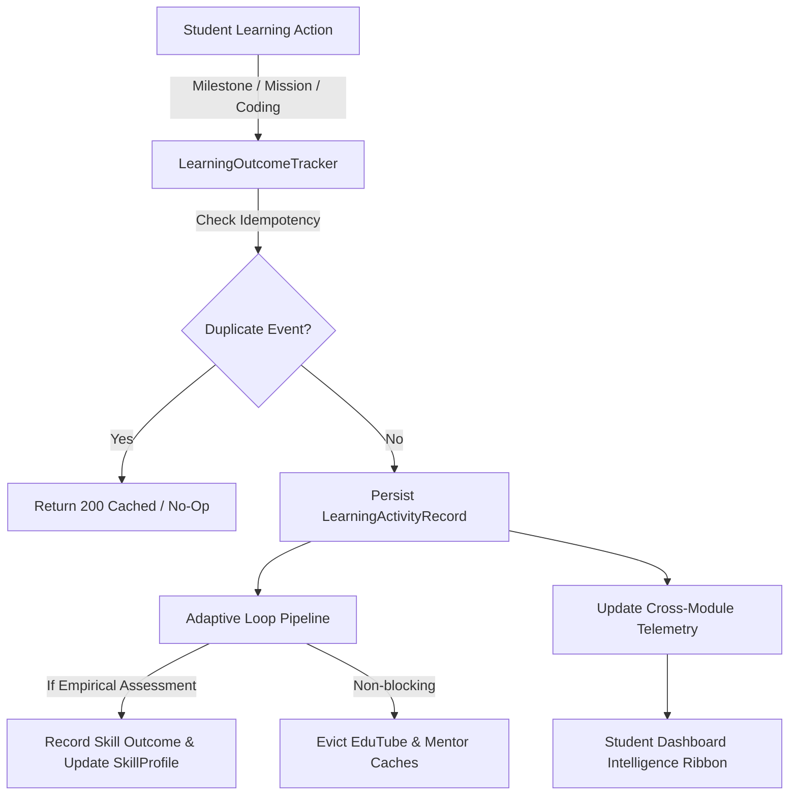

# Smart Skill Hub — Phase 38 Documentation
## Adaptive Learning Loop Feedback & Cross-Module Telemetry

**Document Version:** 1.0.0  
**Phase:** 38 — Adaptive Learning Loop Feedback & Cross-Module Telemetry  
**Branch:** `expand-test`  
**Starting Commit:** `89325eba9ffa533bca61e3afd93893676b70f6b4`  
**Protected Main Baseline:** `e9d89a5898f5c3c28062e9346b339b9b84f7ae90` (Strictly preserved, never modified or pushed)

---

## 1. Executive Summary

Phase 38 connects real student learning outcomes into the Adaptive Learning Loop (`adaptiveSkillLoopService`) and establishes cross-module telemetry across Smart Skill Hub. When students complete learning roadmap milestones, toggle daily missions, or complete coding challenges, these outcomes are idempotently recorded, fed into the adaptive evaluation pipeline, used to recalculate skill gaps and readiness estimates, and trigger non-blocking invalidation of downstream EduTube recommendations and AI mentor context caches.

The student-facing dashboard now presents verified cross-module telemetry (milestones, missions, coding challenges solved vs. attempted, persistent gaps, and recommendation freshness) alongside a direct "Sync Adaptive Loop" control that reconciles live state without page reloads.

---

## 2. Existing Architecture Inspected

The following existing architectures and integration points were analyzed prior to implementation:

1. **Adaptive Loop Evaluation Pipeline (`adaptiveSkillLoopService`):**
   - Implements `getAdaptiveLoopState(studentId)`: Evaluates current primary gaps, latest video lesson, practical exercise, and retrieval review.
   - Implements `recordAdaptiveAssessmentOutcome(studentId, { skill, score, taskId, testCasesPassed, testCasesTotal })`: Empirical updater that increases proficiency, records `LearnerSkillAssessmentHistory`, updates `SkillProfile.skills`, and closes satisfied gaps without artificial inflation.
   - Implements `evaluateSkillProfile(...)`: Comprehensive re-evaluation engine that compares current student evidence against target career role requirements.

2. **Phase 37 Activity Persistence (`LearningActivityRecord` & `learningOutcomeTrackerService`):**
   - Central collection `LearningActivityRecord` with unique compound indexing (`owner`, `activityType`, `activityIdentifier`, `idempotencyKey`).
   - Supports `roadmap_milestone`, `coding_submission`, `assessment_result`, `github_sync`, and newly added `daily_mission`.

3. **EduTube Recommendation Engine (`recommendationPipelineService`):**
   - Multi-stage pipeline: candidate retrieval, quality gate filtering, duplicate removal against `EduTubeWatchHistory` and completed milestones, and student cache.
   - Exposes `invalidateCache(studentId)` to evict stale recommendations upon learning progress.

4. **Smart Mentor Context (`smartMentorContextService`):**
   - Context aggregator that caches student skill profiles and activity for LLM guidance.
   - Exposes `invalidateContext(studentId)` for real-time prompt context synchronization.

5. **Dashboard Intelligence (`DashboardIntelligenceService`):**
   - Synthesizes empirical mastery (Docker sandbox verified) vs. readiness estimates, study time, learning streaks, daily missions, and career progress.

---

## 3. Learning Event Flow Architecture

### Event Lifecycle:
1. **Activity Triggered:** A student checks off a roadmap milestone, marks a daily mission done, or submits a coding challenge in the Docker sandbox.
2. **Idempotency & Persistence:** `LearningOutcomeTracker.recordOutcome()` checks the compound uniqueness constraint. If an identical event was already recorded, it safely returns without duplicate writes. When an item is marked "pending" (reopened), the record is safely deleted.
3. **Adaptive Evaluation:**
   - Empirical coding challenges update skill scores, pass rates, and assessment history via `adaptiveSkillLoopService.recordAdaptiveAssessmentOutcome`.
   - Conceptual milestones mark progress without artificially inflating empirical scores.
4. **Cache Invalidation:** Calling `recommendationPipelineService.invalidateCache(ownerId)` and `smartMentorContextService.invalidateContext(ownerId)` ensures next recommendation queries reflect latest gap state.
5. **Telemetry Aggregation:** `DashboardIntelligenceService` and `/api/v1/adaptive-loop/telemetry` dynamically compute milestones completed, mission completion, coding challenge stats, and persistent gaps.

---

## 4. API Extensions & Backward Compatibility

All API changes preserve strict backward compatibility:

| Endpoint | Method | Auth | Description |
|---|---|---|---|
| `/api/v1/adaptive-loop/evaluate` | `POST` | Required (`verifyFirebaseToken`) | Triggers on-demand evaluation of student's adaptive loop, recalculates readiness, invalidates recommendation cache, and returns refreshed state. |
| `/api/v1/adaptive-loop/state` | `GET` | Required (`verifyFirebaseToken`) | Returns current focal skill, gap priority, recommended lesson, practical exercise, and retrieval review. |
| `/api/v1/adaptive-loop/telemetry` | `GET` | Required (`verifyFirebaseToken`) | Returns privacy-conscious cross-module learning telemetry (milestones, missions, coding challenges, gaps, and freshness). |
| `/api/v1/skills/adaptive-loop/*` | `*` | Required (`verifyFirebaseToken`) | Preserved module alias routes pointing to the same controller methods. |
| `/api/v1/dashboard/intelligence` | `GET` | Required (`verifyFirebaseToken`) | Extended with a `telemetry` payload block containing the exact same verified cross-module metrics. |

### Student Ownership & Isolation Enforced:
- The controller extracts the authenticated identity strictly from `req.user.uid` (verified Firebase decoded token).
- If a caller supplies a mismatched `studentId` or `userId` in query parameters or request body, the endpoint rejects the call with `403 Forbidden` (`FORBIDDEN_STUDENT_ISOLATION`).
- Unauthenticated requests receive `401 Unauthorized`.

---

## 5. Idempotency & Failure Handling

1. **Idempotent Record Creation:**
   - Compound index on `LearningActivityRecord`: `{ owner: 1, activityType: 1, activityIdentifier: 1, idempotencyKey: 1 }`.
   - Toggling a daily mission multiple times uses key `${missionId}_${dateKey}`. Duplicate requests do not create duplicate records.
2. **Milestone Reopening (`status: 'pending'`):**
   - When a milestone is unchecked or set back to pending, `recordOutcome` deletes the existing record, avoiding orphaned records or false completion counts.
3. **Non-Blocking Resilience:**
   - External AI evaluation or YouTube quota limits do not block persistence of the student's core learning activity.
   - Cache invalidations and background evaluations execute in non-blocking try-catch blocks with defensive logging (`logger.warn`), preventing secondary failures from failing primary transactions.

---

## 6. Frontend State Consistency & UI Integration

1. **Adaptive Telemetry Ribbon:**
   - Mounted in `frontend/src/modules/dashboard/DashboardHome.tsx` directly below the intelligence cards.
   - Displays 4 live telemetry indicators:
     - **Milestones Completed:** Verified roadmap milestones completed out of total.
     - **Daily Missions:** Missions done today with visual status badge.
     - **Coding Challenges:** Solved challenges out of attempted with pass percentage.
     - **Persistent Gaps:** Actionable skill gaps remaining for target role.
2. **Sync Adaptive Loop Control:**
   - Added to the quick actions ribbon on the student dashboard.
   - Displays a rotating sync icon during evaluation.
   - Emits a real-time notification toast upon successful synchronization and triggers an immediate React Query cache refresh (`dashboard-intelligence` query key).

---

## 7. Verification & Test Execution Results

### 1. Focused Backend Test Suite
File: `backend/test/phase38.adaptive-telemetry.test.js`
- **Result:** 12 / 12 passed (100%)
- **Covered Scenarios:**
  - Roadmap milestone completion persistence
  - Daily mission completion acceptance as valid activityType
  - Repeated event idempotency (no duplicate writes)
  - Milestone reopening / unmarking safe deletion
  - Invalid `activityType` rejection (400)
  - Coding challenge score updates, gap closure, and assessment history logging
  - Repeated failures trigger weakness without score inflation
  - Conceptual milestone does not award empirical competency
  - Cross-module telemetry accurate aggregation
  - `POST /api/v1/adaptive-loop/evaluate` 401 unauthenticated rejection
  - `GET /api/v1/adaptive-loop/telemetry` 401 unauthenticated rejection
  - Student isolation enforcement (403 on mismatched student ID)

### 2. Focused Frontend Test Suite
File: `frontend/src/test/phase38.adaptive-frontend.test.tsx`
- **Result:** 3 / 3 passed (100%)
- **Covered Scenarios:**
  - Adaptive telemetry ribbon renders with live metrics
  - "Sync Adaptive Loop" button triggers `evaluateAdaptiveLoop` and updates UI
  - `SmartSkillApi.getAdaptiveTelemetry` HTTP client contract verification

### 3. Full Regression Test Suites
- **Backend Test Suite:** 63 / 63 test files passed, 810 / 810 tests passed (100%).
- **Frontend Test Suite:** 44 / 44 test files passed, 301 / 301 tests passed (100%).

### 4. Production Build Verification
- **Frontend:** `npm run build` executed Vite TypeScript build. Succeeded in 6.65s with 0 errors.
- **Backend:** Node.js syntax & ESM imports verified.

---

## 8. Operational Safeguards & Staging Compliance

- **Branch Protection:** All work performed exclusively on `expand-test`.
- **Protected Main Baseline:** `e9d89a5898f5c3c28062e9346b339b9b84f7ae90` untouched.
- **No Cloud Resources Provisioned:** No external infrastructure created; no deployment or publish commands executed.
- **Sandbox Safeguard Maintained:** `CODING_EXECUTION_ENABLED=false` staging safeguard remains active and verified.

---

## 9. Recommended Next Phase

**Phase 39: Automated Adaptive Spaced-Revision Engine & Interactive Video Quizzes**
- Connect video playback timestamps to automated retrieval questions.
- Implement spaced-repetition prompt generation for skills identified as persistent gaps.
- Expose student review schedules directly inside the EduTube watch interface.
