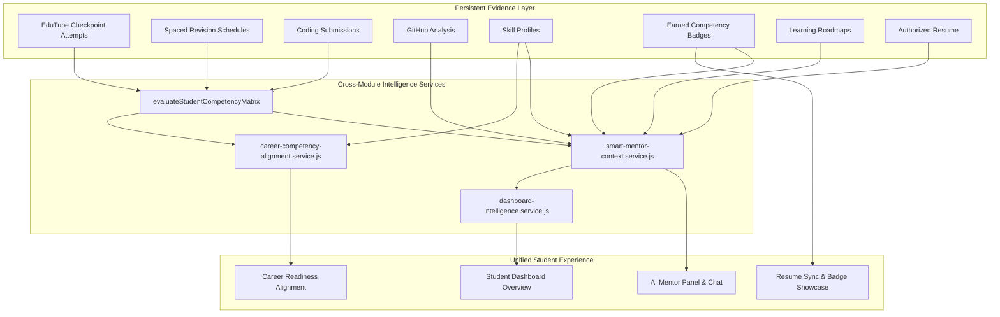

# Phase 41: Cross-Module Student Intelligence & Context-Aware AI Mentor

**Repository**: `/home/sampatakumar/Projects/projects/ssh_expand/SSH_integrated_Project`  
**Active Branch**: `expand-test`  
**Starting Commit**: `48ebacf93aa67c758f334d819507a3dbf64525b1`  
**Protected Main Baseline**: `e9d89a5898f5c3c28062e9346b339b9b84f7ae90` (strictly preserved, untouched)  
**Date**: October 2026  

---

## 1. Executive Summary & Objective

Phase 41 delivers the unifying intelligence layer for Smart Skill Hub (SSH), transforming separate educational capabilities into a coherent, evidence-grounded student journey. 

Rather than creating a disconnected recommendation engine or an ungrounded chatbot, Phase 41 wires together all previously established platform systems:
1. **Career Roles & Canonical Skill Taxonomy** (`CANONICAL_SKILL_TAXONOMY`, `CAREER_PATHS`)
2. **Canonical Skill Profiles** (`SkillProfile`)
3. **Verified GitHub Repository Evidence** (`GitHubAnalysisResult`)
4. **Coding Assessment Outcomes** (`CodingSubmission`)
5. **Learning Roadmaps & Milestones** (`Roadmap`)
6. **EduTube Interactive Quizzes & Checkpoints** (`EduTubeCheckpointAttempt`)
7. **Spaced-Revision Schedules & Retrieval Streaks** (`SpacedRevisionSchedule`)
8. **Phase 40 Capstone Competency Matrix & Verifiable Badges** (`evaluateStudentCompetencyMatrix`, `UserBadge`)
9. **Authorized Resume Builder** (`Resume`)

The entire experience adheres to strict evidentiary truth: **no hallucinated scores, no fabricated achievements, no ungrounded claims of job-readiness, and explicit differentiation between verified empirical evidence and inferred repository heuristics.**

---

## 2. Architecture & Data Flow

---

## 3. Evidence Tiers & Anti-Hallucination Framework

All learning signals aggregated into the unified student context are strictly partitioned into **Four Evidence Tiers**:

| Evidence Tier | Sources Included | Evidentiary Significance | Presentation Rule |
|---|---|---|---|
| **Tier 1: Verified Empirical** | Passed sandbox coding tests, validated EduTube quiz checkpoints (≥70%), active spaced revision retrieval streaks | Direct, objective demonstration of practical or theoretical skill. | Presented as demonstrated competence. Can satisfy competency matrix criteria. |
| **Tier 2: Inferred** | GitHub repository language statistics, commit history analysis, repo heuristic detections | Indirect signal of activity, tooling usage, or exposure. | Must never be presented as proof of mastery. Cannot award competency badges on its own. |
| **Tier 3: Self-Reported** | Student profile selections, unverified resume claims, self-declared interests | Subjective interest or self-assessment. | Clarified as unverified student claims. |
| **Tier 4: Missing / Unassessed** | Role requirements or roadmap milestones lacking any verified or inferred evidence | Clear learning opportunities or assessment gaps. | Explicitly highlighted as focal gaps for recommended next actions. |

### Anti-Inflation and Credential Integrity Safeguards
- **Accreditation Clarity**: All responses and UI components explicitly clarify that SSH Competency Badges certify achievement under **recorded SSH platform rubric criteria**, not external third-party accreditation.
- **Staging Isolation**: `CODING_EXECUTION_ENABLED=false` remains strictly enforced in staging. Staging mock passes are clearly distinguished from sandbox-verified passes.
- **Non-Destructive Resumption**: Historical evaluation records and test histories are never mutated or wiped during context synthesis.

---

## 4. Key Services & Implementations

### A. Unified Student Context Service (`smart-mentor-context.service.js`)
Aggregates a comprehensive snapshot of the learner's live profile without overloading token limits:
- Queries `evaluateStudentCompetencyMatrix(ownerId)` to obtain demonstrated competencies, in-progress items, unmet requirements, and cryptographic badge credentials.
- Queries `SpacedRevisionSchedule` to calculate `retentionHealth` (retention streak, cards due today, mastered items).
- Queries `EduTubeCheckpointAttempt` to extract `knowledgeCheckpoints` (quizzes passed, accuracy percentage).
- Synthesizes `evidenceTiers` to cleanly surface verified empirical proof vs inferred repository statistics.
- Generates `unifiedNextActions` ranked by immediate educational impact.
- Incorporates connection guards (`isDbConnected`) ensuring zero hanging promises or buffering in disconnected test suites.

### B. Career Competency Alignment Service (`career-competency-alignment.service.js`)
Connects the competency matrix and skill profile with career role requirements:
- Maps career goals against `CANONICAL_SKILL_TAXONOMY` and role definitions.
- Computes **grounded readiness percentages**:
  $$\text{Readiness} = \frac{\text{Demonstrated Core Skills}}{\text{Total Required Core Skills}} \times 100$$
- Performs **Multi-Role Intersection Analysis**:
  - `sharedSkills`: Skills common across multiple selected roles.
  - `uniqueSkills`: Role-specific differentiators.
  - `highImpactGaps`: Incomplete skills that immediately advance readiness across two or more target roles.
- Exposes `getPersonalizedProgressExplanation(ownerId)`: generates empirical progress narratives comparing baseline vs latest assessment deltas, sandbox coding passes, and retention streaks without unsupported percentages or rankings.

### C. Context-Aware Smart AI Mentor (`smart-mentor.service.js` & `smart-mentor-local.service.js`)
- **System Instructions**: Configured with strict rules on Evidence Tiers, Competency Matrix Grounding, and SSH Badge Integrity.
- **Context Ingestion**: LLM receives structured JSON containing role targets, evidence tiers, retention health, checkpoint scores, competency summary, and top next actions.
- **Local Fallback NLP**: Enhanced deterministic fallback pattern matcher recognizing intents:
  - `competency_matrix`: Explains demonstrated competencies, in-progress requirements, and missing evidence.
  - `retention_revision`: Outlines due flashcards, intervals, and memory retention streaks.
  - `unified_next_action`: Delivers the exact primary recommendation matching dashboard intelligence.
  - `resume_badge_guidance`: Guides verified badge placement and portfolio evidence on resumes.
  - `personalized_progress`: Summarizes empirical progress over time based on actual test records.

### D. Multi-Module Next Action Prioritization (`dashboard-intelligence.service.js`)
Eliminates conflicting advice across dashboard cards, adaptive loops, and mentor recommendations through a deterministic priority hierarchy:
1. **Priority 1: Urgent Retention Due Today** — If spaced revision items are due, preventing memory decay is prioritized.
2. **Priority 2: Incomplete Competency Requirement / Gap Challenge** — If an active focal gap has an unmet applied coding or quiz criterion, direct practice is recommended.
3. **Priority 3: Resume Badge Claim / In-Flight Milestone** — If all competency criteria are satisfied, claim/export badge to resume or continue active roadmap milestone.
4. **Priority 4: General Skill Evaluation / Adaptive Exploration** — Baseline profile assessment for unverified skills.

### E. Frontend Enhancements
- **Mentor Context Drawer (`MentorContextPanel.tsx`)**:
  - Displays Verified Competency Badges count with direct link to badges showcase.
  - Displays Memory Retention Health card with active retrieval streaks and items due today.
  - Visualizes Evidence Quality Grounding (Verified Empirical vs Inferred Signals).
  - Displays Primary Next Action with badge status and direct navigation action.
- **Dashboard Telemetry Ribbon (`DashboardHome.tsx`)**:
  - Added real-time "Badges Earned" counter linked to `/dashboard/skills`.
- **API Contracts & Types (`smartMentor.types.ts`, `smartMentor.api.ts`, `api.ts`)**:
  - Added type-safe definitions for `CompetencyMatrixSummary`, `RetentionHealth`, `KnowledgeCheckpoints`, and `EvidenceTiers`.
  - Added API endpoints: `getCareerAlignment`, `getProgressExplanation`, and `getUnifiedNextAction`.

---

## 5. API Endpoints Mounted

| Method | Endpoint | Description |
|---|---|---|
| `GET` | `/api/v1/mentor/career-alignment` | Returns career competency alignment, multi-role overlap, and high-impact skill gaps. |
| `GET` | `/api/v1/mentor/progress-explanation` | Returns evidence-grounded progress explanation narrative based on historical deltas. |
| `GET` | `/api/v1/mentor/unified-action` | Returns the single deterministic top recommended action across all modules. |
| `GET` | `/api/v1/mentor/context` | Returns full unified student context with evidence tiers, retention health, and competency matrix. |

---

## 6. Verification & Test Results

### Backend Test Suite
- **Phase 41 Dedicated Suite**: `backend/test/phase41.cross-module-mentor.test.js`
  - 15/15 tests passing.
  - Verifies unified context generation, evidence tier partitioning, retention health calculation, multi-role career alignment, high-impact gap detection, progress narratives, deterministic next action hierarchy, local fallback intents, and controller endpoints.
- **Full Backend Suite**:
  - 66 test files passed.
  - 861 tests passed, 0 failures.

### Frontend Test Suite
- **Phase 41 Dedicated Suite**: `frontend/src/test/phase41.cross-module-frontend.test.tsx`
  - 5/5 tests passing.
  - Verifies Context Panel badge display, retention health metrics, evidence grounding tags, unified next action display, and API service methods.
- **Full Frontend Suite**:
  - 47 test files passed.
  - 319 tests passed, 0 failures.

### Production Build Verification
- Executed `npm run build` in `frontend/`:
  - Output: `dist/` generated cleanly in 7.15s.
  - Zero TypeScript compilation errors, zero Vite bundle errors.

---

## 7. Conclusion

Phase 41 successfully connects Smart Skill Hub into a single, cohesive, and evidence-grounded ecosystem. Students receive contextual, explainable, and consistent guidance across the AI Mentor, career readiness tools, the dashboard, and the resume builder—grounded strictly in their actual demonstrated achievements.
