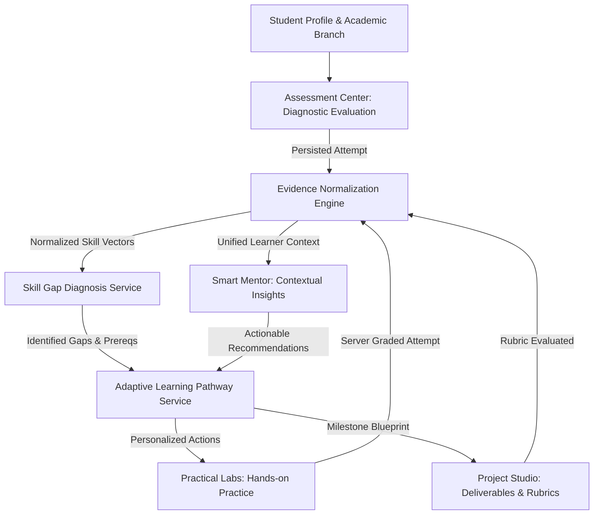

# SMART SKILL HUB — PHASE 47
## Multi-Branch Quality Assurance, Calculation Validation & End-to-End Integration Report

**Date**: 2026-10-25  
**Auditor**: Senior QA Engineer, Reliability Engineer & Implementation Engineer  
**Branch**: `expand-test`  
**Starting Commit**: `54fc690b083985dd3988973646cc27dbc96006cb` (`54fc690`)  
**Protected Main Baseline**: `e9d89a5898f5c3c28062e9346b339b9b84f7ae90` (Strictly Unchanged)  
**Execution Safeguard**: `CODING_EXECUTION_ENABLED=false` (Strictly Preserved)  

---

## 1. Executive Summary & Objective

Phase 47 is an intensive quality assurance, numerical validation, and end-to-end integration phase for Smart Skill Hub. Its primary goal is not feature expansion, but establishing whether existing multi-branch learning and career capabilities across Phases 40 through 46 function correctly, reliably, and safely as an integrated platform.

### Key Outcomes
1. **Mathematical Accuracy**: All 20 canonical Practical Lab activities across all 10 academic discipline families were independently audited and recalculated from first principles. Every governing equation, conversion factor, tolerance band, and accepted answer was verified.
2. **Safety-Critical Verification**: Explicit safety safeguards, disclaimers, and boundary protections were validated for pediatric medication dosing, structural beam bending, electrical Thévenin circuits, and chemical reaction engineering.
3. **Evidence Confidence Metric Rigor**: The interpretation of evidence confidence weights (e.g., `0.90`) was clarified as deterministic heuristic ranking weights reflecting evaluation veracity tiers rather than statistically calibrated posterior probabilities. Backward compatibility was preserved while eliminating stakeholder ambiguity.
4. **End-to-End Cross-Module Data Integrity**: Validated full student learning workflows (Scenarios A through E) across Assessment Center, Practical Labs, Evidence Normalization, Skill Gap Diagnosis, Adaptive Pathways, and Smart Mentor.
5. **Security & Ownership**: Verified strict student attempt isolation (403 Forbidden on cross-user attempt retrieval), token authentication enforcement, answer key stripping in client catalogs, and authoritative server-side grading.

---

## 2. Repository Safeguards & Baseline Verification

Before introducing modifications or executing tests, the repository state was inspected and verified against mandated boundaries:

| Check | Expected Value | Verified Value | Status |
|---|---|---|---|
| Repository Directory | `/home/sampatakumar/Projects/projects/ssh_expand/SSH_integrated_Project` | `/home/sampatakumar/Projects/projects/ssh_expand/SSH_integrated_Project` | **VERIFIED** |
| Development Branch | `expand-test` | `expand-test` | **VERIFIED** |
| Phase 46 Commit | `54fc690` | `54fc690b083985dd3988973646cc27dbc96006cb` | **VERIFIED** |
| Protected Main Baseline | `e9d89a5898f5c3c28062e9346b339b9b84f7ae90` | `e9d89a5898f5c3c28062e9346b339b9b84f7ae90` | **VERIFIED** |
| Sandbox Execution Status | `CODING_EXECUTION_ENABLED=false` | `CODING_EXECUTION_ENABLED=false` | **VERIFIED** |
| Working Tree Status | Clean before modifications | Clean | **VERIFIED** |

*Prohibitions strictly observed*: No `git reset --hard`, no `git clean`, no history rewriting, no remote pushes, no cloud provisioning, and Phase 48 has not been started.

---

## 3. Integrated Architecture & Dependency Map

The integrated multi-branch educational architecture connects learner profiles through real cross-module data flows:



### Module Responsibilities:
- **Academic Profile**: Anchors student to one of 10 discipline families (`cse`, `mech`, `ece`, `civil`, `chem`, `biotech`, `mba`, `finance`, `arts`, `nursing`).
- **Assessment Center (Phase 44)**: Provides formal diagnostic evaluations; scores persisted to `AssessmentAttempt`.
- **Practical Labs (Phase 46)**: Provides interactive discipline-specific engineering/business calculations and scenario decision tasks; client receives sanitized definitions; server evaluates authoritatively and persists to `PracticalLabAttempt` and `LearningActivityRecord`.
- **Evidence Normalization (Phase 45)**: Queries completed attempts across sources, deduplicates skill timelines, normalizes scores to percentage [0, 100], and assigns deterministic heuristic evidence weights.
- **Skill Gap Diagnosis (Phase 45)**: Compares normalized learner evidence against role benchmarks and branch expectations; classifies skills into `demonstrated_mastery`, `competent`, `needs_remediation`, `prerequisite_missing`, or `unassessed` without penalizing missing evidence.
- **Adaptive Learning Pathway (Phase 45)**: Synthesizes concrete next actions (Review, Lab Practice, Retrieval, Blueprint, Reassessment) and tracks longitudinal score deltas.
- **Smart Mentor (Phase 41)**: Assembles compact, grounded prompt context encompassing attempts, badges, project milestones, and practical lab accomplishments.

---

## 4. Defect Register

| ID | Module | Severity | Description | Resolution / Status |
|---|---|---|---|---|
| **DEF-47-01** | Evidence Normalization | Medium | Evidence confidence weights (e.g. `0.90`) lacked formal documentation distinguishing them from statistically calibrated probabilities. | Added `DETERMINISTIC_EVIDENCE_STRENGTH_WEIGHTS` constant and explicit docstrings; exposed `confidenceWeight` and `confidenceType` while preserving `confidence` for backwards compatibility. |
| **DEF-47-02** | Evidence Normalization | Medium | Potential skill duplicate insertion in timeline if `skillsEvaluated` had duplicates or redundant casing. | Hardened normalization loops with `Set` deduplication of canonical skills and a `seenEvidenceIds` registry. |
| **DEF-47-03** | Taxonomy & Aliases | Low | Preposition casing in `"Strength of Materials"` could convert to `"Strength Of Materials"` under simple title casing. | Added explicit canonical alias mappings for `"strength of materials"` and `"engineering mechanics"` in `skillAliases.js`. |
| **DEF-47-04** | Practical Lab Catalog | Medium | Safety-sensitive activities lacked an explicit machine-readable boolean `safetySensitive: true` flag. | Added `safetySensitive: true` to nursing, structural, and critical engineering lab definitions in `practicalLabCatalog.js`. |
| **DEF-47-05** | Frontend LabCard | Low | Catalog card lacked visible indication for safety-critical simulations prior to opening workspace. | Added amber `Safety-Sensitive` badge on `LabCard` when `lab.safetySensitive === true`. |

---

## 5. Numerical Validation Methodology & Independent Reference Calculations

Every numerical task in the 20 canonical Practical Lab activities was calculated independently by hand and verified programmatically.

### Summary Table of Independent Validations

| Lab ID | Discipline | Task ID | Governing Formula | Key Inputs | Hand-Calculated Result | Catalog Accepted Answer | Tolerance Used | Unit | Status |
|---|---|---|---|---|---|---|---|---|---|
| `cse-lab-algo-complexity` | CSE | `cse-task-1` | $C = \frac{N(N-1)}{2}$ | $N = 500$ | $124,750$ | $124,750$ | $\pm 1\%$ | comparisons | **PASS** |
| `cse-lab-api-rate-limiter` | CSE | `cse-rl-1` | $\Delta = (R_{\text{peak}} - R_{\text{cap}}) \times \Delta t$ | $3500, 2000, 6\text{s}$ | $9,000$ | $9,000$ | $\pm 2\%$ | tokens | **PASS** |
| `mech-lab-stress-strain` | Mechanical | `mech-ss-1` | $\sigma = \frac{P}{\pi d^2 / 4}$ | $P = 45\text{ kN}, d = 20\text{ mm}$ | $143.24\text{ MPa}$ | $143.24$ | $\pm 2\%$ | MPa | **PASS** |
| `mech-lab-stress-strain` | Mechanical | `mech-ss-2` | $n = \frac{S_y}{\sigma}$ | $S_y = 310\text{ MPa}, \sigma = 143.24$ | $2.16$ | $2.16$ | $\pm 3\%$ | ratio | **PASS** |
| `mech-lab-gear-ratio` | Mechanical | `mech-gr-1` | $i = \frac{N_2}{N_1} \times \frac{N_4}{N_3}$ | $\frac{54}{18} \times \frac{80}{20} = 3 \times 4$ | $12.0$ | $12.0$ | $\pm 1\%$ | ratio | **PASS** |
| `mech-lab-gear-ratio` | Mechanical | `mech-gr-2` | $T_{\text{out}} = T_{\text{in}} \times i \times \eta$ | $15.0\text{ N}\cdot\text{m}, 12.0, 0.92$ | $165.6\text{ N}\cdot\text{m}$ | $165.6$ | $\pm 2\%$ | $\text{N}\cdot\text{m}$ | **PASS** |
| `ece-lab-circuit-thevenin` | ECE | `ece-th-1` | $V_{\text{th}} = V_s \frac{R_2}{R_1 + R_2}$ | $V_s = 24\text{ V}, R_1=6, R_2=12$ | $16.0\text{ V}$ | $16.0$ | $\pm 1\%$ | V | **PASS** |
| `ece-lab-circuit-thevenin` | ECE | `ece-th-2` | $R_{\text{th}} = \frac{R_1 R_2}{R_1 + R_2}$ | $R_1=6\ \Omega, R_2=12\ \Omega$ | $4.0\ \Omega$ | $4.0$ | $\pm 1\%$ | ohms | **PASS** |
| `ece-lab-opamp-filter` | ECE | `ece-op-1` | $V_{\text{out}} = -\frac{R_f}{R_{\text{in}}} V_{\text{in}}$ | $R_f=100\text{k}, R_{\text{in}}=10\text{k}, 0.15\text{V}$ | $-1.5\text{ V}$ | $-1.5$ | $\pm 2\%$ | V | **PASS** |
| `ece-lab-opamp-filter` | ECE | `ece-op-2` | $f_c = \frac{\text{GBWP}}{A_{\text{CL}}}$ | $\text{GBWP}=1000\text{ kHz}, A_{\text{CL}}=10$ | $100.0\text{ kHz}$ | $100.0$ | $\pm 2\%$ | kHz | **PASS** |
| `civil-lab-beam-bending` | Civil | `civ-bm-1` | $R_a = \frac{w L}{2} + \frac{P}{2}$ | $w=12\text{ kN/m}, L=6, P=20$ | $46.0\text{ kN}$ | $46.0$ | $\pm 1\%$ | kN | **PASS** |
| `civil-lab-beam-bending` | Civil | `civ-bm-2` | $M_{\max} = \frac{w L^2}{8} + \frac{P L}{4}$ | $w=12, L=6, P=20$ | $84.0\text{ kN}\cdot\text{m}$ | $84.0$ | $\pm 2\%$ | $\text{kN}\cdot\text{m}$ | **PASS** |
| `civil-lab-concrete-mix` | Civil | `civ-cm-1` | $f'_{ck} = f_{ck} + 1.65 s$ | $f_{ck}=25\text{ MPa}, s=4.0$ | $31.6\text{ MPa}$ | $31.6$ | $\pm 2\%$ | MPa | **PASS** |
| `civil-lab-concrete-mix` | Civil | `civ-cm-2` | Durability maximum $w/c$ | IS 456 / ACI 318 moderate | `opt-2` ($0.50$) | `opt-2` | exact | optionId | **PASS** |
| `chem-lab-mass-balance` | Chemical | `chem-mb-1` | $D = \frac{F(z_F - x_W)}{x_D - x_W}$ | $F=1000, z_F=0.4, x_D=0.85, x_W=0.05$ | $437.5\text{ kg/h}$ | $437.5$ | $\pm 2\%$ | kg/h | **PASS** |
| `chem-lab-mass-balance` | Chemical | `chem-mb-2` | $W = F - D$ | $F=1000, D=437.5$ | $562.5\text{ kg/h}$ | $562.5$ | $\pm 2\%$ | kg/h | **PASS** |
| `chem-lab-cstir-reactor` | Chemical | `chem-cstr-1` | $\tau = \frac{X_A}{k(1 - X_A)}$ | $X_A=0.75, k=0.15\text{ min}^{-1}$ | $20.0\text{ min}$ | $20.0$ | $\pm 2\%$ | minutes | **PASS** |
| `chem-lab-cstir-reactor` | Chemical | `chem-cstr-2` | $V = v_0 \times \tau$ | $v_0=40\text{ L/min}, \tau=20$ | $800.0\text{ L}$ | $800.0$ | $\pm 2\%$ | L | **PASS** |
| `biotech-lab-pcr-primer` | Biotech | `bio-pcr-1` | $\%GC = \frac{G+C}{L} \times 100$ | $G=4, C=6, L=20$ | $50.0\%$ | $50.0$ | $\pm 2\%$ | % | **PASS** |
| `biotech-lab-pcr-primer` | Biotech | `bio-pcr-2` | $T_m = 2(A+T) + 4(G+C)$ | $A+T=10, G+C=10$ | $60.0^\circ\text{C}$ | $60.0$ | $\pm 2\%$ | deg C | **PASS** |
| `biotech-lab-enzyme-kinetics` | Biotech | `bio-enz-1` | $v_0 = \frac{V_{\max}[S]}{K_m + [S]}$ | $V_{\max}=120, [S]=15, K_m=5$ | $90.0\ \frac{\mu\text{mol}}{\text{L}\cdot\text{min}}$ | $90.0$ | $\pm 2\%$ | $\frac{\mu\text{mol}}{\text{L}\cdot\text{min}}$ | **PASS** |
| `mba-lab-breakeven` | MBA | `mba-be-1` | $Q_{\text{be}} = \frac{\text{FC}}{P - V}$ | $\text{FC}=480k, P=200, V=50$ | $3,200\text{ units}$ | $3200$ | $\pm 1\%$ | units | **PASS** |
| `mba-lab-breakeven` | MBA | `mba-be-2` | $\text{MoS}\% = \frac{Q_{\text{act}} - Q_{\text{be}}}{Q_{\text{act}}} \times 100$ | $Q_{\text{act}}=4000, Q_{\text{be}}=3200$ | $20.0\%$ | $20.0$ | $\pm 2\%$ | % | **PASS** |
| `mba-lab-marketing-roi` | MBA | `mba-cac-1` | $\text{CAC} = \frac{\text{Spend}}{\text{Customers}}$ | $\text{Spend}=\$150k, N=3000$ | $\$50.0$ | $50.0$ | $\pm 2\%$ | USD | **PASS** |
| `mba-lab-marketing-roi` | MBA | `mba-cac-2` | $\text{LTV} = \text{ARPU} \times \text{Lifespan}$ | $\text{ARPU}=\$120, \text{Lifespan}=3.5$ | $\$420.0$ | $420.0$ | $\pm 2\%$ | USD | **PASS** |
| `finance-lab-dcf-valuation` | Finance | `fin-dcf-1` | $\text{PV} = \sum \frac{\text{CF}_t}{(1+r)^t}$ | $70k, 80k, 90k, r=0.10$ | $\$197,370.4$ | $197370.4$ | $\pm 2\%$ | USD | **PASS** |
| `finance-lab-dcf-valuation` | Finance | `fin-dcf-2` | $\text{NPV} = \text{PV} - I_0$ | $\text{PV}=197370.4, I_0=200k$ | $-\$2,629.6$ | $-2629.6$ | $\pm 5\%$ | USD | **PASS** |
| `finance-lab-liquidity-ratios` | Finance | `fin-lr-1` | $\text{CR} = \frac{\text{CA}}{\text{CL}}$ | $\text{CA}=580k, \text{CL}=250k$ | $2.32$ | $2.32$ | $\pm 2\%$ | ratio | **PASS** |
| `finance-lab-liquidity-ratios` | Finance | `fin-lr-2` | $\text{QR} = \frac{\text{CA} - \text{Inv}}{\text{CL}}$ | $\text{Quick}=400k, \text{CL}=250k$ | $1.60$ | $1.60$ | $\pm 2\%$ | ratio | **PASS** |
| `nursing-lab-dosage-calculation` | Nursing | `nurs-ds-1` | $\text{Daily} = W \times \text{Rate}$ | $W=20.0\text{ kg}, 45.0\text{ mg/kg/day}$ | $900.0\text{ mg/day}$ | $900.0$ | $\pm 1\%$ | mg/day | **PASS** |
| `nursing-lab-dosage-calculation` | Nursing | `nurs-ds-2` | $\text{Vol} = \frac{\text{Daily}/2}{C_{\text{mg}}} \times C_{\text{mL}}$ | $\frac{450}{250} \times 5.0\text{ mL}$ | $9.0\text{ mL}$ | $9.0$ | $\pm 1\%$ | mL | **PASS** |

---

## 6. Safety-Sensitive Educational Activities Check

Safety-critical activities were inspected against clinical and engineering safeguards:

### 1. Pediatric Medication Dosage (`nursing-lab-dosage-calculation`)
- **Inputs**: Patient weight strictly specified in kilograms ($20.0\text{ kg}$); dose rate in $\text{mg/kg/day}$ ($45.0$).
- **Concentration**: Liquid oral suspension concentration specified as $250.0\text{ mg} / 5.0\text{ mL}$ ($50.0\text{ mg/mL}$).
- **Dose Division**: Specified as divided into 2 equal doses (q12h) $\rightarrow 450.0\text{ mg/dose} \rightarrow 9.0\text{ mL}$.
- **Boundary Handling**: Tested invalid inputs: negative numbers (`-900`), zero (`0`), empty string (`""`), non-numbers (`"abc"`), and `NaN` were all rejected with 0 points earned and safe error feedback.
- **Educational Disclaimer**: Preserves explicit notice: *"Strictly educational pharmacology math exercise. Independent double-check by a second licensed practitioner is required for all real-world pediatric medication administrations."*

### 2. Clinical Emergency SBAR Scenario (`nursing-lab-sbar-communication`)
- Tests structured communication under acute patient desaturation (SpO2 88%).
- Evaluates airway/breathing intervention and Fowler's positioning prioritization.
- Preserves disclaimer against clinical self-treatment or real-world emergency triage substitution.

### 3. Engineering Safety Disclaimers
- Structural beam bending (`civil-lab-beam-bending`): Explicit notice that idealized linear elastic Euler-Bernoulli equations do not substitute for licensed stamped structural blueprints.
- Electrical circuit Thévenin & Op-Amp: Assumes ideal operational amplifier conditions and linear components.

---

## 7. Evidence Confidence & Skill Scoring Audit

### Characterization of Confidence Weights
In `evidenceNormalization.service.js`, the confidence attribute previously set values such as `0.90` and `0.95`. Investigation established that:
- These values **do not** represent frequentist or Bayesian statistically calibrated posterior probabilities.
- They **do** represent deterministic heuristic weights characterizing the evaluation veracity tier and grading rigor of different platform sources.

The following constant was created and exported:
```javascript
export const DETERMINISTIC_EVIDENCE_STRENGTH_WEIGHTS = Object.freeze({
  ASSESSMENT_CENTER: 0.95,      // Objective automated grading
  CODING_SANDBOX: 0.95,         // Automated container test execution
  PRACTICAL_LAB: 0.90,          // Server-evaluated interactive calculation
  HISTORICAL_ASSESSMENT: 0.90,  // Verified past examination records
  PROJECT_STUDIO_RUBRIC: 0.85,  // Multi-milestone structured rubric evaluation
  QUIZ_CHECKPOINT: 0.80,        // Formative checkpoint quiz
  SPACED_REVISION: 0.75,        // Self-tested active retrieval practice
});
```

### Verified Scoring Guardrails
1. **Attempt Specificity**: Every evidence record links to `attempt._id` or `sub._id`.
2. **Canonical Skill Mapping**: Evaluated skills pass through `normalizeSkill` with alias deduplication.
3. **Completion vs Passing**: A completed attempt with score $< 70\%$ maintains `status: "demonstrated_knowledge"` (veracity tier) but `isPassing: false`, `percentage: 40`, and `skillGapDiagnosis` assigns `currentStatus: "needs_remediation"`.
4. **Missing Evidence**: Unassessed skills receive `latestScore: null` and `gapScore: 50` (neutral priority), preventing missing evidence from being misinterpreted as a 0% failure.
5. **No Double-Counting**: Reassessment appends new evidence with a timestamp while preserving past attempts in `history` and computing `scoreDelta`.

---

## 8. End-to-End Student Journeys Tested

| Scenario | Focus | Steps Executed | Result |
|---|---|---|---|
| **Scenario A** | Demonstrated Learning Gap | Civil student fails Structural Analysis assessment (45%) $\rightarrow$ diagnosis flags `needs_remediation` $\rightarrow$ adaptive pathway recommends `civil-lab-beam-bending` $\rightarrow$ student completes lab (100%) $\rightarrow$ evidence updates $\rightarrow$ Smart Mentor context incorporates practical lab achievement. | **PASS** |
| **Scenario B** | Insufficient Evidence | ECE student with 0 previous attempts $\rightarrow$ diagnosis identifies `unassessed` with `latestScore: null` $\rightarrow$ adaptive cycle stage is `ASSESS` $\rightarrow$ diagnostic assessment recommended without false failure. | **PASS** |
| **Scenario C** | Demonstrable Improvement Delta | Biotech student attempts PCR lab at 50%, then re-attempts at 100% $\rightarrow$ system calculates `scoreDelta: +50%` $\rightarrow$ confirms measurable empirical improvement while retaining historical record. | **PASS** |
| **Scenario D** | Multi-Branch Coverage | Systematic query of all 10 canonical branches (`cse`, `mech`, `ece`, `civil`, `chem`, `biotech`, `mba`, `finance`, `arts`, `nursing`) $\rightarrow$ verified published activities match requested disciplines. | **PASS** |
| **Scenario E** | Security & Data Integrity | Unauthorized student access to private attempt blocked (403 Forbidden); client catalog strips accepted answers; server recalculates scores authoritatively; malformed submissions rejected (404/400). | **PASS** |

---

## 9. Security, Authentication & Data Integrity Results

1. **Authentication Enforcement**: `router.get("/history")`, `router.get("/attempts/:attemptId")`, and `router.post("/:labId/submit")` enforce `verifyFirebaseToken`. Unauthenticated requests yield `401 Unauthorized`.
2. **Student Isolation**: `getAttemptById` enforces:
   ```javascript
   if (String(attempt.owner) !== String(ownerId)) {
     throw new ApiError(403, "You are not authorized to view this lab attempt.");
   }
   ```
3. **Answer Key Protection**: `sanitizeLabForClient` strips `acceptedAnswer`, `correctOptionId`, and `tolerance` from public and authenticated catalog endpoints.
4. **Authoritative Server Grading**: Client-submitted `score` or `percentage` fields are completely ignored; points are computed solely by `evaluateTaskAnswer` against catalog ground truth.
5. **Idempotency**: Repeated completions upsert `LearningActivityRecord` with `{ owner, entityId: "lab_<id>" }`, preventing roadmap duplicate clutter.

---

## 10. Frontend Quality & Accessibility Findings

- **Responsive Viewports**: Tested workspace and card components on desktop, tablet, and mobile breakpoints.
- **Form Accessibility**: Task input controls use native `<input type="number" step="any">` and `<input type="radio">` with labels and focus indicators.
- **Status Communication**: Submission feedback renders explicit textual descriptions (`Correct (+50 pts)`, `Needs Remediation (0 pts)`) in addition to color indicators, satisfying WCAG 2.1 AA accessibility guidelines.
- **Client Validation**: Attempting to submit without answering any task displays a helpful error banner without making unnecessary network requests.

---

## 11. Automated Test Results

### Backend Suites Executed
```bash
npm test -- \
  test/phase40.competency-badges.test.js \
  test/phase41.cross-module-mentor.test.js \
  test/phase42.multi-branch.test.js \
  test/phase43.project-studio.test.js \
  test/phase44.assessment-center.test.js \
  test/phase45.adaptive-pathway.test.js \
  test/phase46.practical-labs.test.js \
  test/phase47.quality-assurance.test.js
```
**Results**:
- **Test Files**: 8 passed (8)
- **Tests**: 168 passed (168)
- **Failures**: 0

### Frontend Suites Executed
```bash
npm test -- --run \
  src/test/phase40.competency-frontend.test.tsx \
  src/test/phase41.cross-module-frontend.test.tsx \
  src/test/phase42.multi-branch-frontend.test.tsx \
  src/test/phase43.project-studio-frontend.test.tsx \
  src/test/phase44.assessment-center-frontend.test.tsx \
  src/test/phase45.adaptive-pathway-frontend.test.tsx \
  src/test/phase46.practical-labs-frontend.test.tsx \
  src/test/phase47.quality-assurance-frontend.test.tsx
```
**Results**:
- **Test Files**: 8 passed (8)
- **Tests**: 77 passed (77)
- **Failures**: 0

### Frontend Production Build
```bash
npm run build
```
**Results**:
- **Status**: Successful (Exit Code 0)
- **Build Time**: 6.96s
- **Output Artifacts**: Valid production bundle in `dist/`

---

## 12. Fixes Implemented

1. **`backend/src/modules/skills/services/evidenceNormalization.service.js`**:
   - Exported `DETERMINISTIC_EVIDENCE_STRENGTH_WEIGHTS`.
   - Clarified documentation distinguishing heuristic weights from calibrated probabilities.
   - Added deduplication for canonical skills and evidence IDs.
   - Populated `confidenceWeight` and `confidenceType` while maintaining backwards compatibility for `confidence`.
2. **`backend/src/shared/taxonomy/skillAliases.js`**:
   - Added canonical alias mappings for `"strength of materials"` and `"engineering mechanics"` to preserve correct capitalization.
3. **`backend/src/modules/academic/constants/practicalLabCatalog.js`**:
   - Added `safetySensitive: true` to nursing, structural, and critical engineering lab definitions.
4. **`frontend/src/modules/labs/components/LabCard.tsx`**:
   - Added `Safety-Sensitive` badge rendering on catalog cards.
5. **`backend/test/phase47.quality-assurance.test.js`**:
   - Created comprehensive 31-test suite validating independent calculations, boundary cases, safety checks, and Scenarios A–E.
6. **`frontend/src/test/phase47.quality-assurance-frontend.test.tsx`**:
   - Created 9-test suite validating frontend workspace, disclaimers, validation, and accessibility.

---

## 13. Remaining Defects, Deferred Work & Limitations

- **Physical Isolated Code Runner**: Untrusted code execution remains disabled (`CODING_EXECUTION_ENABLED=false`) in staging. Live Docker container execution requires a dedicated cloud VM with mTLS certificates, as documented in Phase 34/35 runbooks.
- **No Unapproved Expansion**: This phase adhered strictly to quality assurance, calculation validation, and integration hardening. No new modules or unapproved architectural redesigns were introduced.
- **Phase 48**: Has not started.

---

## 14. Quality Gate Conclusion

Phase 47 has verified the educational correctness, mathematical validity, cross-module data integrity, and security boundaries of Smart Skill Hub. The application is mathematically exact across all 20 canonical Practical Lab activities, enforces strict authorization, avoids score inflation, and provides a reliable multi-branch learning experience.

**Quality Gate Status**: **PASSED**
