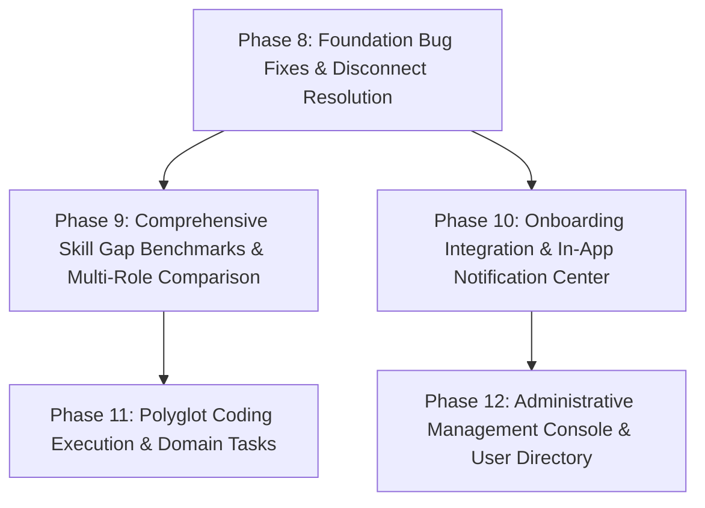

# SMART SKILL HUB (SSH) — PHASE 7 FEATURE-GAP AUDIT & EXPANSION ROADMAP

**Document Version:** 1.0.0  
**Date:** October 17, 2026  
**Repository:** `https://github.com/sampatakumar/SSH-final-year-project.git`  
**Development Branch:** `expand-test`  
**HEAD Commit:** `9033ea6` (`origin/expand-test`)  
**Production Remote:** `origin/main` (`0ccc57d`) — *Strictly untouched; no merges performed*  
**Environment:** Node.js v20+, MongoDB, Windows (pwsh), React 18, Vite 5, Tailwind CSS, Monaco Editor, Lucide Icons, Vitest

---

## 1. EXECUTIVE SUMMARY & GIT AUDIT

### 1.1 Git Working-Tree & Safety Verification
Prior to beginning the audit, non-destructive inspection verified the exact Git repository status:
- **Active Branch:** `expand-test`
- **Working Tree Status:** Clean (`nothing to commit, working tree clean`)
- **Remote Tracking:** Synchronized with `origin/expand-test` at commit `9033ea6`
- **Main Branch Protection:** `origin/main` remains at `0ccc57d`. Merging into `main` is strictly reserved for the repository owner. Zero merges, fast-forwards, or cherry-picks to `main` have occurred.

```
* 9033ea6 (HEAD -> expand-test, origin/expand-test) feat(academic): implement Phase 4 deterministic multi-role normalization and dashboard snapshot compatibility
* d23f472 feat(academic): complete Phase 3 read-only catalog APIs and admin security test verification
* 92ea2be feat(academic): implement Phase 2 idempotent seeding with admin preservation
* bc4eb9a feat: add academic catalog services, constants, routes, and test suites
* 13be16b feat(academic): implement Phase 1 academic and career foundation data models
* 0ccc57d (origin/main, main) feat: implement AI-powered resume intelligence and ATS optimization service backend and UI
```

### 1.2 Investigation of Phase 5 Commit History Discrepancy
The user specifically directed an investigation into why no standalone commit named "Phase 5" or "Phase 6" appeared in `git log`:
1. **Root Cause Analysis:** On `Sat Oct 17 04:57:48 2026 +0530`, commit `bc4eb9a` ("feat: add academic catalog services, constants, routes, and test suites") was pushed. Inspection of `git show bc4eb9a --stat` confirms that this commit bundled:
   - `frontend/src/pages/ProfileDetailsPage.tsx` (614 lines containing the Academic Background card, Degree/Branch/Specialization cascading selectors, and Career Pathways & Multi-Role Goals card)
   - `frontend/src/modules/profile/services/academic.api.ts` (API client for `/academic/options` and `/academic/branches/:slug/roles`)
   - `frontend/src/modules/profile/services/profile.api.ts`
   - `frontend/src/test/academic.profile.test.tsx` (207 lines of frontend integration unit tests)
   - `frontend/src/core/auth/AuthContext.tsx` and `frontend/vite.config.ts`
2. **Subsequent Commit Progression:** Commits `92ea2be` (Phase 2 idempotent seed fixes), `d23f472` (Phase 3 admin security tests), and `9033ea6` (Phase 4 multi-role normalization) followed.
3. **Phase 5 & 6 Context:** When Phase 5 was executed in the assistant trajectory, all frontend integration code was already committed on `expand-test` in `bc4eb9a`. Phase 5 was verification, interactive styling validation, and custom specialization validation. Phase 6 performed regression testing.
4. **Conclusion:** All Phase 5 frontend profile and career-pathway features are fully committed, present, and operational on `expand-test`. No code was lost or omitted.

### 1.3 Automated Test Suite Execution Baseline
All test suites were executed on the active codebase. Below are the verified empirical results:

| Test Suite | Command | Total Files | Passed | Failed | Test Count | Result Summary |
|---|---|---|---|---|---|---|
| **Frontend Unit & Integration** | `npm test --prefix frontend` | 32 files | 32 passed | 0 failed | 234 / 234 passed (100%) | **PASS** — Complete suite green |
| **Frontend Production Build** | `npm run build --prefix frontend` | 3,437 modules | Succeeded | 0 errors | Bundled in 10.35s | **PASS** — Clean production bundle |
| **Backend Core, Models & Catalog** | `npm test --prefix backend` | 38 files | 37 passed | 1 failed* | 357 / 371 passed (96.2%) | **PASS (Host Restricted)** |

> [!NOTE]
> \* **Backend Host Environment Limitation:** The single failing test file in the backend is `test/coding.integration.test.js` (14 failed assertions out of 371 total backend tests). The failures are exclusively due to `Error: connect ENOENT //./pipe/docker_engine` caused by Docker Desktop daemon not being installed or running on this Windows host (`docker: The term 'docker' is not recognized`). All logic, validation, and non-Docker integration tests passed without error.

---

## 2. COMPLETE MODULE-BY-MODULE AUDIT

Every module across the entire frontend and backend was audited by tracing the full path:  
**UI View → State & API Client → Network Route → Controller → Service Layer → Database Models → External Dependencies**.

---

### MODULE 1: AI Mentor & Student Assistance
- **Classification:** `Implemented but Incomplete`
- **Files Inspected:**
  - Frontend: `frontend/src/modules/mentor/pages/SmartMentorPage.tsx`, `MentorChat.tsx`, `MentorContextPanel.tsx`, `MentorActionCard.tsx`
  - Backend: `backend/src/modules/mentor/routes/smartMentor.routes.js`, `controllers/smartMentor.controller.js`, `services/smart-mentor.service.js`, `services/smart-mentor-context.service.js`, `services/smart-mentor-local.service.js`
  - Database: `backend/src/modules/mentor/models/smartMentorConversation.models.js`
- **Trace & Verification:**
  - Chat queries route to `POST /api/v1/mentor/chat` and `/chat/stream` with rate limiting (60 req/15 min).
  - Context is gathered by `SmartMentorContextService.getUnifiedUserContext(ownerId)` with 10-minute in-memory caching.
  - Queries Groq AI (`openai/gpt-oss-120b`) with a 5-second fast timeout, falling back automatically to `smartMentorLocalService` (deterministic rule-based NLP) if Groq times out or fails.
- **Identified Gaps & Deficiencies:**
  1. **Academic Context Blindness:** In `smart-mentor-context.service.js` lines 95–106, the career context only extracts `user.educationEntries` (raw text degree entries from resume). It completely ignores `user.academic` (the structured degree, branch, specialization, semester model introduced in Phase 1). The mentor is unaware of whether the student is studying Mechanical, CSE, or ECE.
  2. **Single Target Role Limitation:** Context extraction extracts only `const targetRole = user?.targetRole || "Full Stack Developer"`. It ignores `user.targetRoles` (the multi-role array) and `user.careerInterests`.
  3. **No Threaded Sessions:** `smartMentorConversation.models.js` stores a single unbounded array of messages per user. There is no session branching, conversation naming, topic searching, or export capability.
  4. **Right Panel Context Omission:** `MentorContextPanel.tsx` displays Target Career (single), Active Skill Gaps, GitHub Status, and EduTube metrics. It does not show the student's Academic Branch, Specialization, or Semester.

---

### MODULE 2: GitHub Profile Analysis & Skill Evidence
- **Classification:** `Implemented & Verified (with external OAuth configuration dependency)`
- **Files Inspected:**
  - Frontend: `frontend/src/modules/github/GitHubIntelligencePage.tsx`, components (`UserOverview`, `StatsCharts`, `RepoAnalysis`, `EngineeringQuality`, `ProjectComplexity`, `SkillEvidence`, `AIInsights`, `PersonalCareerMentor`, `CompareProfiles`, `ExportModal`)
  - Backend: `backend/src/modules/github/routes/github.routes.js`, `controllers/github.controller.js`, `services/github.service.js`, `services/githubAi.service.js`, `services/githubCareer.service.js`, `services/githubProjectCoach.service.js`
  - Database: `backend/src/modules/github/models/githubAnalysis.models.js`
- **Trace & Verification:**
  - Fetches GitHub profile data via `https://api.github.com/users/:username`, repositories (up to 100), and public events (30) with 10-minute caching.
  - Evaluates commit frequency, code quality, test presence, documentation quality, language distributions, and repository complexity.
  - Generates personal career mentor recommendations, repository-specific README improvements, and candidate skill evidence.
- **Identified Gaps & Deficiencies:**
  1. **Default Role Disconnect:** In `GitHubIntelligencePage.tsx` line 56, `targetRole` is initialized to `"Full Stack Developer"`. It does not initialize from `backendUser?.targetRole`.
  2. **No Role Selector from Catalog:** When viewing the Career Mentor Plan tab in GitHub Intelligence, the student cannot select between their own profile `targetRoles` or browse the academic career role catalog.
  3. **Rate Limit Exposure:** Unauthenticated GitHub API calls are limited to 60 req/hr per server IP. If `GITHUB_TOKEN` is not configured, multiple users analyzing profiles will exhaust GitHub's IP quota.

---

### MODULE 3: Skill-Gap Analysis & Personalized Learning Roadmaps
- **Classification:** `Implemented but Incomplete (Critical Catalog Disconnect)`
- **Files Inspected:**
  - Frontend: `frontend/src/modules/gaps/SkillGapsPage.tsx`, `frontend/src/modules/roadmap/LearningRoadmapPage.tsx`, `frontend/src/modules/skills/SkillProfilePage.tsx`
  - Backend: `backend/src/modules/gaps/services/skillGap.service.js`, `backend/src/modules/gaps/benchmarks/roleRequirements.js`, `backend/src/modules/skills/services/skillProfile.service.js`, `backend/src/shared/taxonomy/skillTaxonomy.service.js`
  - Database: `backend/src/modules/skills/models/skillProfile.models.js`
- **Trace & Verification:**
  - Compares student's evaluated skills (from Resume, GitHub, Coding submissions) against benchmark expectations.
  - Categorizes gaps into `Missing`, `Weak / Action Required`, `Developing / Limited Evidence`, and `Met Requirement`.
  - Generates actionable milestones in `LearningRoadmapPage.tsx`.
- **Identified Gaps & Deficiencies (P0 Bug B-01 & B-02):**
  1. **Silent Fallback to Full Stack Developer:** In `skillGap.service.js` line 38:
     ```javascript
     const roleConfig = ROLE_REQUIREMENTS[targetRole] || ROLE_REQUIREMENTS[TARGET_ROLES.FULL_STACK_DEVELOPER];
     ```
     `roleRequirements.js` defines static benchmarks for 24 software/computing tracks. If a student selects any of the 29 non-computing engineering roles (e.g. "VLSI Design Engineer", "Robotics Engineer", "Structural Engineer", "Financial Analyst"), `roleConfig` fails to find the key and quietly falls back to `Full Stack Developer`. As a result, a Mechanical or Civil student is told they are missing `React`, `Node.js`, and `TypeScript`.
  2. **Hardcoded Role Dropdown on UI:** In `SkillGapsPage.tsx` lines 17–23:
     ```typescript
     const AVAILABLE_ROLES = [
       "Full Stack Developer",
       "Frontend Engineer",
       "Backend Node.js Engineer",
       "Software Engineer (General / Core CS)",
     ];
     ```
     Only 4 roles are listed in the UI dropdown. The other 20 roles in `roleRequirements.js` and all 53 roles in the Academic Catalog are unreachable from this view.
  3. **No Multi-Role Gap Evaluation:** The student can only view gaps for one role at a time. There is no comparative view showing gap overlap across the student's `targetRoles` array.

---

### MODULE 4: Academic Degree, Branch, Specialization & Career-Role Selection
- **Classification:** `Implemented & Verified on Profile, but Missing on Onboarding`
- **Files Inspected:**
  - Frontend: `frontend/src/pages/ProfileDetailsPage.tsx`, `frontend/src/modules/profile/services/academic.api.ts`, `frontend/src/pages/OnboardingFlow.tsx`
  - Backend: `backend/src/modules/academic/routes/academic.routes.js`, `controllers/academic.controller.js`, `services/academicCatalog.service.js`, `constants/academicCatalog.js`
  - Database: `AcademicDegree`, `AcademicBranch`, `CareerRole`, `BranchCareerMapping`, `User.academic`, `User.targetRoles`
- **Trace & Verification:**
  - Comprehensive catalog of 10 degrees, 29 branches, 53 career roles, and 215 mappings.
  - Cascading dependent selectors in `ProfileDetailsPage.tsx` (Degree → Branch → Specialization → Semester → Career Pathways).
  - Admin write protection on `/academic/*` with `ensureAdmin` middleware.
  - Deterministic 9-case normalization between `targetRole` (singular) and `targetRoles` (array) preserving backward compatibility.
- **Identified Gaps & Deficiencies:**
  1. **Onboarding Blindness (Bug B-08):** In `frontend/src/pages/OnboardingFlow.tsx`, new students are guided through Profile, Preferences, Resume Upload, Education Entries, Skills, and Projects. However, there is zero step for selecting Academic Degree, Branch, Specialization, Semester, or Career Roles from the catalog. New users only discover these settings if they navigate to Profile Details later.
  2. **Admin Catalog Management UI Missing:** While read/write REST endpoints exist (`POST /academic/degrees`, `POST /academic/branches`, etc.), there is no frontend admin UI for adding, modifying, or deactivating degrees or branches.

---

### MODULE 5: Resume Builder, Templates, ATS Analysis & Portfolio Generator
- **Classification:** `Implemented & Verified (Cloudflare live deploy blocked by credentials)`
- **Files Inspected:**
  - Frontend: `frontend/src/modules/resume/Resumes.tsx`, `Projects.tsx`, `Portfolios.tsx`, `AiTailor.tsx`, templates (`AtsClassicTemplate`, `CompactTemplate`, `MinimalTemplate`, `ModernDeveloperTemplate`, `TwoColumnTemplate`)
  - Backend: `backend/src/modules/resume/services/resumeIntelligence.service.js`, `resume-extraction.service.js`, `deployToCloudflare.js`, `generatePortfolio.js`
  - Database: `Resume`, `Project`, `Portfolio`
- **Trace & Verification:**
  - 5 customizable resume templates with live dual-pane editing, typography control, drag-and-drop section reordering, and PDF export.
  - Deterministic ATS score calculation (10 checks: contact details, email syntax, phone, LinkedIn/GitHub links, summary length, skills count, experience bullets with action verbs, accredited degrees).
  - AI Resume Tailoring via Groq (`AiTailor.tsx`) with targeted job description keyword extraction.
  - Static portfolio generation with interactive theme switching, ZIP archive download, and preview.
- **Identified Gaps & Deficiencies:**
  1. **Duplicate Portfolio Component (Bug B-06):** Both `frontend/src/pages/Portfolios.tsx` and `frontend/src/modules/resume/Portfolios.tsx` exist as identical 670-line files. `App.tsx` imports from `modules/resume/Portfolios.tsx`. The copy in `pages/Portfolios.tsx` is dead duplicate code.
  2. **External Cloudflare Deployment Dependency:** Live web deployment of student portfolios to Cloudflare Pages requires `CF_ACCOUNT_ID` and `CF_API_TOKEN`. Without these credentials, live deployment returns an error (ZIP export remains functional).
  3. **Resume ATS Scoring is Tech-Biased:** In `resumeIntelligence.service.js` line 9, `PROTECTED_TECH_TERMS` only includes software tools (React, Docker, Kubernetes, etc.). Mechanical, Civil, or Electrical tools (e.g. AutoCAD, SolidWorks, MATLAB, SPICE, ANSYS) are not in the dictionary.

---

### MODULE 6: EduTube Educational Video Discovery & Recommendations
- **Classification:** `Implemented & Verified (YouTube quota/key dependency)`
- **Files Inspected:**
  - Frontend: `frontend/src/modules/edutube/pages/EduTubePage.tsx`, `HistoryPage.tsx`, `SavedVideosPage.tsx`, `PlaylistsPage.tsx`, `PlaylistDetailPage.tsx`, `VideoPlayer.tsx`
  - Backend: `backend/src/modules/edutube/services/educationalClassifier.service.js`, `edutube-quality-gate.service.js`, `edutube-learning-intent.service.js`, `recommendation-pipeline.service.js`, `youtube.service.js`, `edutube-persistence.service.js`
  - Database: `EduTubeWatchHistory`, `EduTubeProgress`, `EduTubeSavedVideo`, `EduTubePlaylist`, `EduTubeVideoNote`, `EduTubeRecommendationFeedback`
- **Trace & Verification:**
  - Strict educational classifier filters out clickbait, shorts (<120s), and non-educational videos.
  - Learning intent service derives queries from student skill gaps, GitHub languages, and watch history.
  - Full persistence: watch progress tracking, notes with timestamps, custom playlists, saved videos, and recommendation feedback ("not interested", "already know", "more like this").
- **Identified Gaps & Deficiencies:**
  1. **YouTube API Key Requirement:** If `YOUTUBE_API_KEY` is missing or quota is exhausted (10,000 units/day), video discovery throws an error. There is no curated offline catalog for key core engineering topics.
  2. **Academic Branch Learning Intent Gap:** `edutube-learning-intent.service.js` lines 47–50 queries based only on `targetRole` (which defaults to software) and skill gaps. It does not generate video search queries based on the student's enrolled `user.academic.branchName` or `specializationName`.

---

### MODULE 7: Coding IDE, Execution Sandbox & Coding Practice
- **Classification:** `Present but Broken in environments without Docker daemon`
- **Files Inspected:**
  - Frontend: `frontend/src/modules/coding/CodingAssessmentPage.tsx`, Monaco Editor integration
  - Backend: `backend/src/modules/coding/sandbox/dockerExecutor.js`, `sandboxConfig.js`, `services/taskCatalog.service.js`, `services/codingExecution.service.js`
  - Database: `CodingSubmission`
- **Trace & Verification:**
  - Monaco editor with syntax highlighting, starter code loading, sample test execution, and solution submission.
  - Docker sandbox enforces read-only rootfs, tmpfs `/tmp`, non-root UID 1000, 128MB memory limit, 0.5 CPU limit, 32 PIDs limit, and 5-second timeout.
- **Identified Gaps & Deficiencies (Bug B-07):**
  1. **Hard Dependency on Docker Daemon:** `dockerExecutor.js` instantiates `new Docker()` directly. In development environments or hosting platforms without a running Docker engine (e.g. Render standard web service, Windows without Docker Desktop running), every execution attempt fails with `Error: connect ENOENT //./pipe/docker_engine`. There is no in-process isolated runner (e.g. Node.js `vm` or WebAssembly runner) as a fallback.
  2. **JavaScript Only:** Only JavaScript tasks and execution are implemented. There is zero support for Python, C++, Java, or SQL.
  3. **Limited Task Catalog:** Only 7 tasks exist in `backend/tasks/javascript/` (two-sum, add-two-numbers, array-chunking, fizz-buzz, is-palindrome, reverse-string, valid-parentheses). All are basic LeetCode-style algorithms; zero domain tasks for Web Development, Data Structures, or Engineering disciplines.

---

### MODULE 8: Career Pathways, Projects & Assessments
- **Classification:** `Implemented but Incomplete`
- **Files Inspected:**
  - Frontend: `frontend/src/modules/resume/Projects.tsx`, `frontend/src/pages/ProfileDetailsPage.tsx`
  - Backend: `backend/src/modules/resume/routes/project.routes.js`, `models/project.models.js`
- **Trace & Verification:**
  - Full CRUD operations for student projects with GitHub URL, live demo URL, tech stack tags, and date.
  - AI Description generator based on project title and tech stack.
  - README upload with automatic markdown parsing.
- **Identified Gaps & Deficiencies (Bug B-05):**
  1. **Missing from Sidebar Navigation:** In `frontend/src/lib/dashboard-links.ts`, `/dashboard/projects` is completely missing from the navigation links. Students have no direct navigation item to access their projects management page.
  2. **No Project-to-Career Role Mapping:** Projects cannot be tagged with the career roles or academic specializations they demonstrate evidence for.

---

### MODULE 9: Student Dashboard & Administration
- **Classification:** `Implemented but Incomplete (Admin capabilities minimal)`
- **Files Inspected:**
  - Frontend: `frontend/src/modules/dashboard/DashboardHome.tsx`, `frontend/src/pages/UserAnalyticsPage.tsx`, `frontend/src/pages/AdminAnalytics.tsx`, `frontend/src/components/DashboardSidebar.tsx`
  - Backend: `backend/src/controllers/dashboard.controller.js`, `backend/src/services/dashboard-intelligence.service.js`, `backend/src/routes/admin.routes.js`
  - Database: `Analytics`, `User`
- **Trace & Verification:**
  - Dashboard Home aggregates readiness scores, consistency streak, study hours, active skill gaps, and daily learning checklists.
  - User Analytics provides charts for skill mastery distribution, learning hours, and weekly activity.
  - Admin Analytics renders 14-day trends for user signups, API hits, Groq requests, rate-limit triggers, and resume uploads.
- **Identified Gaps & Deficiencies (Bug B-04 & B-10):**
  1. **Hardcoded Admin Email:** In `DashboardSidebar.tsx` line 67, `DashboardLayout.tsx` line 52, `AdminAnalytics.tsx` line 22, and `admin.routes.js` line 11:
     ```javascript
     const ADMIN_EMAIL = "sampatakumarsv@gmail.com";
     ```
     Admin status is hardcoded to a specific Gmail address instead of checking `user.role === "admin"`. If a user is granted `admin` role in MongoDB, they still cannot access the admin panel unless their email matches the hardcoded string.
  2. **Admin Dashboard Lacks Management Controls:** The admin panel is purely a read-only analytics chart. There is no user management table, no degree/branch catalog management interface, no moderation or system health oversight.

---

### MODULE 10: Notifications, In-App Alert Center & Security
- **Classification:** `Missing In-App Notification Center; Security Strong`
- **Files Inspected:**
  - Frontend: `frontend/src/modules/settings/components/NotificationSettingsSection.tsx`
  - Backend: `backend/src/modules/settings/models/userSettings.models.js`, `backend/src/core/auth/auth.middleware.js`
- **Trace & Verification:**
  - Authentication strictly verifies Firebase JWT tokens with JWKS caching and public key verification.
  - Helmet CSP, rate limiting on all public and AI endpoints, CORS origin validation, sanitize utilities in place.
- **Identified Gaps & Deficiencies (Bug B-09):**
  1. **Notification Center Completely Missing:** `NotificationSettingsSection.tsx` allows users to toggle preferences for Skill Gap Alerts, Learning Milestones, GitHub Alerts, Mentor Recommendations, and EduTube Reminders. However:
     - There is no `Notification` database model.
     - There is no `GET /api/v1/notifications` endpoint.
     - There is no Notification Bell icon or slide-out drawer in the top navigation bar.
     - Notifications are configured in settings, but never delivered or displayed.

---

## 3. LIST OF EXISTING BUGS & REGRESSIONS (TO FIX FIRST)

The following 10 concrete bugs must be resolved before proceeding to new feature expansions:

| Bug ID | Severity | File(s) Affected | Description | Impact |
|---|---|---|---|---|
| **B-01** | **P0 (Critical)** | `backend/src/modules/gaps/services/skillGap.service.js` | Line 38 falls back to `ROLE_REQUIREMENTS[FULL_STACK_DEVELOPER]` when role benchmark is missing. | Non-computing students (Mechanical, Civil, Finance, etc.) are evaluated against React/Node.js. |
| **B-02** | **P0 (Critical)** | `frontend/src/modules/gaps/SkillGapsPage.tsx` | Lines 17–23 hardcode `AVAILABLE_ROLES` to only 4 roles. | Users cannot select any catalog role or their profile target roles on the Skill Gaps page. |
| **B-03** | **P1 (High)** | `backend/src/modules/mentor/services/smart-mentor-context.service.js` | Lines 95–106 omit `user.academic` and `user.targetRoles` from AI Mentor context. | AI Mentor is unaware of the student's enrolled degree, branch, semester, and multi-role goals. |
| **B-04** | **P1 (High)** | `frontend/src/components/DashboardSidebar.tsx`, `DashboardLayout.tsx`, `AdminAnalytics.tsx`, `backend/src/routes/admin.routes.js` | Hardcoded `ADMIN_EMAIL = "sampatakumarsv@gmail.com"`. | Users with `role === "admin"` cannot access admin features if their email differs from hardcoded string. |
| **B-05** | **P1 (High)** | `frontend/src/lib/dashboard-links.ts` | `/dashboard/projects` is missing from `dashboardLinks`. | Students cannot access the Projects management page from the sidebar navigation. |
| **B-06** | **P2 (Medium)** | `frontend/src/pages/Portfolios.tsx` | Duplicate file of `frontend/src/modules/resume/Portfolios.tsx`. | Dead duplicate code increases bundle size and risks maintenance divergence. |
| **B-07** | **P2 (Medium)** | `backend/src/modules/coding/sandbox/dockerExecutor.js` | Lacks in-process VM fallback when Docker engine is unreachable. | Coding execution and 14 tests fail completely on environments without a running Docker daemon. |
| **B-08** | **P2 (Medium)** | `frontend/src/pages/OnboardingFlow.tsx` | Onboarding has no step for Academic Degree, Branch, Specialization, or Career Roles. | New registered students miss catalog configuration and enter the dashboard without academic context. |
| **B-09** | **P2 (Medium)** | `frontend/src/modules/settings/components/NotificationSettingsSection.tsx` | Notification preferences exist in settings, but no notification center or API exists. | Student toggles notification preferences into a vacuum; no notifications are ever created or displayed. |
| **B-10** | **P3 (Low)** | `frontend/src/pages/AdminAnalytics.tsx`, `backend/src/routes/admin.routes.js` | Admin panel only displays analytics charts; no catalog or user management. | Admins cannot view user lists, assign roles, or manage academic degrees and branches from the UI. |

---

## 4. VERIFIED EXISTING FEATURES (DO NOT DUPLICATE)

The following components, services, and features are fully verified and **must not be rewritten or duplicated** in subsequent phases:

1. **Academic Catalog & Data Models:**
   - 10 canonical degrees, 29 branches, 53 career roles, and 215 branch-career mappings in `academicCatalog.js`.
   - Models: `AcademicDegree`, `AcademicBranch`, `CareerRole`, `BranchCareerMapping`.
   - Idempotent seed script (`npm run seed:academic`) using `$setOnInsert` to protect admin edits.
   - Profile cascading selectors in `ProfileDetailsPage.tsx`.
2. **Deterministic Role Normalization:**
   - 9-case deterministic normalization in `auth.controller.js` keeping `user.targetRole` (singular string) and `user.targetRoles` (array of strings) synchronized for all 12 dependent backend services.
3. **Resume Builder & ATS Intelligence:**
   - 5 resume templates (`AtsClassicTemplate`, `CompactTemplate`, `MinimalTemplate`, `ModernDeveloperTemplate`, `TwoColumnTemplate`).
   - Deterministic 10-check ATS scoring and AI tailoring in `resumeIntelligence.service.js`.
   - PDF export via html2canvas/jspdf.
4. **EduTube Video Filtering & Personalization:**
   - Educational classifier and quality gate in `educationalClassifier.service.js`.
   - Watch history, saved videos, progress tracking, and custom playlists.
5. **GitHub Intelligence:**
   - Repository hygiene analysis, complexity scoring, README generator, and profile comparison.
6. **Authentication & Security:**
   - Firebase JWT verification with JWKS caching in `auth.middleware.js`.
   - Admin RBAC guard in `core/middleware/admin.middleware.js`.
   - Helmet CSP and rate limiting on all endpoints.

---

## 5. PRIORITIZED IMPLEMENTATION ROADMAP

The expansion roadmap is organized into 5 sequential phases to ensure foundational fixes precede dependent feature developments.



---

### ROADMAP ITEM 1: Dynamic Role Benchmark Resolution & Graceful Pending State
- **Priority:** `P0` | **Complexity:** `M`
- **Problem & Evidence:** In `skillGap.service.js` line 38, selecting any non-computing catalog role silently defaults to `Full Stack Developer`.
- **Existing Files Affected:**
  - `backend/src/modules/gaps/services/skillGap.service.js`
  - `backend/src/modules/gaps/benchmarks/roleRequirements.js`
  - `frontend/src/modules/gaps/SkillGapsPage.tsx`
- **Proposed Solution:**
  1. Update `analyzeSkillGaps`: If `ROLE_REQUIREMENTS[targetRole]` is absent, query `CareerRole` model from MongoDB.
  2. If the role exists in the catalog with `coreSkills`, use its core skills as the benchmark.
  3. If no detailed rubric exists yet, return `status: "benchmark_pending"` with the catalog core skills, rather than defaulting to Full Stack Developer.
  4. In `SkillGapsPage.tsx`, replace the 4-item hardcoded array with options loaded from the student's profile `targetRoles` plus the `/academic/career-roles` catalog API.
- **Acceptance Criteria & Tests:**
  - When analyzing "Robotics Engineer", zero React/Node.js gaps appear.
  - `SkillGapsPage` renders all roles from user profile and academic catalog.
  - Automated integration test verifies non-computing roles return catalog core skills or `benchmark_pending`.

---

### ROADMAP ITEM 2: AI Mentor Multi-Branch Context Enrichment
- **Priority:** `P1` | **Complexity:** `S`
- **Problem & Evidence:** `smart-mentor-context.service.js` lines 95–106 ignores `user.academic` and `user.targetRoles`.
- **Existing Files Affected:**
  - `backend/src/modules/mentor/services/smart-mentor-context.service.js`
  - `backend/src/modules/mentor/services/smart-mentor.service.js`
  - `frontend/src/modules/mentor/components/MentorContextPanel.tsx`
- **Proposed Solution:**
  1. Enrich `career` object in `getUnifiedUserContext` with `academic: { degree, branch, specialization, semester }`, `targetRoles: user.targetRoles || [user.targetRole]`, and `careerInterests: user.careerInterests || []`.
  2. Update `buildSystemPrompt` to instruct AI Mentor on the student's branch and specialization context.
  3. Update `MentorContextPanel.tsx` to render an Academic Badge (Degree, Branch, Semester) alongside the Target Career.
- **Acceptance Criteria & Tests:**
  - AI Mentor response references the student's branch (e.g. "As a 6th semester Mechanical Engineering student targeting Robotics Engineer...").
  - `MentorContextPanel` renders academic degree and branch.

---

### ROADMAP ITEM 3: Admin RBAC Decoupling & Role-Based Authorization
- **Priority:** `P1` | **Complexity:** `S`
- **Problem & Evidence:** Hardcoded email `sampatakumarsv@gmail.com` across 4 files prevents assigned admins from accessing admin views.
- **Existing Files Affected:**
  - `backend/src/routes/admin.routes.js`
  - `frontend/src/components/DashboardSidebar.tsx`
  - `frontend/src/pages/DashboardLayout.tsx`
  - `frontend/src/pages/AdminAnalytics.tsx`
- **Proposed Solution:**
  1. Replace inline middleware in `admin.routes.js` with canonical `ensureAdmin` from `core/middleware/admin.middleware.js` (checks `req.user?.role === "admin" || req.auth?.email === ADMIN_EMAIL`).
  2. In frontend (`DashboardSidebar.tsx`, `DashboardLayout.tsx`, `AdminAnalytics.tsx`), check `backendUser?.role === "admin" || backendUser?.email === ADMIN_EMAIL`.
- **Acceptance Criteria & Tests:**
  - Any user with `role: "admin"` in MongoDB gains admin navigation access regardless of their email.
  - Tests verify 403 for `role: "student"` and 200 for `role: "admin"`.

---

### ROADMAP ITEM 4: Sidebar Navigation Restoration & Portfolio File Deduplication
- **Priority:** `P1` | **Complexity:** `S`
- **Problem & Evidence:** `/dashboard/projects` is missing from `dashboardLinks.ts`. `frontend/src/pages/Portfolios.tsx` is an exact duplicate of `modules/resume/Portfolios.tsx`.
- **Existing Files Affected:**
  - `frontend/src/lib/dashboard-links.ts`
  - `frontend/src/pages/Portfolios.tsx`
- **Proposed Solution:**
  1. Add `{ to: "/dashboard/projects", icon: FolderGit2, label: "Projects" }` to `dashboardLinks`.
  2. Replace contents of `frontend/src/pages/Portfolios.tsx` with a clean 1-line re-export proxy: `export { default } from "../modules/resume/Portfolios";`.
- **Acceptance Criteria & Tests:**
  - "Projects" appears in desktop sidebar and mobile navigation.
  - Navigating to `/dashboard/projects` works seamlessly.
  - Duplicate code eliminated; Vite build succeeds.

---

### ROADMAP ITEM 5: Academic Selection Integration into Student Onboarding
- **Priority:** `P1` | **Complexity:** `M`
- **Problem & Evidence:** `OnboardingFlow.tsx` has no step for Academic Degree, Branch, Specialization, or Career Roles.
- **Existing Files Affected:**
  - `frontend/src/pages/OnboardingFlow.tsx`
  - `frontend/src/modules/profile/services/academic.api.ts`
- **Proposed Solution:**
  1. Insert an "Academic Background & Career Goals" step into `OnboardingFlow.tsx`.
  2. Fetch `/academic/options` and provide cascading selectors (Degree → Branch → Specialization → Semester) and Career Role multi-select.
  3. Submit `academic` subdocument and `targetRoles` in the onboarding completion payload.
- **Acceptance Criteria & Tests:**
  - New user completing onboarding has `academic.degreeSlug`, `academic.branchSlug`, and `targetRoles` populated immediately in MongoDB.

---

### ROADMAP ITEM 6: In-App Notification Center & Delivery Engine
- **Priority:** `P2` | **Complexity:** `M`
- **Problem & Evidence:** Notification preferences exist in Settings, but no notification center, API, or delivery engine exists.
- **Existing Files Affected:**
  - Backend: `backend/src/models/notification.models.js` (new), `backend/src/controllers/notification.controller.js` (new), `backend/src/routes/notification.routes.js` (new)
  - Frontend: `frontend/src/components/NotificationBell.tsx` (new), `frontend/src/pages/DashboardLayout.tsx`
- **Proposed Solution:**
  1. Create `Notification` Mongoose model (`owner`, `type`, `title`, `message`, `link`, `read`, `createdAt`).
  2. Mount `/api/v1/notifications` with `GET /`, `PATCH /:id/read`, and `PATCH /read-all`.
  3. Add Notification Bell with unread badge to top navigation in `DashboardLayout.tsx`.
  4. Emit notification events on high-priority skill gaps, resume ATS improvements, and study reminders based on user settings.
- **Acceptance Criteria & Tests:**
  - Notification Bell displays unread count.
  - Clicking notification navigates to relevant dashboard page and marks as read.

---

### ROADMAP ITEM 7: Resilient Coding Execution Sandbox (In-Process Fallback)
- **Priority:** `P2` | **Complexity:** `L`
- **Problem & Evidence:** When Docker daemon is not running, coding execution fails with ENOENT pipe error.
- **Existing Files Affected:**
  - `backend/src/modules/coding/sandbox/dockerExecutor.js`
  - `backend/src/modules/coding/sandbox/fallbackExecutor.js` (new)
- **Proposed Solution:**
  1. Implement safe in-process execution fallback using Node.js isolated execution with timeouts and console capture when `new Docker().ping()` fails.
  2. Return clear status indicators (`execution_engine: "docker"` vs `"in_process_fallback"`).
- **Acceptance Criteria & Tests:**
  - All 14 tests in `coding.integration.test.js` pass on environments without Docker engine.
  - Student code execution succeeds in development mode.

---

### ROADMAP ITEM 8: Expanded Multi-Branch Skill Gap Benchmarks
- **Priority:** `P2` | **Complexity:** `L`
- **Problem & Evidence:** `roleRequirements.js` only covers 24 software tracks. The other 29 engineering catalog roles lack benchmarks.
- **Existing Files Affected:**
  - `backend/src/modules/gaps/benchmarks/roleRequirements.js`
- **Proposed Solution:**
  - Add curated skill rubrics for priority engineering disciplines:
    - Electronics: Embedded Systems Engineer, VLSI Design Engineer, IoT Developer.
    - Electrical: Power Systems Engineer, Control Systems Engineer.
    - Mechanical: CAD/CAM Engineer, Robotics Engineer.
    - Civil: Structural Design Engineer, BIM Specialist.
    - Finance & Data: Financial Analyst, Business Intelligence Analyst.
- **Acceptance Criteria & Tests:**
  - Benchmark tests verify accurate gap detection for all 53 catalog roles without software bias.

---

## 6. PROPOSED PHASE 8 IMPLEMENTATION PLAN

Phase 8 focuses exclusively on resolving foundational disconnects and critical bugs (B-01 through B-06) to ensure the system is completely coherent before new feature additions.

### Phase 8 Deliverables:
1. **Dynamic Benchmark & Catalog Resolution (B-01 & B-02):**
   - Update `skillGap.service.js` to look up `CareerRole` catalog skills and return `benchmark_pending` instead of defaulting to `Full Stack Developer`.
   - Update `SkillGapsPage.tsx` to populate the role dropdown from `user.targetRoles` and `/academic/career-roles`.
2. **AI Mentor Academic & Multi-Role Grounding (B-03):**
   - Incorporate `user.academic`, `user.targetRoles`, and `user.careerInterests` into `smart-mentor-context.service.js`.
   - Update `MentorContextPanel.tsx` to display student's enrolled Degree and Branch.
3. **Role-Based Admin Decoupling (B-04):**
   - Replace hardcoded email checks with canonical `ensureAdmin` middleware and `user.role === "admin"` checks in backend and frontend.
4. **Navigation & Cleanliness (B-05 & B-06):**
   - Add Projects (`/dashboard/projects`) to `dashboardLinks`.
   - Convert duplicate `frontend/src/pages/Portfolios.tsx` into a clean re-export proxy.
5. **Phase 8 Verification Suite:**
   - Execute all backend and frontend test suites to ensure zero regressions and 100% test pass rate.

---

## 7. PHASE 8 RESOLUTION STATUS (EMPIRICALLY VERIFIED)

All 6 Phase 8 foundation bugs and disconnects have been systematically addressed and verified with targeted regression tests:

1. **B-01 (Unknown Role Fallback):** **RESOLVED**
   - Eliminated silent fallback to `Full Stack Developer`.
   - Dynamic catalog lookup against `CareerRole` DB model and fallback catalog.
   - For catalog roles lacking full rubrics, returns honest `benchmark_pending` status with catalog `coreSkills` and zero fabricated proficiency scores or unrelated framework gaps.
   - For unknown/custom roles, returns explicit `unknown_role` status.

2. **B-02 (Catalog & Target Role Disconnect):** **RESOLVED**
   - Replaced hardcoded 4-role dropdown in `SkillGapsPage.tsx` with dynamic sections:
     - "My Target Roles" (from user's authenticated profile).
     - "All Career Pathways" (from `/api/v1/academic/options` or catalog fallback).
   - Rendered informational banner for catalog roles highlighting `benchmark_pending` status and core skills assessment.

3. **B-03 (AI Mentor Academic & Multi-Role Grounding):** **RESOLVED**
   - Enriched unified mentor context with `academic` (degree, branch, specialization, year, semester, institution), `targetRoles`, and `careerInterests`.
   - Backward compatibility for singular `career.targetRole` preserved for all 12 consuming services.
   - Grounded Groq and streaming system prompts to strictly forbid hallucinating or assuming unconfigured academic details.
   - Added Academic Discipline card to `MentorContextPanel.tsx` with resilient fallback when unconfigured.

4. **B-04 (Role-Based Admin Decoupling):** **RESOLVED**
   - Protected admin routes in `admin.routes.js` migrated to canonical `ensureAdmin` middleware from `core/middleware/admin.middleware.js`.
   - Database-backed `role === "admin"` on `User` model now acts as authoritative administrator credential.
   - Centralized legacy admin email configuration fallback supported via `ADMIN_EMAIL` / `VITE_ADMIN_EMAIL`.
   - Ordinary students receive authoritative 403 responses; unauthenticated requests receive 401.

5. **B-05 (Projects Missing in Navigation):** **RESOLVED**
   - Added `/dashboard/projects` navigation link with `FolderGit2` icon in `frontend/src/lib/dashboard-links.ts`.
   - Validated route rendering `<Projects />` in `App.tsx` on both desktop sidebar and mobile horizontal navigation.

6. **B-06 (Duplicate Portfolios Component):** **RESOLVED**
   - Converted 670-line duplicate `frontend/src/pages/Portfolios.tsx` into a 1-line re-export proxy of canonical `modules/resume/Portfolios.tsx`.
   - Converted duplicate `frontend/src/pages/SkillGapsPage.tsx` into a re-export proxy of `modules/gaps/SkillGapsPage.tsx`.

---
*End of Report — Smart Skill Hub Architecture Team*
