# Smart Skill Hub Frontend Documentation

> **React 18 + TypeScript + Vite Client Application for Smart Skill Hub**

[](https://react.dev/)
[](https://www.typescriptlang.org/)
[](https://vitejs.dev/)
[](https://tailwindcss.com/)
[](https://www.radix-ui.com/)
[](https://tanstack.com/query)
[](https://microsoft.github.io/monaco-editor/)
[](https://socket.io/)
[](https://vitest.dev/)

---

## 📑 Related Documentation

- 🏠 **Root System Documentation**: [`../README.md`](../README.md) – Overall platform overview, system architecture, and repository information.
- ⚙️ **Backend Technical Documentation**: [`../backend/README.md`](../backend/README.md) – Express 5 REST API, MongoDB schemas, Groq AI inference, and Docker sandbox.

---

## 📑 Table of Contents

1. [Frontend Overview](#1-frontend-overview)
2. [Frontend Technology Stack](#2-frontend-technology-stack)
3. [Frontend Architecture](#3-frontend-architecture)
4. [Project Directory Structure](#4-project-directory-structure)
5. [Routing Architecture](#5-routing-architecture)
6. [Authentication and Session Flow](#6-authentication-and-session-flow)
7. [UI/UX Design System](#7-uiux-design-system)
8. [Dashboard Architecture](#8-dashboard-architecture)
9. [Feature Module Documentation](#9-feature-module-documentation)
   - [Smart Mentor](#smart-mentor)
   - [Skill Profile and Public Verification](#skill-profile-and-public-verification)
   - [Career Intelligence and Career Pathway Studio](#career-intelligence-and-career-pathway-studio)
   - [Skill Gap Analysis](#skill-gap-analysis)
   - [Learning Roadmap and Adaptive Loop](#learning-roadmap-and-adaptive-loop)
   - [EduTube Educational System](#edutube-educational-system)
   - [Coding Assessment and Monaco Editor](#coding-assessment-and-monaco-editor)
   - [Assessment Center and Practical Labs](#assessment-center-and-practical-labs)
   - [Specialized Multi-Branch Academic Tool Hub](#specialized-multi-branch-academic-tool-hub)
   - [Student Community and Real-Time Messaging](#student-community-and-real-time-messaging)
   - [GitHub Intelligence](#github-intelligence)
   - [Resume AI Studio](#resume-ai-studio)
   - [Portfolio Builder](#portfolio-builder)
   - [Personal and Administrative Analytics](#personal-and-administrative-analytics)
   - [Settings and Profile Details](#settings-and-profile-details)
10. [API Communication](#10-api-communication)
11. [State Management and Data Caching](#11-state-management-and-data-caching)
12. [Environment Variables](#12-environment-variables)
13. [Local Development](#13-local-development)
14. [Testing Suite](#14-testing-suite)
15. [Production Build and Code Splitting](#15-production-build-and-code-splitting)
16. [Performance Optimization](#16-performance-optimization)
17. [Accessibility Standards](#17-accessibility-standards)
18. [Frontend Security Architecture](#18-frontend-security-architecture)
19. [Deployment (Vercel)](#19-deployment-vercel)
20. [Troubleshooting Guide](#20-troubleshooting-guide)

---

## 1. Frontend Overview

The **Smart Skill Hub Frontend** is an interactive, responsive Single Page Application (SPA) engineered with React 18, TypeScript, and Vite. It serves as the primary student and developer interface for technical learning, coding practice, career benchmarking, real-time collaboration, and resume engineering.

### Core Client Responsibilities

- **High-Performance Navigation**: Client-side declarative routing with route-level lazy loading (`React.lazy` + `Suspense`) and code splitting.
- **Client-Side Authentication**: Firebase Web SDK integration managing email/password and OAuth (Google, GitHub) sessions, with automatic token acquisition.
- **Asynchronous Server State**: TanStack Query (`@tanstack/react-query`) managing server state caching, pagination, optimistic mutations, and automated background cache invalidation.
- **Interactive Code Workspace**: Monaco Editor integration delivering a full-featured code editing experience for algorithmic challenges.
- **Real-Time Collaboration**: Socket.IO client handling real-time messaging, typing indicators, presence counters, and password-protected group interactions.
- **Document Engineering**: Interactive A4 resume canvas with live formatting adjustments, AI job-description tailoring, and vector PDF generation via `jspdf` and `html2canvas`.

---

## 2. Frontend Technology Stack

All dependencies are verified from [`frontend/package.json`](./package.json):

### Core Framework and Build Tools
- **React (`18.3.1`) & React DOM (`18.3.1`)**: Foundation UI component library using functional components and custom hooks.
- **TypeScript (`5.8.3`)**: Strict static typing across all components, API interfaces, and state stores.
- **Vite (`5.4.19`)**: High-performance local development server with Hot Module Replacement (HMR) and optimized Rollup bundler.
- **Vite React Plugin (`@vitejs/plugin-react-swc 3.11.0`)**: Speedy compiler for React transforms.

### Routing and Data Caching
- **React Router DOM (`6.30.1`)**: Declarative client-side routing, protected route wrappers, and dynamic parameter parsing.
- **TanStack React Query (`5.83.0`)**: Asynchronous data synchronization layer configured with a 5-minute cache stale time.

### UI Primitives and Styling
- **Tailwind CSS (`3.4.19`) & PostCSS (`8.5.6`)**: Utility-first CSS framework with custom design tokens.
- **Radix UI Primitives (`@radix-ui/react-*`)**: Headless, accessible primitives powering modals, tooltips, dropdown menus, tabs, and popovers.
- **Framer Motion (`11.0.0`)**: Smooth animations, layout transitions, and entrance effects.
- **Lucide React (`0.462.0`)**: Modern, consistent SVG icon set.
- **next-themes (`0.3.0`)**: System-aware Dark and Light theme orchestration.
- **Sonner (`1.7.4`) & Radix Toaster (`1.2.14`)**: Non-blocking toast notification dispatchers.

### Specialized Client Capabilities
- **Monaco Editor React (`@monaco-editor/react 4.7.0`)**: In-browser VS Code editing experience with JavaScript language support.
- **Recharts (`2.15.4`)**: Composable SVG charting for skill radar diagrams, commit frequency, and analytics.
- **Socket.IO Client (`4.8.4`)**: Real-time WebSocket connection for Community messaging and presence tracking.
- **jsPDF (`4.2.1`) & html2canvas (`1.4.1`)**: Client-side raster-to-vector A4 resume generation.
- **React Hook Form (`7.61.1`) & Zod (`3.25.76`)**: Form state management with schema-based input validation.

### Testing and Quality Assurance
- **Vitest (`3.2.4`)**: Fast unit and integration test runner.
- **React Testing Library (`16.0.0`) & JSDOM (`20.0.3`)**: Component DOM testing and event simulation.
- **Playwright (`1.57.0`)**: End-to-end browser automation and visual regression testing.

---

## 3. Frontend Architecture

The application initializes through a layered provider hierarchy wrapping lazy-loaded pages inside an Error Boundary and Suspense wrapper:

```mermaid
flowchart TD
    IndexHTML["index.html"] --> Main["main.tsx"]
    Main --> App["App.tsx"]

    subgraph ProviderHierarchy ["Provider Hierarchy"]
        App --> QueryProvider["QueryClientProvider (TanStack Query)"]
        QueryProvider --> ThemeProvider["ThemeProvider (next-themes: dark/light)"]
        ThemeProvider --> AuthProvider["AuthProvider (AuthContext / Firebase)"]
        AuthProvider --> TooltipProvider["TooltipProvider (Radix UI)"]
        TooltipProvider --> Toasters["Toaster (Radix) & Sonner"]
        Toasters --> ErrorBoundary["ErrorBoundary (Crash Fallback)"]
        ErrorBoundary --> Router["BrowserRouter (React Router v6)"]
        Router --> Suspense["Suspense (Loading Fallback Spinner)"]
    end

    subgraph RouteDispatch ["Route Dispatcher"]
        Suspense --> Routes["Routes"]

        subgraph PublicRoutes ["Public Pages"]
            Routes --> Landing["/ (Landing Page)"]
            Routes --> Login["/login (LoginPage)"]
            Routes --> Register["/register (RegisterPage)"]
            Routes --> Forgot["/forgot-password (ForgotPasswordPage)"]
            Routes --> Verify["/verify-email (VerifyEmailPage)"]
            Routes --> AuthAction["/auth/action (AuthActionPage)"]
            Routes --> PublicBadge["/badges/verify/:badgeId (PublicBadgeVerificationPage)"]
            Routes --> NotFound["* (NotFound 404)"]
        end

        subgraph ProtectedRoutes ["Protected Routes (RequireAuth Guard)"]
            Routes --> RequireAuth["RequireAuth Guard"]
            RequireAuth --> Onboarding["/onboarding (OnboardingFlow)"]
            RequireAuth --> DashLayout["/dashboard (DashboardLayout)"]

            subgraph DashboardSubRoutes ["Dashboard Views (Outlet)"]
                DashLayout --> DashHome["Overview (/dashboard)"]
                DashLayout --> SmartMentor["Smart Mentor (/dashboard/mentor)"]
                DashLayout --> SkillProfile["Skill Profile (/dashboard/skills)"]
                DashLayout --> SkillGaps["Skill Gaps (/dashboard/gaps)"]
                DashLayout --> Roadmap["Learning Roadmap (/dashboard/roadmap)"]
                DashLayout --> EduTube["EduTube (/dashboard/edutube/*)"]
                DashLayout --> Coding["Coding Assessment (/dashboard/coding)"]
                DashLayout --> Assessments["Assessment Center (/dashboard/assessments)"]
                DashLayout --> Labs["Practical Labs (/dashboard/labs)"]
                DashLayout --> Career["Career Pathways (/dashboard/career-pathways)"]
                DashLayout --> Tools["Specialized Tools (/dashboard/tools/*)"]
                DashLayout --> Community["Community Lounge (/dashboard/community/*)"]
                DashLayout --> GitHub["GitHub Intelligence (/dashboard/github)"]
                DashLayout --> Resumes["Resume AI (/dashboard/resumes)"]
                DashLayout --> Projects["Projects (/dashboard/projects)"]
                DashLayout --> Portfolios["Portfolios (/dashboard/portfolios)"]
                DashLayout --> Profile["Profile Details (/dashboard/profile)"]
                DashLayout --> Analytics["My Analytics (/dashboard/analytics)"]
                DashLayout --> Settings["Settings (/dashboard/settings)"]
                DashLayout --> AdminAnalytics["Admin Analytics (/dashboard/admin/analytics)"]
            end
        end
    end
```



---

## 4. Project Directory Structure

```text
frontend/
├── public/                             # Public static assets
│   ├── fonts/                          # Local web fonts
│   └── robots.txt                      # Web crawler policy
├── e2e/                                # Playwright end-to-end test scenarios
├── index.html                          # Single-page application HTML entry
├── package.json                        # Dependencies and npm script definitions
├── vite.config.ts                      # Vite build, HMR, and manual chunking configuration
├── vitest.config.ts                    # Vitest test framework configuration
├── tailwind.config.ts                  # Tailwind design tokens and animations
├── vercel.json                         # Vercel deployment and routing rewrites
└── src/
    ├── App.tsx                         # Provider root, query client, and route definitions
    ├── App.css                         # App-level utility styles
    ├── index.css                       # Tailwind directives and CSS theme variables
    ├── main.tsx                        # React DOM mounting entry point
    ├── vite-env.d.ts                   # Vite environment type declarations
    │
    ├── components/                     # Reusable UI primitives and layout guards
    │   ├── ui/                         # Radix UI wrappers (accordion, button, dialog, tabs)
    │   ├── ErrorBoundary.tsx           # Application-level crash boundary
    │   ├── RequireAuth.tsx             # Authentication route guard
    │   └── theme-provider.tsx          # next-themes integration
    │
    ├── config/                         # Static presets and frontend configurations
    │   └── aiPromptPresets.ts          # Prompt suggestion presets for Smart Mentor
    │
    ├── contexts/                       # Legacy context re-exports
    │   └── auth-context.tsx            # Backward-compatible auth re-export
    │
    ├── core/                           # Foundational client infrastructure
    │   ├── api/                        # Centralized HTTP API client
    │   │   ├── apiClient.ts            # Base URL resolution and authenticated fetch wrapper
    │   │   └── communityClient.ts      # REST endpoints for community & messaging
    │   ├── auth/                       # Firebase Authentication engine
    │   │   ├── AuthContext.tsx         # User state, login, registration, and logout logic
    │   │   └── firebase.ts             # Firebase client initialization & token resolver
    │   ├── layout/                     # Core layout shells
    │   ├── socket/                     # Socket.IO client manager for real-time messaging
    │   └── utils/                      # Low-level core helper functions
    │
    ├── hooks/                          # Custom reusable React hooks
    │
    ├── lib/                            # Application-wide utility libraries
    │   ├── api.ts                      # Legacy and extended API client services
    │   ├── dashboard-links.ts          # Authoritative sidebar navigation menu definitions
    │   ├── firebase.ts                 # Firebase client re-export
    │   └── utils.ts                    # clsx & tailwind-merge helper (`cn`)
    │
    ├── modules/                        # Domain feature modules
    │   ├── academic/                   # Academic degrees, branches, and mappings
    │   ├── admin/                      # Administrative analytics and user management
    │   ├── assessments/                # Branch assessment studio components
    │   ├── career/                     # Career pathways and benchmark readiness
    │   ├── coding/                     # Coding assessment & Monaco editor workspace
    │   ├── community/                  # Real-time community chat, groups, and directory
    │   ├── dashboard/                  # Dashboard overview cards and summary metrics
    │   ├── edutube/                    # EduTube video player, notes, and playlists
    │   ├── gaps/                       # Skill gap visualizations and comparisons
    │   ├── github/                     # GitHub repository analysis & sync components
    │   ├── labs/                       # Practical virtual lab interface
    │   ├── mentor/                     # Smart Mentor AI chat interface
    │   ├── onboarding/                 # Initial student branch and skill onboarding wizard
    │   ├── profile/                    # Profile management components
    │   ├── projects/                   # Project showcase and collaboration
    │   ├── resume/                     # Resume AI canvas, templates, and ATS tailoring
    │   ├── roadmap/                    # Interactive learning roadmap milestone cards
    │   ├── settings/                   # User preferences and GitHub OAuth integrations
    │   ├── skills/                     # Skill profile radar charts and competency badges
    │   └── tools/                      # 11 Specialized Academic Tool Hub interfaces
    │
    ├── pages/                          # Primary page-level views
    │   ├── Landing.tsx                 # Public marketing landing page
    │   ├── LoginPage.tsx               # User login form
    │   ├── RegisterPage.tsx            # New user registration form
    │   ├── ForgotPasswordPage.tsx      # Password reset flow
    │   ├── VerifyEmailPage.tsx         # Email verification prompt
    │   ├── AuthActionPage.tsx          # Firebase action handler (password reset, email verification)
    │   ├── OnboardingFlow.tsx          # Multi-step academic and skill onboarding
    │   ├── DashboardLayout.tsx         # Sidebar, header, and module outlet container
    │   ├── PublicBadgeVerificationPage.tsx # Public tamper-proof badge verification view
    │   ├── CommunityPage.tsx           # Real-time community lounge & project collaboration
    │   ├── AssessmentCenterPage.tsx    # Academic testing center
    │   ├── PracticalLabsPage.tsx       # Virtual practical lab terminal
    │   ├── CareerPathwayStudioPage.tsx # Career pathway readiness studio
    │   ├── ToolHubPage.tsx             # 11-discipline tool catalog
    │   ├── ToolWorkspacePage.tsx       # Dedicated workspace for individual academic tools
    │   ├── UserAnalyticsPage.tsx       # Developer learning trajectory analytics
    │   ├── AdminAnalytics.tsx          # Administrative platform analytics
    │   ├── ProfileDetailsPage.tsx      # Comprehensive user profile and academic info
    │   ├── SettingsPage.tsx            # Account and GitHub integration settings
    │   └── NotFound.tsx                # 404 Not Found error screen
    │
    ├── styles/                         # Style sheets and design variables
    │   └── variables.css               # CSS custom properties for colors and radii
    │
    └── test/                           # Unit and integration test suites
        ├── setup.ts                    # Vitest DOM environment setup
        ├── navigationSecurity.test.ts  # Open-redirect vulnerability test suite
        └── *.test.tsx                  # Component and integration test suites
```

---

## 5. Routing Architecture

Every route declared in `src/App.tsx` is documented below:

| Route Path | Page Component | Access Level | Description |
|---|---|---|---|
| `/` | `Landing.tsx` | Public | Platform landing page with feature previews and CTA |
| `/login` | `LoginPage.tsx` | Public | Email/Password, Google, and GitHub login form |
| `/register` | `RegisterPage.tsx` | Public | User registration and account creation |
| `/forgot-password` | `ForgotPasswordPage.tsx` | Public | Password recovery request form |
| `/verify-email` | `VerifyEmailPage.tsx` | Public | Notice to confirm email verification link |
| `/auth/verify-email` | `VerifyEmailPage.tsx` | Public | Verification alias route |
| `/auth/action` | `AuthActionPage.tsx` | Public | Handles Firebase password resets and email verifications |
| `/badges/verify/:badgeId` | `PublicBadgeVerificationPage.tsx` | Public | Public tamper-proof competency badge verification |
| `/onboarding` | `OnboardingFlow.tsx` | Authenticated | Step-by-step academic branch, degree, and initial skill setup |
| `/edutube` | *Redirect* | Authenticated | Redirects to `/dashboard/edutube` |
| `/edutube/watch/:videoId` | *Redirect* | Authenticated | Redirects to `/dashboard/edutube` |
| `/dashboard` | `DashboardHome.tsx` | Authenticated | Overview of streaks, active roadmap, and quick metrics |
| `/dashboard/mentor` | `SmartMentorPage.tsx` | Authenticated | Real-time AI career and code coaching chat |
| `/dashboard/skills` | `SkillProfilePage.tsx` | Authenticated | Master skill profile, competency matrix, and badges |
| `/dashboard/gaps` | `SkillGapsPage.tsx` | Authenticated | Target role benchmark comparison and gap analysis |
| `/dashboard/roadmap` | `LearningRoadmapPage.tsx` | Authenticated | Personalized milestone-based learning roadmap |
| `/dashboard/edutube` | `EduTubePage.tsx` | Authenticated | Curated educational video search and player |
| `/dashboard/edutube/watch/:videoId` | `EduTubePage.tsx` | Authenticated | Dedicated video player with interactive quiz checkpoints |
| `/dashboard/edutube/history` | `HistoryPage.tsx` | Authenticated | Watch history with progress timestamps |
| `/dashboard/edutube/saved` | `SavedVideosPage.tsx` | Authenticated | Bookmarked educational videos |
| `/dashboard/edutube/playlists` | `PlaylistsPage.tsx` | Authenticated | Custom user-created video playlists |
| `/dashboard/edutube/playlists/:playlistId` | `PlaylistDetailPage.tsx` | Authenticated | Detailed view of a specific video playlist |
| `/dashboard/coding` | `CodingAssessmentPage.tsx` | Authenticated | Monaco Editor coding challenge workspace |
| `/dashboard/assessments` | `AssessmentCenterPage.tsx` | Authenticated | Branch-aware academic quizzes and exams |
| `/dashboard/labs` | `PracticalLabsPage.tsx` | Authenticated | Virtual practical labs with automated verification |
| `/dashboard/career-pathways` | `CareerPathwayStudioPage.tsx` | Authenticated | Multi-role readiness benchmarking studio |
| `/dashboard/career` | *Redirect* | Authenticated | Redirects to `/dashboard/career-pathways` |
| `/dashboard/tools` | `ToolHubPage.tsx` | Authenticated | Specialized Multi-Branch Academic Tool Hub |
| `/dashboard/tools/:toolId` | `ToolWorkspacePage.tsx` | Authenticated | Dedicated interactive workspace for a specific academic tool |
| `/dashboard/community` | `CommunityPage.tsx` | Authenticated | Real-time Global Student Lounge and study circles |
| `/dashboard/community/*` | `CommunityPage.tsx` | Authenticated | Sub-routes for community groups and directory |
| `/dashboard/github` | `GitHubIntelligencePage.tsx` | Authenticated | Repository analysis, commit velocity, and README generator |
| `/dashboard/resumes` | `Resumes.tsx` | Authenticated | Resume AI studio, multi-format parser, and A4 canvas |
| `/dashboard/projects` | `Projects.tsx` | Authenticated | Student project showcase and collaboration management |
| `/dashboard/portfolios` | `Portfolios.tsx` | Authenticated | Developer web portfolio generator and Cloudflare publisher |
| `/dashboard/profile` | `ProfileDetailsPage.tsx` | Authenticated | Comprehensive personal, academic, and technical profile |
| `/dashboard/profile-details` | *Redirect* | Authenticated | Redirects to `/dashboard/profile` |
| `/dashboard/analytics` | `UserAnalyticsPage.tsx` | Authenticated | Personal learning streaks, skill growth, and charts |
| `/dashboard/settings` | `SettingsPage.tsx` | Authenticated | Account preferences and GitHub OAuth connection |
| `/dashboard/admin` | *Redirect* | Administrator | Redirects to `/dashboard/admin/analytics` |
| `/dashboard/admin/analytics` | `AdminAnalytics.tsx` | Administrator | System-wide usage metrics, rate limit hits, and user audits |
| `*` | `NotFound.tsx` | Public | 404 Not Found error view |

---

## 6. Authentication and Session Flow

Smart Skill Hub uses Firebase Authentication Web SDK (`v12.6.0`) with custom session management:

### 1. Initialization (`src/core/auth/firebase.ts`)
The Firebase client initializes using public environment variables. Google and GitHub OAuth providers are configured with required permission scopes (`read:user`, `user:email`).

### 2. State Resolution (`waitForAuthReady`)
To prevent flash-of-unauthenticated-content (FOUC), the application awaits `waitForAuthReady()` before rendering guarded routes. This guarantees the Firebase Auth client has restored any existing session from `IndexedDB` or `localStorage`.

### 3. Route Guarding (`src/components/RequireAuth.tsx`)
Guarded routes check the `useAuth()` hook:
- If loading: Displays a centered spinner.
- If unauthenticated: Redirects to `/login`, preserving the intended destination in `location.state.from`.
- If authenticated: Renders the nested child route inside `<Outlet />`.

### 4. Open-Redirect Hardening (`src/core/utils/navigationSecurity.ts`)
When redirecting users post-login, the `getSafeRedirectUrl()` function verifies that target URLs are strictly relative application paths (e.g., `/dashboard/skills`), preventing malicious open-redirect attacks (`//attacker.com` or `/\evil.com`).

### 5. Bearer Token Injection
Every outgoing API request calls `getAuthToken()` from `firebase.ts`. This invokes Firebase's `currentUser.getIdToken()`, obtaining a fresh, cryptographically signed RS256 JWT ID token that is attached to the `Authorization: Bearer <token>` header.

---

## 7. UI/UX Design System

The application adheres to a cohesive design system balancing aesthetics and accessibility:

- **Theme Engine**: Powered by `next-themes`, storing preference in `theme` local storage. Toggles between `dark`, `light`, and `system` modes without layout jumps.
- **Color Tokens**: CSS custom properties define surface and accent layers in `src/styles/variables.css` (e.g., `--background`, `--foreground`, `--primary`, `--card`, `--border`).
- **Headless Accessible Components**: Built on Radix UI, providing full keyboard accessibility, focus rings, and WAI-ARIA compliance.
- **Typography**: Clean sans-serif hierarchy using Inter-inspired typographic scale with crisp line heights and contrast ratios.
- **Toast Notifications**: Powered by `sonner` and Radix UI `Toast`, providing non-blocking feedback for success, warning, and error states.

---

## 8. Dashboard Architecture

The main dashboard (`src/pages/DashboardLayout.tsx`) provides a unified, responsive shell:

- **Collapsible Sidebar**: Renders navigation links defined in `src/lib/dashboard-links.ts`. Highlights the active route, provides status badges (e.g., "AI", "Live", "New"), and collapses on mobile viewports.
- **Dynamic Header**: Contains a mobile hamburger drawer toggle, breadcrumb navigation, dark/light theme switch, notification popover, and user avatar dropdown menu.
- **Content Viewport**: Encloses child pages inside a responsive container with padded margins, horizontal scrolling containment, and lazy-loading Suspense boundaries.

---

## 9. Feature Module Documentation

### Smart Mentor
- **Location**: `src/modules/mentor/pages/SmartMentorPage.tsx`
- **Capabilities**: Conversational coaching powered by Groq LLM with context gathered from skills, gaps, GitHub, and resumes.
- **Key Components**: Chat message list, prompt presets (`src/config/aiPromptPresets.ts`), context refresh button, and stream mode toggle.
- **API Integration**: `POST /api/v1/mentor/chat` and `POST /api/v1/mentor/chat/stream`.

### Skill Profile and Public Verification
- **Location**: `src/modules/skills/SkillProfilePage.tsx` & `src/pages/PublicBadgeVerificationPage.tsx`
- **Capabilities**: Master skill matrix with proficiency bars, evidence source tags (GitHub, Coding, Labs), and verifiable competency badges.
- **Key Components**: Skill radar chart, competency matrix table, badge claim dialog, and public verification certificate view.
- **API Integration**: `GET /api/v1/skills/profile`, `POST /api/v1/skills/badges/claim`, and `GET /api/v1/badges/verify/:badgeId`.

### Career Intelligence and Career Pathway Studio
- **Location**: `src/pages/CareerPathwayStudioPage.tsx` & `src/modules/career/`
- **Capabilities**: Evaluates readiness percentage against target career roles (e.g., Full Stack, DevOps, AI Engineer) and performs side-by-side multi-role comparisons.
- **Key Components**: Role selector, readiness circular progress indicator, missing skill checklists, and preparation plan timeline.
- **API Integration**: `GET /api/v1/career/roles`, `GET /api/v1/career/readiness/:roleId`, and `POST /api/v1/career/compare`.

### Skill Gap Analysis
- **Location**: `src/modules/gaps/SkillGapsPage.tsx`
- **Capabilities**: Pinpoints required competencies absent from the user's profile, ranking gaps by industry demand and priority.
- **Key Components**: Gap distribution breakdown, required vs. current skill level sliders, and "Bridge this Gap" action buttons.
- **API Integration**: `GET /api/v1/gaps/analysis` and `POST /api/v1/gaps/analyze`.

### Learning Roadmap and Adaptive Loop
- **Location**: `src/modules/roadmap/LearningRoadmapPage.tsx`
- **Capabilities**: Milestone progression view with sequential learning targets, adaptive learning loop telemetry, and spaced revision alerts.
- **Key Components**: Milestone timeline cards, milestone completion toggles, and spaced revision review dialogs.
- **API Integration**: `GET /api/v1/skills/roadmap`, `POST /api/v1/skills/learning-loop/activity`, and `GET /api/v1/skills/spaced-revision/due`.

### EduTube Educational System
- **Location**: `src/modules/edutube/pages/EduTubePage.tsx`
- **Capabilities**: Search and stream curated educational videos with interactive quiz checkpoints embedded at playback timestamps.
- **Key Components**: Video search bar, player view with timestamped notes, playlist organizer, and checkpoint question modals.
- **API Integration**: `GET /api/v1/edutube/search`, `GET /api/v1/edutube/video/:videoId`, `POST /api/v1/edutube/video/:videoId/checkpoints/:checkpointId/submit`, and `POST /api/v1/edutube/playlists`.

### Coding Assessment and Monaco Editor
- **Location**: `src/modules/coding/CodingAssessmentPage.tsx`
- **Capabilities**: Full-featured code editor with algorithm challenges, test runner, output terminal, and submission scoring.
- **Key Components**: Monaco Code Editor wrapper, test case result tabs, memory/execution time meters, and reset starter code button.
- **API Integration**: `GET /api/v1/coding/tasks`, `POST /api/v1/coding/run`, and `POST /api/v1/coding/submit`.

### Assessment Center and Practical Labs
- **Location**: `src/pages/AssessmentCenterPage.tsx` & `src/pages/PracticalLabsPage.tsx`
- **Capabilities**: Branch-specific academic quizzes and step-by-step virtual practical labs with terminal verification.
- **Key Components**: Quiz question paginator, timer display, lab step checklist, and solution review modal.
- **API Integration**: `GET /api/v1/academic/branches`, `GET /api/v1/labs`, and `POST /api/v1/labs/:labId/submit`.

### Specialized Multi-Branch Academic Tool Hub
- **Location**: `src/pages/ToolHubPage.tsx` & `src/pages/ToolWorkspacePage.tsx`
- **Capabilities**: 11 discipline calculation and review studios covering Mechanical, Civil, ECE/EEE, Chemical, Biotech, Business, Commerce, Arts/Media, Health/Nursing, and Academic Report Review.
- **Key Components**: Discipline filter pills, calculation input cards, step-by-step formula derivations, and exportable result sheets.
- **API Integration**: `GET /api/v1/tools`, `GET /api/v1/tools/:toolId`, and `POST /api/v1/tools/:toolId/execute`.

### Student Community and Real-Time Messaging
- **Location**: `src/pages/CommunityPage.tsx` & `src/modules/community/`
- **Capabilities**: Real-time Socket.IO chat in the Global Lounge, password-protected private study circles, student peer discovery, and project collaboration.
- **Key Components**: Chat channel sidebar, message thread viewport, typing indicator, password prompt modal, and project invite cards.
- **API & Socket Integration**: `GET /api/v1/community/groups`, `POST /api/v1/community/groups`, and Socket.IO real-time event listeners (`message:received`, `user:typing`).

### GitHub Intelligence
- **Location**: `src/modules/github/GitHubIntelligencePage.tsx`
- **Capabilities**: Synchronizes public GitHub repositories, displays language breakdowns, commit velocity, and generates AI README documentation.
- **Key Components**: Repository card grid, sync button, commit bar chart, and README preview modal.
- **API Integration**: `POST /api/v1/github/sync`, `GET /api/v1/github/latest`, and `POST /api/v1/github/mentor/readme`.

### Resume AI Studio
- **Location**: `src/modules/resume/Resumes.tsx`
- **Capabilities**: Upload existing resumes (PDF, DOCX, OCR), edit content inside an interactive A4 live preview canvas, tailor bullets to target job descriptions, and export to PDF.
- **Key Components**: Resume upload dropzone, A4 canvas editor, ATS score meter, JD keyword comparator, and PDF download button.
- **API Integration**: `POST /api/v1/resumes/upload`, `POST /api/v1/ai/tailor`, and `POST /api/v1/ai/analyze-jd`.

### Portfolio Builder
- **Location**: `src/modules/resume/Portfolios.tsx`
- **Capabilities**: Generates static developer portfolios from profile information and deploys directly to Cloudflare Pages.
- **Key Components**: Portfolio theme picker, project inclusion checklist, preview iframe, and Cloudflare publish button.
- **API Integration**: `POST /api/v1/portfolio/publish` and `GET /api/v1/portfolio/status/:jobId`.

### Personal and Administrative Analytics
- **Location**: `src/pages/UserAnalyticsPage.tsx` & `src/pages/AdminAnalytics.tsx`
- **Capabilities**: Personal developer streak tracking and skill growth charts; administrative platform telemetry and catalog audits for staff.
- **Key Components**: Streak calendar, skill velocity area charts, user directory table, and rate limit hit monitors.
- **API Integration**: `GET /api/v1/analytics/me` and `GET /api/v1/admin/analytics`.

### Settings and Profile Details
- **Location**: `src/pages/SettingsPage.tsx` & `src/pages/ProfileDetailsPage.tsx`
- **Capabilities**: Manage academic degrees, branch affiliations, graduation years, bio, avatar, and GitHub OAuth connections.
- **Key Components**: Academic dropdown selectors, profile editing form, and GitHub connect/disconnect toggle.
- **API Integration**: `GET /api/v1/auth/me`, `PATCH /api/v1/auth/me`, and `GET /api/v1/settings`.

---

## 10. API Communication

API communication is centralized in `src/core/api/apiClient.ts`:

### Base URL Dynamic Resolution
The client dynamically resolves the appropriate backend endpoint:
1. **Development Tunnels**: When accessed through Dev Tunnels (e.g., `*-8080.inc1.devtunnels.ms`), automatically points to the backend tunnel port (`*-8000.inc1.devtunnels.ms`).
2. **Production Vercel**: When served on `smartskillhub.vercel.app` or any `*.vercel.app` deployment, points directly to the production Render backend (`https://ssh-final-year-project.onrender.com/api/v1`).
3. **Localhost & Testing**: Falls back to `import.meta.env.VITE_API_URL` or `http://localhost:8000/api/v1`.

### Authenticated Request Wrapper
```typescript
// Every request automatically acquires a fresh Firebase RS256 ID token
const token = await getAuthToken();
const headers = {
  "Content-Type": "application/json",
  ...(token ? { Authorization: `Bearer ${token}` } : {}),
};
```

Standard helper methods (`apiClient.get`, `apiClient.post`, `apiClient.put`, `apiClient.patch`, `apiClient.delete`, and `apiClient.upload`) manage JSON serialization, multi-part form payloads, and error normalization.

---

## 11. State Management and Data Caching

### 1. Server State (TanStack Query)
Configured with conservative defaults in `src/App.tsx`:
- `staleTime: 5 * 60 * 1000` (5 minutes): Minimizes redundant network requests during route transitions.
- `retry: 1`: Retries failed requests once before presenting an error state.
- `refetchOnWindowFocus: false`: Prevents jarring re-renders when switching browser tabs.

### 2. Global Identity State (`AuthContext`)
Manages Firebase user state, email verification status, user role (`admin` or `user`), and auth initialization status. Available throughout the application via the `useAuth()` hook.

### 3. Real-Time State (`Socket.IO`)
Maintains live socket connections, room memberships, typing participant lists, and optimistic message delivery states for Community chat.

---

## 12. Environment Variables

Create a `.env` file in `frontend/` matching `.env.example`:

| Variable | Required | Description | Public / Private |
|---|---|---|---|
| `VITE_API_URL` | Yes | Backend REST API base URL (e.g., `http://localhost:8000/api/v1`) | **Public** (Bundled in client) |
| `VITE_FIREBASE_API_KEY` | Yes | Firebase Web API Key | **Public** (Bundled in client) |
| `VITE_FIREBASE_AUTH_DOMAIN` | Yes | Firebase Auth Domain (e.g., `smart-skill-hub.firebaseapp.com`) | **Public** (Bundled in client) |
| `VITE_FIREBASE_PROJECT_ID` | Yes | Firebase Project ID | **Public** (Bundled in client) |
| `VITE_FIREBASE_MESSAGING_SENDER_ID` | Yes | Firebase Cloud Messaging Sender ID | **Public** (Bundled in client) |
| `VITE_FIREBASE_APP_ID` | Yes | Firebase Web Application ID | **Public** (Bundled in client) |
| `VITE_FIREBASE_MEASUREMENT_ID` | Optional | Google Analytics Measurement ID | **Public** (Bundled in client) |

> [!CAUTION]
> All `VITE_*` variables are embedded into client JavaScript bundles during build time. **Never** put private backend keys (e.g., Firebase Private Key, Groq API Key, Supabase Service Role Key) into frontend environment files.

---

## 13. Local Development

### 1. Install Dependencies
```bash
cd frontend
npm install
```

### 2. Configure Environment
```bash
cp .env.example .env
```

### 3. Start Local Development Server
```bash
npm run dev
```

The Vite dev server launches on port **8080**:
- Local URL: `http://localhost:8080/`
- Network URL: `http://<your-ip>:8080/`

---

## 14. Testing Suite

The frontend includes unit, component, and integration tests using Vitest and React Testing Library:

```bash
# Run all frontend tests once
npm test

# Run tests in interactive watch mode
npm run test:watch

# Run Playwright end-to-end tests
npm run test:e2e
```

### Test Coverage Highlights
- `navigationSecurity.test.ts`: Validates open-redirect prevention against protocol-relative URLs (`//attacker.com`) and backslash exploits (`/\evil.com`).
- `community-messaging.test.tsx`: Verifies Socket.IO message dispatch, optimistic rendering, and typing debounce logic.
- `smart-mentor.test.tsx`: Tests AI chat rendering, context payload generation, and streaming text updates.
- `edutube.education-filter.test.tsx`: Tests YouTube video filtering and checkpoint evaluation.

---

## 15. Production Build and Code Splitting

Build an optimized production distribution:

```bash
npm run build
```

This compiles TypeScript, executes PostCSS, and generates production assets in `frontend/dist/`.

### Rollup Manual Chunk Splitting (`vite.config.ts`)
To prevent large monolithic JavaScript bundles, Rollup partitions vendor libraries into dedicated chunks:
- `pdf-export`: `jspdf`, `html2canvas`
- `monaco-editor`: `@monaco-editor/react`, `monaco-editor`
- `charts`: `recharts`, `d3-*`
- `framer-motion`: `framer-motion`
- `icons`: `lucide-react`
- `firebase`: `firebase/app`, `firebase/auth`
- `radix-ui`: `@radix-ui/*` primitives
- `tanstack`: `@tanstack/react-query`
- `form-vendor`: `react-hook-form`, `zod`
- `date-vendor`: `date-fns`, `react-day-picker`

### Preview Production Build
```bash
npm run preview
```
Previews the compiled `dist/` bundle on `http://localhost:8080/`.

---

## 16. Performance Optimization

- **Route Lazy-Loading**: All dashboard sub-routes are imported via `React.lazy()` to ensure clients only download code for views they actively visit.
- **Image & SVG Optimization**: Lucide icons are tree-shaken at build time; external YouTube thumbnails use native lazy-loading (`loading="lazy"`).
- **TanStack Query Invalidation**: Data queries are invalidated selectively on mutation rather than polling on intervals, reducing unnecessary bandwidth consumption.
- **Debounced Inputs**: Live search bars and chat typing events utilize debounce wrappers to minimize API calls and socket broadcasts.

---

## 17. Accessibility Standards

- **WAI-ARIA Compliant Primitives**: Built on Radix UI, ensuring screen readers announce modal dialogs, accessible names, expanded tab states, and alert toasts.
- **Keyboard Navigation**: All interactive elements (buttons, inputs, dropdown triggers, Monaco editor) support complete tab navigation and `Escape` dismissals.
- **Color Contrast**: Dark and light theme tokens comply with WCAG 2.1 AA contrast requirements for readable text surfaces.

---

## 18. Frontend Security Architecture

- **Zero Secret Infiltration**: No private backend credentials or database connection strings exist in client source code or environment files.
- **XSS Mitigation**: React's JSX engine auto-escapes rendered text. Rich text from external sources is sanitized before injection.
- **Open-Redirect Protection**: Route navigation filters validate return URLs against allowed internal routes, blocking scheme-based (`javascript:`, `data:`) or domain-relative exploits.
- **Session Token Refresh**: Firebase Web SDK manages automated, background RS256 token refreshes, mitigating token expiration during active student sessions.

---

## 19. Deployment (Vercel)

The frontend is deployed to Vercel at: `https://smartskillhub.vercel.app`

### Configuration (`frontend/vercel.json`)
```json
{
  "rewrites": [
    {
      "source": "/api/v1/:path*",
      "destination": "https://ssh-final-year-project.onrender.com/api/v1/:path*"
    },
    {
      "source": "/(.*)",
      "destination": "/index.html"
    }
  ]
}
```

- **SPA Fallback**: Rewrites all client routes to `/index.html`, allowing React Router to handle deep-linking without 404 errors.
- **API Proxy**: Optionally proxies API calls to the production Render backend, avoiding cross-origin preflight overhead.

---

## 20. Troubleshooting Guide

### 1. Port 8080 Already in Use
```bash
# Check process occupying port 8080
lsof -i :8080
# Terminate process
kill -9 <PID>
```

### 2. Firebase Auth Configuration Error
**Symptom**: `auth/invalid-api-key` or login screen fails to initialize.
**Resolution**: Verify that `.env` contains valid Firebase Web credentials (`VITE_FIREBASE_API_KEY`, `VITE_FIREBASE_PROJECT_ID`). Ensure your local origin (`http://localhost:8080`) is authorized in the Firebase Console under **Authentication -> Settings -> Authorized Domains**.

### 3. API Connection or CORS Errors
**Symptom**: Browser console logs `Cross-Origin Request Blocked`.
**Resolution**: Ensure the backend server is running on port 8000. Verify that `CORS_ORIGIN` in `backend/.env` includes `http://localhost:8080`.

### 4. Build Chunk Size Warning
**Symptom**: `(!) Some chunks are larger than 500 kBs after minification`.
**Resolution**: Vite is configured with `chunkSizeWarningLimit: 1000` and Rollup manual chunks in `vite.config.ts`. If new large dependencies are introduced, add them to `manualChunks` in `vite.config.ts`.

---

*For backend API architecture and database models, continue to the [Backend Documentation](../backend/README.md).*
