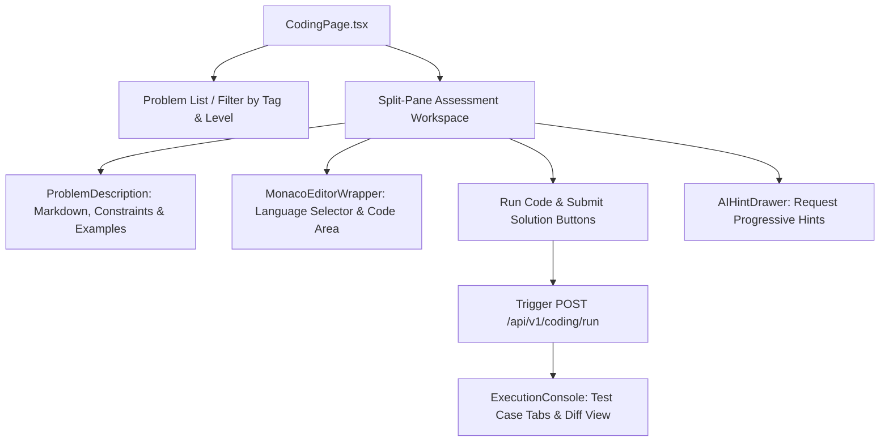

# Coding Assessment Frontend Module — Monaco Editor & Test Runner Workspace

> **Interactive Code Editor, Sandboxed Test Execution Console & AI Hint Interface**

---

## 1. Overview & UI/UX Principles

The **Coding Assessment Frontend Module** provides an in-browser algorithmic development environment. It pairs Microsoft's Monaco Editor with a real-time test execution console, syntax formatting, multi-language support, and graduated AI hints.

### Key UX Features:
- **Monaco Code Editor**: Features IntelliSense, bracket pairing, line numbers, and dark theme styling matching VS Code.
- **Split-Pane Layout**: Allows seamless reading of challenge descriptions while writing code and reviewing test case outputs.
- **Test Case Console**: Displays test inputs, expected outputs, actual outputs, stdout logs, and execution times.
- **AI Hint Assistant**: Provides progressive guidance (conceptual hint $\to$ pseudo-code guidance $\to$ edge-case tip) without revealing complete solutions.

---

## 2. Component Hierarchy



---

## 3. Directory Structure

```
frontend/src/modules/coding/
├── components/
│   ├── CodingWorkspace.tsx         # Main dual-pane editor and description layout
│   ├── ExecutionConsole.tsx        # Test case outputs, stdout & status badges
│   ├── HintPanel.tsx               # AI code intelligence progressive hints viewer
│   ├── MonacoEditorWrapper.tsx     # Configured Monaco editor instance
│   └── ProblemDescription.tsx      # Problem statement, examples & constraints
├── pages/
│   ├── CodingAssessmentPage.tsx    # Assessment catalogue & active problem route
│   └── ProblemDetailPage.tsx       # Dedicated problem view
├── services/
│   └── coding.api.ts               # API client for run, submit, and hints
└── types/
    └── coding.types.ts             # Problem schemas, submission verdicts & test results
```
