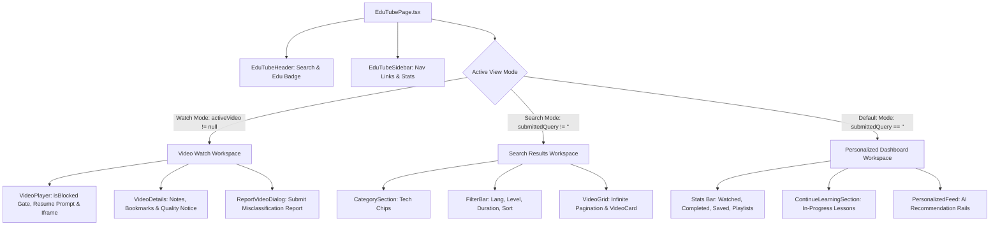

# EduTube Frontend Module — Architecture & Playback Security

> **Distraction-Free Educational Discovery, Zero-Iframe Rejection Gate & Learning Workspace**

---

## 1. Overview & UI/UX Principles

The **EduTube Frontend Module** delivers an education-first video learning experience. It implements strict content gating, resume playback prompts, timestamped note taking, custom playlist management, and a reporting system for misclassified videos.

### Key UX Principles:
- **Zero-Iframe Gate on Restricted Content**: If the backend returns `allowed: false` or `decision: reject`, the YouTube embed `<iframe>` is **not rendered** in the DOM. An **Education-Only Gate** shield informs the user of the exact rejection codes (e.g. `ENTERTAINMENT_OR_MUSIC`, `SHORTS_FORMAT_DETECTED`).
- **Privacy-Enhanced Player**: Renders approved videos using `youtube-nocookie.com` with `rel=0&modestbranding=1` to minimize third-party tracking and unrelated suggestions.
- **Separated Default vs Search Modes**: Initial page visit loads personalized recommendations and in-progress lessons without burning YouTube API search quotas. Search executes only upon explicit user submission.
- **Misclassification Feedback Loop**: Integrates `ReportVideoDialog` to allow learners to flag false positives or false negatives directly to the backend.

---

## 2. Component Hierarchy & Flow



---

## 3. Directory Structure

```
frontend/src/modules/edutube/
├── components/
│   ├── AddToPlaylistDialog.tsx     # Add video to custom playlist modal
│   ├── CategorySection.tsx         # Technology track chips (Algorithms, System Design, etc.)
│   ├── ContinueLearningSection.tsx # In-progress lessons with progress bars
│   ├── EduTubeHeader.tsx           # Search header with Education-Only filter badge
│   ├── EduTubeSidebar.tsx          # Navigation sidebar with route links
│   ├── FilterBar.tsx               # Multi-dimensional filter dropdowns
│   ├── PersonalizedFeed.tsx        # AI recommended feeds & learning tracks
│   ├── RecommendationCard.tsx      # Video card with why-recommended explanations
│   ├── ReportVideoDialog.tsx       # Content misclassification reporting modal
│   ├── VideoCard.tsx               # Reusable video thumbnail card with bookmark toggle
│   ├── VideoDetails.tsx            # Full metadata, playlist adder, and notes container
│   ├── VideoGrid.tsx               # Responsive video grid with skeletons & empty states
│   ├── VideoNotes.tsx              # Timestamped interactive note-taking tool
│   └── VideoPlayer.tsx             # Gated player with resume prompt and no-cookie embed
├── pages/
│   ├── EduTubePage.tsx             # Main entry point: /dashboard/edutube
│   ├── HistoryPage.tsx             # Watch history: /dashboard/edutube/history
│   ├── PlaylistsPage.tsx           # Custom playlists: /dashboard/edutube/playlists
│   └── SavedVideosPage.tsx         # Bookmarked lessons: /dashboard/edutube/saved
├── services/
│   └── edutube.api.ts              # API client for EduTube endpoints
├── types/
│   └── edutube.types.ts            # TypeScript interfaces & classification contracts
└── utils/
    └── edutube.utils.ts            # Duration formatters, view counters & tech categories
```

---

## 4. Playback Security & Rejection Gate

In `VideoPlayer.tsx`:
```tsx
{isBlocked ? (
  <div className="w-full h-full flex flex-col items-center justify-center p-6 text-center space-y-3 bg-surface">
    <ShieldAlert className="h-6 w-6 text-rose-500" />
    <span className="text-[10px] font-black uppercase px-2.5 py-0.5 rounded-full bg-rose-500/15 text-rose-400">
      Education-Only Gate
    </span>
    <h3>Playback Blocked: Non-Educational Content</h3>
    <p>{rejectionReason}</p>
    {/* Renders reason codes and Report Error action */}
  </div>
) : (
  <iframe
    src={`https://www.youtube-nocookie.com/embed/${videoId}?rel=0&modestbranding=1`}
    allowFullScreen
  />
)}
```

---

## 5. Testing & Verification

Verified in `frontend/src/test/edutube.education-filter.test.tsx` and `frontend/src/test/edutube.integration.test.tsx`:
- Zero-iframe rendering on `isBlocked = true`.
- Correct rendering of reason code badges and custom rejection messages.
- Privacy-enhanced embed URL structure with `youtube-nocookie.com` and `rel=0`.
- Seamless submission of classification reports via `ReportVideoDialog`.
