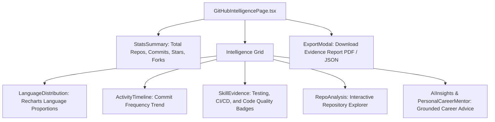

# GitHub Intelligence Frontend Module — Engineering Dashboards & Evidence Visualization

> **Repository Analysis, Language Distribution Charts & Evidence-Based Skill Verification UI**

---

## 1. Overview & Capabilities

The **GitHub Intelligence Frontend Module** renders interactive visual representations of a developer's engineering activity. It visualizes code patterns, testing rigor, and commit trends.

### Core Visualizations:
- **Language Distribution**: Interactive Donut/Pie chart using Recharts showing exact byte proportions across repositories.
- **Activity & Velocity Timeline**: Line/Area chart illustrating commit frequency and code contributions over time.
- **Skill Evidence Cards**: Visual cards displaying empirical signals (e.g. unit test frameworks detected, CI workflows found, Docker containerization).
- **Repository Deep Dive**: Searchable, filterable list of repositories annotated with complexity metrics and detected architectural patterns.
- **Career Archetype Fit**: Radar charts showing match percentages against industry roles (Full Stack, DevOps, Frontend, Backend).

---

## 2. Component Hierarchy



---

## 3. Directory Structure

```
frontend/src/modules/github/
├── components/
│   ├── ActivityTimeline.tsx        # Commit velocity & contribution chart
│   ├── AIInsights.tsx              # Repository-grounded AI recommendations
│   ├── ExportModal.tsx             # Intelligence report export dialog
│   ├── LanguageDistribution.tsx    # Linguistic breakdown donut chart
│   ├── PersonalCareerMentor.tsx    # Repository-specific career coaching advice
│   ├── RepoAnalysis.tsx            # Repository cards with complexity badges
│   ├── SkillEvidence.tsx           # Testing & CI/CD empirical evidence cards
│   └── StatsSummary.tsx            # Header metrics overview
├── pages/
│   └── GitHubIntelligencePage.tsx  # Main route: /dashboard/github
├── services/
│   └── github.api.ts               # API client for sync, profile, and evidence
└── types/
    └── github.types.ts             # TypeScript definitions for repo data & evidence
```
