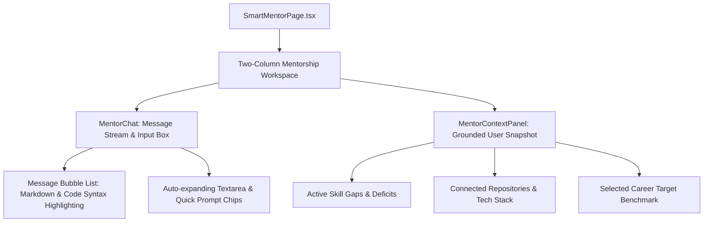

# Smart Mentor Frontend Module — Real-Time Conversational AI Coaching

> **Streaming Chat Interface, Grounded Context Inspector & Curated Prompt Library**

---

## 1. Overview & Capabilities

The **Smart Mentor Frontend Module** delivers an interactive, context-grounded conversational interface for engineering mentorship.

### Key UX Features:
- **Streaming Markdown Chat**: Renders streamed LLM responses with syntax-highlighted code blocks, tables, and clickable roadmap references.
- **Context Transparency Panel**: Allows users to inspect the real-time context (identified skill gaps, top repositories, target career role) being injected into the mentor's system prompt.
- **Curated Prompt Library**: Single-click prompt chips covering technical system design, code review, interview mock scenarios, and career trajectory guidance.
- **Chat History Management**: Seamless message persistence with optimistic UI rendering and one-click chat history clearing.

---

## 2. Component Hierarchy



---

## 3. Directory Structure

```
frontend/src/modules/mentor/
├── components/
│   ├── MentorChat.tsx              # Interactive message thread & input controls
│   ├── MentorContextPanel.tsx      # Grounded context viewer sidebar
│   └── MentorPromptLibrary.tsx     # One-click prompt template selector
├── pages/
│   └── SmartMentorPage.tsx         # Main route: /dashboard/mentor
├── services/
│   └── mentor.api.ts               # API client for chat, history, and prompts
└── types/
    └── mentor.types.ts             # Message contracts, prompt templates & context state
```
